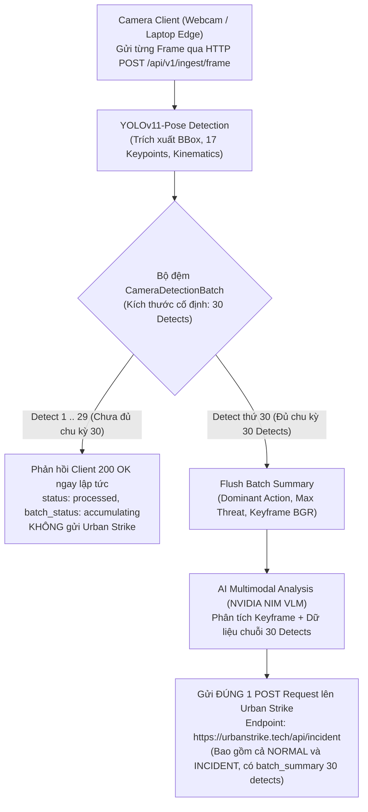

# TÀI LIỆU ĐẶC TẢ KỸ THUẬT (TECHNICAL SPECIFICATION)
## URBAN SAFETY AI-SOC: ĐỊNH KỲ MỖI 30 DETECT GỬI 1 POST REQUEST LÊN URBAN STRIKE
**Mã đặc tả:** `SPEC-URBANSOC-PERIODIC-30-DETECTS-POST`  
**Dự án:** Hệ thống Giám sát An ninh & An toàn Đô thị Thông minh (Urban Safety AI-SOC)  
**Phương pháp luận:** Spec-Driven Development (SDD) & Strict Human-in-the-Loop (AGENTS.md)  
**Trạng thái:** [SPEC AUTO-APPROVED] (Theo quy tắc CD-01 & CD-04 của AGENTS.md)

---

## 1. MỤC TIÊU & BỐI CẢNH NGHIỆP VỤ

### 1.1. Yêu Cầu Từ Lead Developer
> *"thay vi khi nao co incident thi moi gui post request thi config lai thanh sau moi 30 detect cua camera gui 1 post request"*

### 1.2. Vấn Đề Hiện Trạng (As-Is)
- Trước đây hệ thống chỉ gửi POST request lên Urban Strike khi phát hiện sự cố nguy hiểm (`incident`: `WEAPON_THREAT`, `FALLEN`, v.v.) được AI xác nhận.
- Khi camera hoạt động bình thường (`NORMAL`), hệ thống không gửi gì, khiến máy chủ giám sát Urban Strike không nhận được dữ liệu nhịp tim (heartbeat telemetry) và không nắm bắt được trạng thái thời gian thực của khu vực camera đang giám sát.

### 1.3. Mục Tiêu Cần Đạt (To-Be)
1. **Chu Kỳ 30 Detects Cố Định Cho Mỗi Camera:**
   - Bộ đệm `CameraDetectionBatch` gom chính xác **30 detects** (mặc định: `30`, hỗ trợ `SOC_DETECTION_BATCH_SIZE=30`).
   - Từ detect 1 đến detect 29: Server ghi nhận, phản hồi nhanh (`status: "processed"`, `batch_status: "accumulating"`, `ai_analyzed: false`), KHÔNG gửi POST request lên Urban Strike.
2. **Kích hoạt Gửi Đúng 1 POST Request Sau Mỗi 30 Detects:**
   - Tại detect thứ 30: Buffer kích hoạt xả (`flush`), trích xuất Keyframe tối ưu (frame có threat cao nhất hoặc frame tiêu biểu) và tổng hợp `batch_summary`.
   - AI (NVIDIA NIM VLM / Local Tactical Engine) thực hiện phân tích tổng quan chu kỳ 30 frame.
   - **BẤT KỂ** có sự cố hay chỉ là hoạt động bình thường (`NORMAL`), hệ thống **LUÔN LUÔN GỬI ĐÚNG 1 POST REQUEST** lên endpoint Urban Strike (`https://urbanstrike.tech/api/incident`).
   - Gói tin chứa: `event_id`, camera metadata, `batch_summary` (30 detects, dominant action, action frequencies), `primary_action`, `threat_level`, ảnh Keyframe Base64 kèm Forensic SHA-256 hash và nhận định từ AI.

---

## 2. KIẾN TRÚC LUỒNG DỮ LIỆU (DATA FLOW PIPELINE)



---

## 3. THÔNG SỐ CẤU HÌNH & DATA CONTRACT

### 3.1. Tham số Cấu hình Mới
- `SOC_DETECTION_BATCH_SIZE`: Số lượng detect gộp trước khi gửi POST request (mặc định: `30`).
- `SOC_ENABLE_DETECTION_BATCHING`: Bật/tắt chế độ gộp detect (mặc định: `true`).
- `INCIDENT_MODEL_URL` / `HARDCODED_MODEL_URL`: Endpoint nhận bản tin sự cố Urban Strike (`https://urbanstrike.tech/api/incident`).

### 3.2. Cấu Trúc Gói Tin POST lên Urban Strike (1 Lần / 30 Detects)
```json
{
  "event_id": "EVT_1794098823_LAPTOP_01",
  "timestamp": "2026-11-08T05:35:00+07:00",
  "timestamp_ms": 1794098823120,
  "camera": {
    "camera_id": "LAPTOP_01",
    "name": "Laptop 01 - Cổng Giám Sát",
    "latitude": 10.776889,
    "longitude": 106.700806,
    "address": "Khu vực Giám sát Trung tâm"
  },
  "batch_summary": {
    "detect_count": 30,
    "duration_ms": 2000.0,
    "first_frame_index": 100,
    "last_frame_index": 129,
    "dominant_action": "NORMAL",
    "action_frequencies": { "NORMAL": 30 },
    "highest_threat": "LOW",
    "highest_threat_score": 0.20,
    "tracked_subjects_count": 1
  },
  "primary_action": "NORMAL",
  "threat_level": "LOW",
  "threat_score": 0.20,
  "is_urgent": false,
  "ai_verified": true,
  "reasoning": "Định kỳ báo cáo 30 detect từ camera LAPTOP_01: hoạt động bình thường.",
  "full_image": {
    "format": "jpeg",
    "width": 640,
    "height": 480,
    "image_base64": "<base64_jpeg_keyframe>",
    "sha256_hash": "<forensic_sha256>"
  },
  "hand_crop_image_base64": "<base64_jpeg_hand_roi>",
  "hand_crop_image_sha256": "<forensic_sha256_hand>"
}
```

---
[SPEC AUTO-APPROVED]

## BỔ SUNG SPEC — NVIDIA VLM ALERT PROVENANCE (2026-11-08)

- Only a successfully parsed NVIDIA NIM response may carry `source: "nvidia_nim_vlm"` and `analysis_status: "completed"`.
- Local tactical results use `source: "local_vlm_engine"`; exhausted remote calls use `source: "vlm_local_fallback (AI retries exhausted)"` and `analysis_status: "fallback"`.
- The AI server returns local CV/tactical results immediately, queues deep NVIDIA analysis in its background worker, and publishes the completed result to its dashboard SSE stream.
- Downstream alerting must use the NVIDIA result, not the preliminary local result. Invalid model JSON is a fallback, never verified NVIDIA output.

**[SPEC AUTO-APPROVED]**
