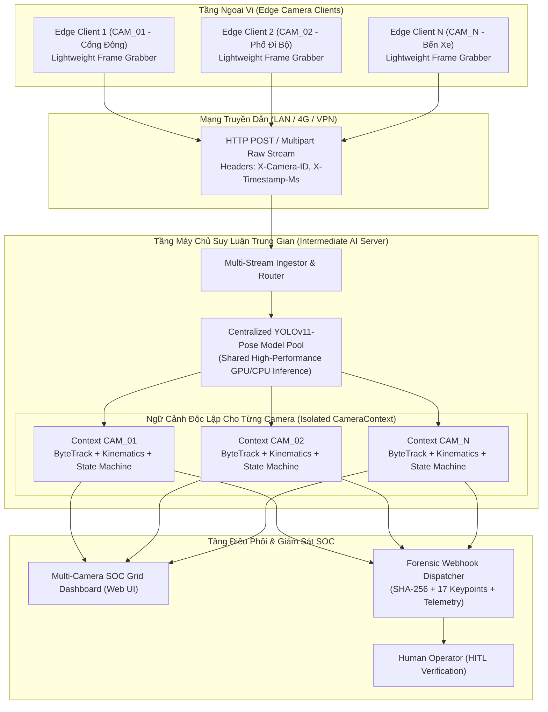

# TÀI LIỆU ĐẶC TẢ KỸ THUẬT (TECHNICAL SPECIFICATION)
## URBAN SAFETY AI-SOC: KIẾN TRÚC CLIENT - SERVER ĐA CAMERA VỚI MÁY CHỦ SUY LUẬN TRUNG GIAN (MULTI-CAMERA CLIENT-SERVER ARCHITECTURE WITH CENTRALIZED AI INFERENCE INTERMEDIARY)
**Mã đặc tả:** `SPEC-URBANSOC-MULTICAM-06`  
**Dự án:** Hệ thống Giám sát An ninh & An toàn Đô thị Thông minh (Urban Safety AI-SOC)  
**Phương pháp luận:** Spec-Driven Development (SDD) & Strict Human-in-the-Loop (AGENTS.md)  
**Tác giả:** AI Assistant (dưới quyền Lead Developer / Principal Architect)  
**Trạng thái:** Chờ phê duyệt (Awaiting Approval)

---

## 1. TỔNG QUAN YÊU CẦU & BỐI CẢNH TRIỂN KHAI

### 1.1. Yêu cầu từ Principal Architect
> *"dựa vào cấu trúc sẵn có hãy thiết lập làm sao để có thể deploy lên nhiều camera với mô hình client server với 1 server làm trung gian để chạy model detect"*

### 1.2. Thách Thức Kỹ Thuật Khi Triển Khai Thực Tế
1. **Chi phí Phần cứng Biên (Edge Cost Bottleneck):**
   - Các điểm giám sát thực tế (cột đèn, cổng trường, ngã tư, công viên) sử dụng camera IP, Raspberry Pi, Jetson Nano hoặc mini PC giá rẻ. Các thiết bị này **không đủ tài nguyên GPU** để chạy đồng thời mô hình lớn YOLOv11-Pose + phân tích động học 13 hành vi nguy hiểm.
2. **Quản lý Tập trung & Cách ly Đa Camera (Multi-Tenant Isolation):**
   - Nếu gom nhiều luồng camera về một server, phải đảm bảo **mã đối tượng (Track ID)** của Camera 1 không bị xung đột hoặc lẫn lộn với Camera 2. Mỗi camera bắt buộc phải có ngữ cảnh theo vết (`CameraContext`), lịch sử động học và máy trạng thái độc lập.
3. **Nghẽn Băng Thông & Độ Trễ (Latency & Backpressure):**
   - Khi có nhiều camera gửi luồng video liên tục, server trung gian phải có cơ chế bộ đệm vòng (Ring Buffer) và cơ chế tự động bỏ khung hình cũ (Adaptive Frame Dropping) để luôn bảo đảm thời gian thực, độ trễ xử lý $\le 150\text{ms}$.

---

## 2. KIẾN TRÚC HỆ THỐNG ĐA CAMERA (CLIENT - SERVER ARCHITECTURE)



---

## 3. CƠ CHẾ CÁCH LY ĐA CAMERA TRÊN SERVER TRUNG GIAN

Mỗi camera kết nối vào Server trung gian sẽ được cấp phát một **`CameraContext`** riêng biệt:

```python
class CameraContext:
    """Ngữ cảnh cách ly hoàn toàn cho từng camera trên Server trung gian."""
    camera_id: str
    config: CameraLocationConfig
    behavior_engine: BehaviorEngine      # Bộ phân tích 13 luật và Hysteresis Debouncer độc lập
    throttler: EventThrottler            # Bộ lọc chống bão và cooldown độc lập
    evidence_recorder: EvidenceClipRecorder # Bộ đệm 5s video bằng chứng riêng
    last_frame_time: float
    fps: float
    latest_analysis: Optional[SOCFrameAnalysisResult]
    latest_frame: Optional[np.ndarray]
    is_active: bool
```

**Lợi ích kiến trúc:**
- **Không va chạm ID:** Đối tượng #1 ở CAM_01 và Đối tượng #1 ở CAM_02 được phân tích trong 2 không gian tọa độ và chuỗi thời gian tách biệt 100%.
- **Dùng chung Mô hình AI (Shared Model Instance):** Toàn bộ các camera chia sẻ một thực thể `YOLOPoseDetector` duy nhất, tận dụng tối đa năng lực tính toán GPU/NPU của máy chủ trung gian.

---

## 4. GIAO THỨC TRUYỀN DẪN CLIENT - SERVER (API CONTRACTS)

### 4.1. Đăng Ký Camera (`POST /api/v1/cameras/register`)
- **Edge Client gửi khi khởi động:**
  ```json
  {
    "camera_id": "CAM_01",
    "name": "Cổng Đông - Phố Đi Bộ",
    "zone_id": "ZONE_ALPHA",
    "address": "Nguyễn Huệ, Quận 1, TP.HCM",
    "latitude": 10.776889,
    "longitude": 106.700806,
    "target_fps": 15
  }
  ```
- **Server phản hồi:** `{"status": "registered", "camera_id": "CAM_01", "keepalive_timeout": 10}`

### 4.2. Đẩy Khung Hình Lên Server (`POST /api/v1/ingest/frame`)
- **Headers:**
  - `X-Camera-ID: CAM_01`
  - `X-Timestamp-Ms: 1794038622128`
  - `Content-Type: image/jpeg`
- **Body:** Dữ liệu nhị phân của ảnh JPEG (Binary Raw JPEG Bytes - truyền trực tiếp với độ trễ thấp nhất và không tốn chi phí Base64).
- **Server phản hồi tức thì:**
  ```json
  {
    "status": "processed",
    "camera_id": "CAM_01",
    "frame_index": 142,
    "human_count": 2,
    "highest_threat": "CRITICAL",
    "primary_action": "WEAPON_THREAT",
    "is_urgent": true
  }
  ```

### 4.3. Giám Sát Trạng Thái Đa Camera (`GET /api/v1/cameras`)
Trả về danh sách toàn bộ camera kèm trạng thái Online/Offline, FPS thực tế, số người hiện diện và mức độ đe dọa.

### 4.4. Giao Diện Web Giám Sát Tập Trung (Multi-Camera SOC Web Dashboard - `GET /`)
Cung cấp màn hình trực quan dạng lưới (Grid View 2x2, 3x3) hiển thị đồng thời các camera, gắn khung nhận diện, thanh HUD, mức cảnh báo và đồng hồ đo xa.

---

## 5. THIẾT KẾ CÁC MODULE TRIỂN KHAI

### 5.1. Edge Client (`src/urbansoc/client/edge_client.py` & `client.py`)
- Script siêu nhẹ chạy trên thiết bị cắm camera (Raspberry Pi / Laptop / Camera IP / File Video).
- Không yêu cầu cài đặt PyTorch hay Ultralytics YOLO! Chỉ cần `opencv-python-headless` và `urllib/requests`.
- Thu nhận khung hình qua `CameraSource`, nén JPEG và truyền bất đồng bộ sang Intermediate Server.
- Tự động kết nối lại (Auto-reconnect) khi rớt mạng.

### 5.2. Intermediate Inference Server (`src/urbansoc/server/inference_server.py`)
- Server trung gian đa luồng (`HTTPServer` / `ThreadingHTTPServer`).
- Tiếp nhận luồng từ $N$ Edge Client song song.
- Sử dụng hàng đợi phi khóa (Lock-free Ring Buffer) cho từng camera.
- Đóng gói sự kiện nguy hiểm gửi tiếp tới Webhook Dispatcher bên ngoài kèm mã băm **Forensic SHA-256 (Raw Bytes + Timestamp)** và trọn vẹn 17 keypoints.

---

## 6. RÀNG BUỘC KỸ THUẬT & DỰ PHÒNG (FAIL-SAFE & CONSTRAINTS)

1. **Cam kết Độ trễ Thời Gian Thực (Latency $\le 150\text{ms}$):**
   - Hàng đợi của mỗi camera trên Server chỉ giữ tối đa 2 frame (`maxsize=2`). Nếu luồng xử lý AI chưa kịp giải phóng, frame cũ bị hủy ngay (Drop oldest) để bảo đảm AI luôn phân tích frame tươi mới nhất của camera.
2. **Tự Động Phát Hiện Mất Kết Nối (Heartbeat Timeout = 5.0s):**
   - Nếu một Edge Client ngừng gửi frame quá 5 giây, Server chuyển trạng thái camera đó sang `DISCONNECTED` và ghi log cảnh báo tới SOC Operator.
3. **Tuân thủ Tuyệt đối Dual HITL (AGENTS.md CD-04):**
   - Dù nhận diện được súng hay ẩu đả trên bất kỳ camera nào, server chỉ phát cảnh báo ưu tiên và chuẩn bị hồ sơ bằng chứng; không tự động điều phối nếu chưa có xác nhận từ Vận hành viên.

---

[WAITING FOR SPEC APPROVAL]
