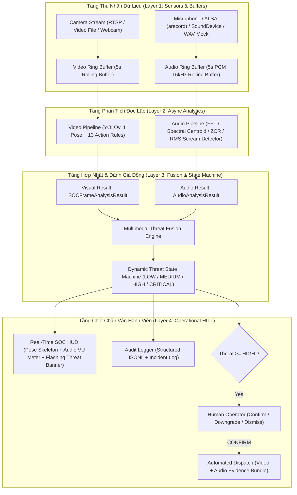
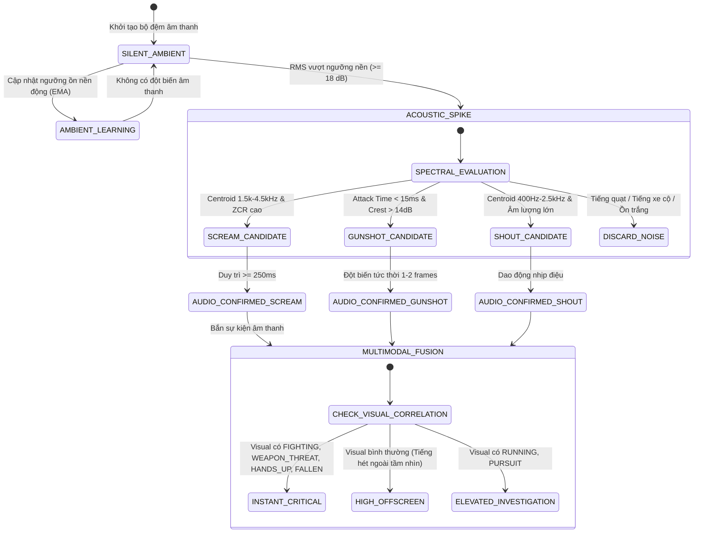

# TÀI LIỆU ĐẶC TẢ KỸ THUẬT (TECHNICAL SPECIFICATION)
## URBAN SAFETY AI-SOC: HỆ THỐNG GIÁM SÁT ĐA PHƯƠNG THỨC NGHE - NHÌN & PHÁT HIỆN TIẾNG LA HÉT / NGUY HIỂM ÂM THANH (MULTIMODAL AUDIO-VISUAL SURVEILLANCE & ACOUSTIC DISTRESS DETECTION)
**Mã đặc tả:** `SPEC-URBANSOC-AUDIO-03`  
**Dự án:** Hệ thống Giám sát An ninh & An toàn Đô thị Thông minh (Urban Safety AI-SOC)  
**Phương pháp luận:** Spec-Driven Development (SDD) & Strict Human-in-the-Loop (AGENTS.md)  
**Tác giả:** AI Assistant (dưới quyền Lead Developer / Principal Architect)  
**Trạng thái:** Chờ phê duyệt (Awaiting Approval)

---

## 1. TỔNG QUAN YÊU CẦU & BỐI CẢNH NGHIỆP VỤ

### 1.1. Yêu cầu từ Principal Architect
> "bạn có thể add thêm microphone để detect screaming không, có thể áp dụng thêm cái gì vào thì áp dụng"

Hệ thống Urban Safety AI-SOC hiện tại đã sở hữu bộ nhận dạng thị giác 13 hành vi nguy hiểm (Pose & Spatial Kinematics). Tuy nhiên, trong môi trường đô thị thực tế:
1. **Góc chết thị giác (Visual Blindspots):** Nạn nhân bị hành hung sau góc tường, gầm cầu vượt, trong bóng tối hoặc ngoài khung hình camera.
2. **Nhiễu thị giác (Visual Ambiguity):** Hai người ôm nhau hoặc nhảy múa có thể gây phân vân với hành vi khống chế (`RESTRAINING`) hoặc ẩu đả (`FIGHTING`).
3. **Phản ứng chậm trễ nếu thiếu âm thanh:** Tiếng la hét cầu cứu (`SCREAM`) hoặc tiếng súng (`GUNSHOT`) xảy ra trước khi hành vi bạo lực hoàn toàn lộ diện trên camera.

### 1.2. Mục tiêu Kỹ thuật
Bổ sung hệ thống **Giám sát Âm thanh Thời gian Thực (Real-Time Acoustic Threat Surveillance)** và **Động cơ Hợp nhất Đa phương thức Nghe - Nhìn (Multimodal Audio-Visual Threat Fusion Engine)**:
1. **Thu nhận âm thanh đa kênh không khóa (Non-blocking Audio Ingestion):** Luồng Microphone độc lập, hỗ trợ tự động nhận diện phần cứng (ALSA `arecord` / `sounddevice`), file âm thanh kiểm thử (WAV), và bộ sinh âm thanh nhân tạo (Synthetic Mock) cho kiểm thử tự động.
2. **Bộ phát hiện tiếng la hét & âm thanh nguy hại (Acoustic Threat Classifier):**
   - **`SCREAM` (Tiếng la hét kinh hoàng / thét thất thanh):** Năng lượng tập trung ở dải tần số cao 1.5 kHz - 4.5 kHz, Spectral Centroid > 2000 Hz, RMS năng lượng cao vượt ngưỡng nền động, Zero-Crossing Rate (ZCR) cao, thời lượng duy trì $\ge 0.25\text{s}$.
   - **`GUNSHOT` (Tiếng nổ súng / Xung kích cực đoan):** Xung năng lượng bộc phát cực nhanh (Attack Time $< 15\text{ms}$), tỷ số đỉnh/nền (Peak-to-Average Ratio / Crest Factor $> 14\text{ dB}$), kèm suy giảm hàm mũ (decay).
   - **`AGGRESSIVE_SHOUT` (Tiếng quát tháo / Cãi vã bạo lực):** Dao động năng lượng dải trung 400 Hz - 2.5 kHz có nhịp điệu ngắt quãng và biên độ cao.
   - **`GLASS_BREAK` (Tiếng kính vỡ / Đập phá tài sản):** Năng lượng tần số rất cao $> 4.5\text{ kHz}$ dạng tạp âm trắng (broadband noise).
3. **Hợp nhất đa phương thức Nghe - Nhìn (Audio-Visual Fusion):**
   - Kết hợp điểm đe dọa thị giác ($S_{\text{visual}}$) và âm thanh ($S_{\text{audio}}$).
   - Leo thang mức đe dọa tức thì (`FAST-TRACK CRITICAL`) khi có sự đồng quy giữa tư thế thị giác và âm thanh hiểm họa (ví dụ: `HANDS_UP` + `SCREAM`, `FIGHTING` + `SCREAM`, `WEAPON_THREAT` + `GUNSHOT`).
   - Cảnh báo âm thanh ngoài khung hình (`OFF_SCREEN_ACOUSTIC_DISTRESS`) khi camera chưa thấy đối tượng nhưng micro thu được tiếng kêu cứu.
4. **Bộ đệm bằng chứng âm thanh (Audio Rolling Evidence Buffer):** Lưu giữ 5 giây âm thanh trước và sau sự kiện, tự động đóng gói kèm clip video khi gửi hồ sơ sự cố lên Vận hành viên SOC.
5. **HUD hiển thị âm thanh & VU Meter thời gian thực:** Đồng hồ đo mức decibel/RMS và nhãn cảnh báo đỏ nhấp nháy trên màn hình trực quan.

---

## 2. KIẾN TRÚC HỆ THỐNG & SƠ ĐỒ LUỒNG DỮ LIỆU (DATA FLOW & MERMAID)

### 2.1. Sơ đồ Kiến trúc Đa phương thức Nghe - Nhìn (Multimodal AI-SOC Architecture)



### 2.2. Sơ đồ Máy Trạng Thái Đe Dọa Âm Thanh & Hợp Nhất (Audio-Visual State Machine)



---

## 3. CƠ CHẾ KỸ THUẬT PHÁT HIỆN TIẾNG LA HÉT (SCREAM DETECTION ALGORITHM)

### 3.1. Đặc trưng Sinh học Âm thanh của Tiếng La Hét Con Người
Tiếng la hét (Human Scream) khác biệt hoàn toàn với tiếng nói thường, tiếng cười hoặc tiếng còi xe nhờ các chỉ số vật lý âm thanh sau:

1. **Năng lượng Hiệu dụng (Root Mean Square - RMS & Decibel):**
   - Biên độ âm thanh đột biến cao hơn độ ồn nền thích nghi (Adaptive Ambient Floor) ít nhất $18\text{ dB}$:
     $$\text{RMS} = \sqrt{\frac{1}{N}\sum_{i=1}^{N} x_i^2}, \quad \text{dBFS} = 20 \log_{10}(\text{RMS} + \epsilon)$$
2. **Trọng tâm Phổ Âm (Spectral Centroid - $f_c$):**
   - Tiếng la hét con người có trọng tâm phổ dồn mạnh vào dải tần số **$1800\text{ Hz} - 4200\text{ Hz}$** (do dây thanh quản căng cực đại và cộng hưởng khoang họng):
     $$f_c = \frac{\sum_{k=0}^{K-1} f_k |X(k)|}{\sum_{k=0}^{K-1} |X(k)|}$$
   - *Ngược lại:* Giọng nói thông thường có $f_c \in [300, 1200]\text{ Hz}$. Tiếng động cơ xe cộ có $f_c < 600\text{ Hz}$.
3. **Tỷ Lệ Năng Lượng Dải Hét (Scream Band Energy Ratio - SBER):**
   - Tỷ số giữa năng lượng trong dải $[1500, 4500]\text{ Hz}$ so với tổng năng lượng phổ:
     $$\text{SBER} = \frac{\sum_{f \in [1500, 4500]} |X(f)|^2}{\sum_{f} |X(f)|^2 + \epsilon} \ge 0.45$$
4. **Tỷ Lệ Băng Qua Điểm Không (Zero Crossing Rate - ZCR):**
   - Đo độ thô ráp và tần số biến thiên cao của sóng âm:
     $$\text{ZCR} = \frac{1}{N-1} \sum_{i=1}^{N-1} \mathbb{I}(x_i \cdot x_{i+1} < 0)$$
   - Tiếng hét có $\text{ZCR} \ge 0.12$.
5. **Độ Bền Thời Gian (Temporal Duration Gate):**
   - Tiếng hét phải duy trì tối thiểu **$250\text{ ms}$** để không bị kích hoạt nhầm bởi tiếng gõ bàn phím, tiếng vỗ tay hay tiếng đóng sầm cửa.

### 3.2. Cơ chế Loại trừ Báo Động Giả (Anti-False-Positive Filtering)
- **Tiếng còi xe / Còi báo động (Siren / Horn):** Có năng lượng cao nhưng phổ là các vạch điều hòa đơn âm rất hẹp (Spectral Flatness rất thấp).
- **Tiếng đóng cửa / Đập bàn:** Xung diễn ra cực ngắn ($< 50\text{ ms}$) $\to$ Bị bộ lọc thời lượng $\ge 250\text{ ms}$ triệt tiêu.
- **Tiếng cười đùa bình thường:** Tần số thấp hơn, thiếu độ thô ráp (Roughness) và SBER $< 0.35$.
- **Thích nghi ồn nền (Adaptive Noise Floor):** Nền ồn được cập nhật liên tục bằng bộ lọc Exponential Moving Average (EMA) để tự thích ứng với môi trường yên tĩnh (văn phòng) lẫn môi trường ồn ào (đường phố).

---

## 4. BẢNG QUY TẮC HỢP NHẤT ĐA PHƯƠNG THỨC (MULTIMODAL FUSION MATRIX)

| Mã | Dấu hiệu Thị giác (Visual Pose) | Dấu hiệu Âm thanh (Acoustic Cue) | Threat Score Tổng | Threat Level | Hành động Hệ thống & SOC |
| :-: | :--- | :--- | :---: | :---: | :--- |
| **MM-01** | `FIGHTING` (Ẩu đả) | `SCREAM` (La hét) | **`1.00`** | **`CRITICAL`** | Đẩy cảnh báo đỏ khẩn cấp nhất, còi báo động HUD, tự động khóa video+audio buffer. |
| **MM-02** | `HANDS_UP` (Giơ tay đầu hàng) | `SCREAM` / `GUNSHOT` | **`0.99`** | **`CRITICAL`** | Kịch bản cướp có vũ trang hoặc đe dọa con tin. Fast-track ngay lập tức. |
| **MM-03** | `FALLEN` (Nạn nhân gục ngã) | `DISTRESS_CRY` / `SCREAM` | **`1.00`** | **`CRITICAL`** | Nạn nhân chấn thương nặng hoặc bị tấn công gục tại chỗ. Yêu cầu cứu thương khẩn cấp. |
| **MM-04** | `WEAPON_THREAT` (Chĩa súng/dao) | `GUNSHOT` / `SCREAM` | **`1.00`** | **`CRITICAL`** | Kịch bản nổ súng hoặc đâm chém có thương vong. |
| **MM-05** | `SNATCHING` (Cướp giật) | `SCREAM` | **`0.98`** | **`CRITICAL`** | Nạn nhân tri hô thất thanh sau khi bị cướp bứt tốc tháo chạy. |
| **MM-06** | `PURSUIT` (Rượt đuổi) | `SCREAM` / `AGGRESSIVE_SHOUT` | **`0.95`** | **`CRITICAL`** | Đuổi bắt thù hằn, hung thủ truy sát nạn nhân. |
| **MM-07** | `NORMAL` (Không phát hiện người) | `SCREAM` / `GUNSHOT` | **`0.78`** | **`HIGH`** | **Off-Screen Threat:** Sự cố xảy ra ngoài góc nhìn camera hoặc khu vực khuất. SOC điều hướng PTZ. |
| **MM-08** | `LOITERING` / `CROUCHING` | `AGGRESSIVE_SHOUT` | **`0.80`** | **`HIGH`** | Nghi can rình rập và bắt đầu phát động đe dọa ngôn từ. |
| **MM-09** | `NORMAL` | `AGGRESSIVE_SHOUT` | **`0.60`** | **`MEDIUM`** | Tranh cãi to tiếng nơi công cộng, theo dõi diễn biến. |
| **MM-10** | Mọi hành vi nguy hiểm | Không có âm thanh (Silent) | Giữ nguyên điểm Video | Giữ nguyên điểm | Hệ thống chạy chế độ Video thuần túy (vẫn bảo đảm 100% chức năng hiện có). |

---

## 5. THIẾT KẾ SCHEMA DỮ LIỆU & GIAO DIỆN HÀM (DATA SCHEMA & INTERFACES)

### 5.1. Data Schemas (Python Dataclasses & Enums)

```python
from enum import Enum
from dataclasses import dataclass, field
from typing import List, Dict, Optional, Any
import numpy as np

class AudioThreatType(str, Enum):
    NONE = "NONE"
    SCREAM = "SCREAM"                   # Tiếng la hét, thét kinh hoàng
    GUNSHOT = "GUNSHOT"                 # Tiếng súng nổ / tiếng nổ xung kích
    AGGRESSIVE_SHOUT = "AGGRESSIVE_SHOUT" # Tiếng cãi vã, quát tháo hung bạo
    DISTRESS_CRY = "DISTRESS_CRY"       # Tiếng rên rỉ, kêu cứu
    GLASS_BREAK = "GLASS_BREAK"         # Tiếng kính vỡ / va chạm đập phá

@dataclass
class AudioAnalysisResult:
    """Kết quả phân tích một khối âm thanh (Window ~ 0.25 - 0.5s)."""
    timestamp: float                    # Thời điểm phân tích
    event_type: AudioThreatType         # Loại sự kiện âm thanh
    confidence: float                   # Độ tin cậy (0.0 - 1.0)
    threat_score: float                 # Điểm đe dọa (0.0 - 1.0)
    rms_db: float                       # Cường độ âm thanh (dBFS)
    spectral_centroid_hz: float         # Trọng tâm phổ (Hz)
    scream_band_ratio: float            # Tỷ lệ năng lượng dải hét (1.5kHz - 4.5kHz)
    zero_crossing_rate: float           # Tỷ lệ ZCR
    duration_sec: float                 # Thời lượng duy trì của tín hiệu
    is_threat: bool                     # Cờ báo hiệu âm thanh nguy hiểm
    reasoning: str                      # Giải trình nguyên nhân kích hoạt
    waveform_sample: Optional[np.ndarray] = None # Khung mẫu sóng phục vụ hiển thị/chứng thực

@dataclass
class MultimodalThreatResult:
    """Kết quả hợp nhất đa phương thức Thị giác + Âm thanh."""
    timestamp: float
    threat_level: str                   # LOW | MEDIUM | HIGH | CRITICAL
    fused_threat_score: float           # Điểm hợp nhất cuối cùng (0.0 - 1.0)
    visual_threat_type: str             # Tên hành vi thị giác nguy hiểm nhất
    audio_threat_type: AudioThreatType  # Loại sự kiện âm thanh
    visual_score: float                 # Điểm thị giác
    audio_score: float                  # Điểm âm thanh
    fusion_rule_applied: str            # Mã quy tắc hợp nhất (ví dụ: MM-01, MM-02)
    reasoning: str                      # Lý giải hợp nhất cho Operator
    is_urgent_dispatch: bool            # Yêu cầu kích hoạt chốt chặn HITL khẩn
    evidence_audio_chunk: Optional[bytes] = None # Buffer âm thanh kèm theo
```

### 5.2. Chữ Ký Hàm Core Module `urbansoc.audio`

1. **`src/urbansoc/audio/microphone.py`:**
   ```python
   class AudioCaptureBackend:
       """Quản lý thu nhận âm thanh đa nguồn (ALSA arecord, SoundDevice, WAV, Mock)."""
       def __init__(self, sample_rate: int = 16000, chunk_duration_sec: float = 0.25, source_type: str = "auto", wav_path: Optional[str] = None): ...
       def start(self) -> bool: ...
       def read_chunk(self, timeout: float = 0.5) -> Optional[np.ndarray]: ...
       def get_rolling_buffer(self, duration_sec: float = 5.0) -> bytes: ...
       def stop(self) -> None: ...
       @property
       def is_active(self) -> bool: ...
   ```

2. **`src/urbansoc/audio/scream_detector.py`:**
   ```python
   class AcousticThreatDetector:
       """Bộ phân tích phổ và phát hiện tiếng la hét, tiếng súng, tiếng quát tháo."""
       def __init__(self, sample_rate: int = 16000, sensitivity: float = 0.85): ...
       def process_chunk(self, audio_data: np.ndarray, timestamp: float) -> AudioAnalysisResult: ...
       def update_ambient_floor(self, current_rms: float) -> None: ...
       def reset(self) -> None: ...
   ```

3. **`src/urbansoc/audio/fusion.py`:**
   ```python
   class MultimodalThreatFuser:
       """Động cơ hợp nhất Nghe - Nhìn và chuyển tiếp máy trạng thái."""
       def __init__(self, audio_weight: float = 0.40): ...
       def fuse(self, visual_result: SOCFrameAnalysisResult, audio_result: AudioAnalysisResult) -> MultimodalThreatResult: ...
   ```

---

## 6. RÀNG BUỘC KỸ THUẬT & CƠ CHẾ DỰ PHÒNG (FAIL-SAFE & PERFORMANCE CONSTRAINTS)

1. **Độ Trễ Phản Hồi Âm Thanh (Audio Latency):**
   - Kích thước khung âm thanh xử lý: 4096 mẫu tại 16 kHz ($256\text{ ms}$).
   - Thời gian tính toán FFT & trích xuất đặc trưng trên CPU: $< 5\text{ ms}$ (sử dụng thư viện `numpy` vector hóa cao độ).
   - Tổng độ trễ từ lúc âm thanh phát ra đến khi phát hiện: $\le 300\text{ ms}$.
2. **Cơ chế Dự Phòng Đa Tầng (Graceful Multi-Backend Fallback):**
   - Hệ thống tự động kiểm tra theo thứ tự ưu tiên:
     1. `sounddevice` (nếu PortAudio có sẵn trên OS).
     2. ALSA `arecord` subprocess trực tiếp (đã kiểm chứng hoạt động tốt trên môi trường Linux hiện tại).
     3. Tệp âm thanh đầu vào (`--audio-file test_scream.wav`).
     4. `SilentMockAudioCapture` (Nếu không có micro vật lý hoặc bị lỗi quyền thiết bị).
   - **Cam kết không sập (Zero-Crash Guarantee):** Nếu micro bị rút ra hoặc không có thiết bị thu âm, hệ thống chỉ ghi nhận cảnh báo Warning vào log và tiếp tục vận hành luồng Video mượt mà, không bao giờ ngắt chương trình.
3. **Tuân Thủ Tuyệt Đối Dual HITL (AGENTS.md CD-04):**
   - Kể cả khi tiếng súng hoặc tiếng hét đạt độ tin cậy $100\%$ ($1.00$), hệ thống **tuyệt đối không gửi lệnh điều phối ra cơ quan chức năng ngoài xã hội** nếu chưa có lệnh `CONFIRM` từ Vận hành viên SOC. Âm thanh chỉ dùng để leo thang ưu tiên trên HUD và chuẩn bị gói bằng chứng video+audio.

---

[WAITING FOR SPEC APPROVAL]
