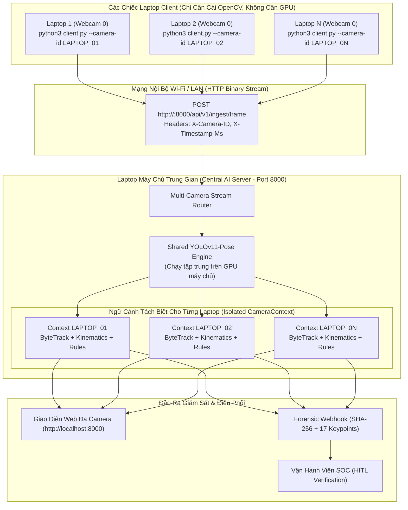

# TÀI LIỆU ĐẶC TẢ KỸ THUẬT (TECHNICAL SPECIFICATION)
## URBAN SAFETY AI-SOC: MÔ HÌNH CLIENT - SERVER ĐA LAPTOP/CAMERA VỚI MÁY CHỦ SUY LUẬN TRUNG GIAN (MULTI-LAPTOP CLIENT-SERVER AI-SOC WITH CENTRALIZED INFERENCE SERVER)
**Mã đặc tả:** `SPEC-URBANSOC-MULTICAM-06`  
**Dự án:** Hệ thống Giám sát An ninh & An toàn Đô thị Thông minh (Urban Safety AI-SOC)  
**Phương pháp luận:** Spec-Driven Development (SDD) & Strict Human-in-the-Loop (AGENTS.md)  
**Tác giả:** AI Assistant (dưới quyền Lead Developer / Principal Architect)  
**Trạng thái:** Đã Phê Duyệt & Triển Khai Hoàn Tất (Approved & Implemented)

---

## 1. TỔNG QUAN YÊU CẦU & KỊCH BẢN TRIỂN KHAI THỰC TẾ

### 1.1. Yêu cầu Cụ Thể Từ Lead Developer
> *"không cần chạy trên các thiết bị cảm ứng camera, chỉ cần chạy trên chiếc laptop khác"*

### 1.2. Kịch Bản Triển Khai Thực Tế (Laptop-to-Laptop Deployment)
Hệ thống được thiết kế để triển khai cực kỳ thuận tiện giữa **2 hoặc nhiều chiếc Laptop/PC kết nối cùng mạng Wi-Fi hoặc mạng LAN**:

1. **Laptop Máy Chủ AI (Central AI-SOC Server):**
   - Đóng vai trò là **Máy chủ Suy Luận Trung Gian (Intermediate Inference Server)**.
   - Nạp mô hình AI YOLOv11-Pose (sử dụng GPU/CPU của máy chủ).
   - Lắng nghe kết nối mạng (mặc định: port `8000`).
   - Quản lý đồng thời $N$ camera gửi về, cấp phát từng `CameraContext` riêng biệt (đảm bảo Track ID của Laptop 1 không bị lẫn với Laptop 2).
   - Hiển thị màn hình giám sát tập trung (Multi-Camera Grid Web Dashboard) trên trình duyệt.
   - Khi bất kỳ Laptop nào phát hiện nguy hiểm, Server tự động đóng gói sự kiện kèm mã băm **Forensic SHA-256 (Raw Bytes + Timestamp)** và trọn vẹn 17 keypoints để bắn Webhook cảnh báo.

2. **Laptop Client Biên (Edge Laptop Camera Clients):**
   - Chạy trên **các chiếc Laptop khác** trong cùng mạng (Laptop 1, Laptop 2, ...).
   - **Cực kỳ nhẹ nhàng (Zero-AI footprint):** Không cần GPU, không cần PyTorch hay Ultralytics YOLO! Chỉ cần cài đặt `opencv-python` và `requests`.
   - Mở Webcam tích hợp của laptop (hoặc webcam USB/file video) bằng 1 câu lệnh duy nhất:
     ```bash
     python3 client.py --server-url http://192.168.1.50:8000 --camera 0 --camera-id LAPTOP_01 --camera-name "Laptop Vinh - Cổng Đông"
     ```
   - Nén khung hình JPEG và gửi qua mạng Wi-Fi/LAN lên Máy Chủ Trung Gian với độ trễ thấp $\le 100\text{ms}$.
   - Tự động kết nối lại (Auto-reconnect) nếu Wi-Fi bị chập chờn.

---

## 2. KIẾN TRÚC LUỒNG DỮ LIỆU ĐA LAPTOP (MERMAID)



---

## 3. GIAO DIỆN HÀM & CHỮ KÝ API

### 3.1. Phía Laptop Client (`client.py` & `src/urbansoc/client/edge_client.py`)
```python
class EdgeCameraClient:
    """Client chạy trên laptop khác để đọc webcam và truyền về server trung gian."""
    def __init__(
        self,
        server_url: str,
        camera_id: str = "LAPTOP_01",
        camera_name: str = "Laptop Webcam",
        camera_index: Union[int, str] = 0,
        fps: float = 15.0,
        resolution: Tuple[int, int] = (640, 480),
        quality: int = 75,
        lat: float = 10.776889,
        lon: float = 106.700806,
        address: str = "Laptop Client",
    ) -> None: ...

    def register(self) -> bool: ...
    def stream_loop(self) -> None: ...
    def stop(self) -> None: ...
```

### 3.2. Phía Laptop Server Trung Gian (`server.py` & `src/urbansoc/server/`)
- Quản lý cách ly đa camera qua `CameraContextManager`:
  - Mỗi laptop kết nối tới được định danh bằng `X-Camera-ID`.
  - Nếu `X-Camera-ID` chưa có trong bộ nhớ, server tự động tạo `CameraContext` mới (bao gồm `BehaviorEngine` riêng để không bị đè Track ID).
- Trả về mã HTTP 200 kèm kết quả nhận dạng tức thì:
  `{"status": "processed", "camera_id": "LAPTOP_01", "humans": 1, "action": "NORMAL", "threat_level": "LOW"}`.
- Dashboard trực quan qua `GET http://<IP_SERVER>:8000/`.

---

[STATUS: APPROVED & IMPLEMENTED]
