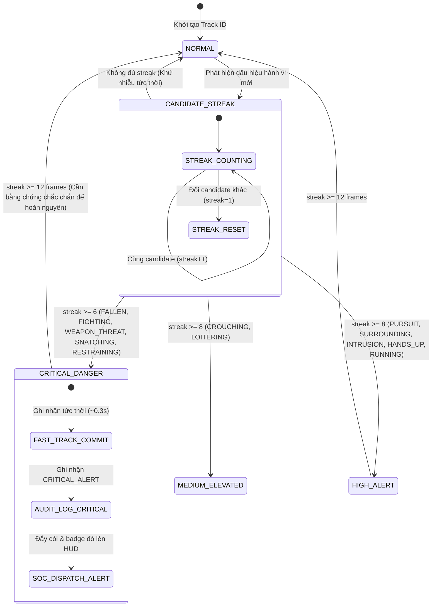

# TÀI LIỆU ĐẶC TẢ KỸ THUẬT (TECHNICAL SPECIFICATION)
## URBAN SAFETY AI-SOC: HỆ THỐNG GIÁM SÁT AN NINH & BỘ LUẬT NHẬN DẠNG HÀNH VI NGUY HIỂM CHUẨN CAO (HIGH-PRECISION DANGEROUS ACTION RULES)
**Mã đặc tả:** `SPEC-URBANSOC-RULES-02`  
**Dự án:** Hệ thống Giám sát An ninh & An toàn Đô thị Thông minh (Urban Safety AI-SOC)  
**Phương pháp luận:** Spec-Driven Development (SDD) & Strict Human-in-the-Loop (AGENTS.md)  
**Mục tiêu:** Mở rộng và chuẩn hóa toàn diện bộ luật nhận dạng các hành vi nguy hiểm (Ẩu đả bạo lực, cầm/chĩa hung khí, cướp giật, rượt đuổi, khống chế/kẹp cổ, vây ráp, đột nhập/trèo tường, nạn nhân gục ngã), tối đa hóa độ chính xác và triệt tiêu báo động giả (False Positive Mitigation).

---

## 1. TỔNG QUAN BỘ LUẬT & YÊU CẦU NGHIỆP VỤ

### 1.1. Bối cảnh
Theo yêu cầu chỉ đạo từ Lead Developer:
> "Dựa trên những gì đã có, xây dựng bộ rule để AI có thể detect những hành động nguy hiểm như đánh nhau, cầm vũ khí nguy hiểm, ... nhiều và chính xác nhất có thể, giảm thiểu false positive."

Hệ thống AI-SOC mở rộng bộ luật từ 7 hành vi cơ sở lên **13 hành vi chuyên sâu**, tập trung vào các tình huống đe dọa an ninh trật tự công cộng và an toàn tính mạng:

1. **`FIGHTING` (Ẩu đả, bạo lực đối kháng, tấn công thể xác):** Đánh đấm tương hỗ hoặc một bên tấn công dồn dập trong cự ly gần.
2. **`WEAPON_THREAT` (Cầm / Chĩa hung khí nguy hiểm):** Tư thế chĩa súng 2 tay chiến thuật (Isosceles/Weaver), chĩa hung khí 1 tay hướng thẳng mục tiêu, hoặc vung vũ khí tấn công từ trên cao (overhead strike).
3. **`SNATCHING` (Cướp giật tài sản):** Tiếp cận sát mục tiêu $\to$ vung tay giật giật mạnh $\to$ bứt tốc tháo chạy tốc độ cao kèm phân kỳ khoảng cách đột ngột.
4. **`PURSUIT` (Rượt đuổi, truy sát):** Hai hoặc nhiều đối tượng cùng chạy ở tốc độ cao với hướng di chuyển đồng quy (Vector Cosine Similarity $\ge 0.70$).
5. **`RESTRAINING` (Khống chế, kẹp cổ, giằng co ôm giữ):** Hai đối tượng dính chặt với độ giao cắt hộp bao cao (IoU $\ge 0.40$) duy trì liên tục trên 0.6 giây.
6. **`SURROUNDING` (Vây ráp, tụ tập áp đảo mục tiêu):** Nhóm từ 3 người trở lên khép vòng vây xung quanh một đối tượng đơn lẻ trong bán kính hẹp.
7. **`INTRUSION` (Trèo tường, vượt rào, đột nhập vùng cấm):** Nâng cao tọa độ cơ thể theo phương thẳng đứng liên tục (chân và hông leo cao dần), hai tay bám trên cao.
8. **`FALLEN` (Nạn nhân gục ngã / Bất tỉnh):** Thân người nghiêng ngang $\ge 55^\circ$ hoặc tỷ lệ $H/W < 0.90$. Đặc biệt: Tự động leo thang lên mức đe dọa tối đa ($1.00$) nếu xảy ra ngay sau sự kiện ẩu đả hoặc cướp giật.
9. **`HANDS_UP` (Cầu cứu / Giơ tay đầu hàng):** Hai cổ tay giơ cao quá đầu khi đứng yên dưới tình huống nguy hiểm.
10. **`RUNNING` (Chạy nhanh):** Tốc độ dịch chuyển chuẩn hóa $\ge 1.75$ chiều cao cơ thể/giây.
11. **`CROUCHING` (Cúi khom / Ngồi xổm nghi vấn):** Tư thế co cụm $H/W < 1.30$, góc cột sống $< 45^\circ$, có gập gối.
12. **`LOITERING` (Lảng vảng rình rập bất thường):** Lưu trú tại khu vực nhạy cảm trên 10s (leo thang rủi ro cao nếu $>20\text{s}$).
13. **`NORMAL` (Sinh hoạt bình thường):** Trạng thái đi đứng bình thường, không vi phạm các luật trên.

---

## 2. PHÂN TÍCH ĐỘNG HỌC & ĐẶC TRƯNG MỞ RỘNG (KINEMATICS)

Để phát hiện chính xác các hành vi phức tạp và loại bỏ báo động giả (False Positives), hệ thống tính toán thêm các đại lượng sinh trắc học và hình học không gian:

1. **Góc Khuỷu Tay ($\theta_{\text{elbow}}$):**
   - Góc hợp bởi Vai - Khuỷu tay - Cổ tay cho từng tay:
     $$\theta_{\text{elbow}} = \arccos\left(\frac{\vec{v}_{es} \cdot \vec{v}_{ew}}{\|\vec{v}_{es}\| \|\vec{v}_{ew}\|}\right)$$
   - *Ứng dụng:* Cánh tay duỗi thẳng chĩa vũ khí ($\theta_{\text{elbow}} \ge 150^\circ$) khác với tay gập nghe điện thoại ($\theta_{\text{elbow}} < 65^\circ$).
2. **Độ Vươn Cánh Tay Chuẩn Hóa ($L_{\text{arm\_norm}}$):**
   - Khoảng cách từ cổ tay tới vai tương ứng, chia cho chiều cao cơ thể $H$:
     $$L_{\text{arm\_norm}} = \frac{\text{hypot}(x_w - x_s, y_w - y_s)}{H}$$
   - *Ứng dụng:* Tay chĩa vũ khí hoặc vung đấm có $L_{\text{arm\_norm}} \ge 0.38$.
3. **Khoảng Cách Hội Tụ Hai Cổ Tay ($D_{\text{wrist\_convergence}}$):**
   - Khoảng cách giữa cổ tay trái và cổ tay phải:
     $$D_{\text{wrists}} = \text{hypot}(x_{wl} - x_{wr}, y_{wl} - y_{wr})$$
   - *Ứng dụng:* Cầm súng 2 tay chiến thuật có $D_{\text{wrists}} < 0.18 \times H$ ở phía trước ngực.
4. **Vận Tốc & Động Năng Cổ Tay ($V_{\text{wrist}}, E_{\text{wrist}}$):**
   - Đạo hàm bậc 1 của tọa độ cổ tay theo thời gian:
     $$V_{\text{wrist}} = \sqrt{\frac{1}{N}\sum \left(\frac{\Delta x_w}{\Delta t}\right)^2 + \left(\frac{\Delta y_w}{\Delta t}\right)^2}$$
5. **Góc Hướng Di Chuyển & Độ Tương Đồng Vector (Cosine Similarity):**
   - Với hai đối tượng di chuyển với vector vận tốc $\vec{v}_1, \vec{v}_2$:
     $$\cos(\theta) = \frac{\vec{v}_1 \cdot \vec{v}_2}{\|\vec{v}_1\| \|\vec{v}_2\|}$$
   - *Ứng dụng:* Rượt đuổi (`PURSUIT`) yêu cầu $\cos(\theta) \ge 0.70$ (cùng hướng đuổi nhau), loại bỏ trường hợp hai người chạy ngược chiều lướt qua nhau.
6. **Tốc Độ Phân Kỳ Khoảng Cách ($d(\text{Dist})/dt$):**
   - Tốc độ thay đổi khoảng cách giữa hai đối tượng. Dùng để phát hiện cướp giật bứt tốc rời xa nạn nhân ($> 250\text{ px/s}$).

---

## 3. ĐẶC TẢ CHI TIẾT BỘ LUẬT & CƠ CHẾ GIẢM THIỂU FALSE POSITIVE

| # | Hành vi | Mức Đe dọa | Threat Score | Điều kiện Kích hoạt Kỹ thuật | Cơ chế Triệt tiêu Báo động Giả (Anti-False-Positive) |
| :-: | :--- | :---: | :---: | :--- | :--- |
| **1** | **WEAPON_THREAT** | `CRITICAL` | `0.96` | **Kịch bản A (Chĩa 2 tay chiến thuật):** $D_{\text{wrists}} < 0.20 H$ VÀ $y_w$ nằm giữa vai và hông VÀ $L_{\text{arm\_norm}} \ge 0.30$ VÀ tốc độ di chuyển thấp $< 0.8\text{ bh/s}$. **Kịch bản B (Chĩa 1 tay duỗi thẳng):** $\theta_{\text{elbow}} \ge 150^\circ$ VÀ $L_{\text{arm\_norm}} \ge 0.40$ VÀ góc nâng cánh tay so với phương ngang trong khoảng $\pm 35^\circ$ duy trì $\ge 6$ frames. **Kịch bản C (Vung đòn từ trên cao):** Một cổ tay ở trên đỉnh đầu ($y_w < y_{\text{nose}}$) VÀ $\theta_{\text{elbow}} < 85^\circ$ VÀ $V_{\text{wrist}} > 1000\text{ px/s}$. | - Loại trừ vỗ tay: vỗ tay có vận tốc đối xứng nhưng không duỗi tay ra xa thân mình. - Loại trừ nghe điện thoại: nghe điện thoại có cổ tay sát tai ($y_w \approx y_{\text{ear}}$) nhưng khuỷu tay gập sâu ($\theta_{\text{elbow}} < 60^\circ$) và không có độ vươn ngang. - Yêu cầu duy trì $\ge 6$ frames liên tiếp để chống nhiễu 1 frame vung tay chỉ đường. |
| **2** | **FIGHTING** | `CRITICAL` | `0.95` | Khoảng cách tâm giữa 2 đối tượng $< 1.35 \times \text{avg\_w}$ **VÀ** một trong các điều kiện: (a) $V_{\text{wrist1}} + V_{\text{wrist2}} > 1200\text{ px/s}$ (Ẩu đả đối kháng hai chiều). (b) $V_{\text{wrist1}} > 900\text{ px/s}$ VÀ đối tượng 2 có góc nghiêng cột sống giật lùi $\Delta \theta_{\text{spine2}} > 20^\circ$ (Tấn công một chiều / đấm đối phương). | - Loại trừ bắt tay: Bắt tay diễn ra êm dịu ($V_{\text{wrist}} < 350\text{ px/s}$). - Loại trừ hai người đi bộ gần nhau: Vận tốc cổ tay tự nhiên khi đi bộ chỉ $< 400\text{ px/s}$. - Loại trừ chào nhau: Chỉ 1 tay chuyển động nhịp nhàng, không có áp sát khoảng cách kèm giật thân. |
| **3** | **SNATCHING** | `CRITICAL` | `0.94` | Giai đoạn 1: Hai người tiếp cận sát $< 1.2 \times \text{avg\_w}$ VÀ có vận tốc cổ tay bộc phát $> 800\text{ px/s}$. Giai đoạn 2 (trong vòng 1.5s tiếp theo): Một đối tượng bứt tốc $\text{speed} \ge 2.0\text{ bh/s}$ thoát ly khỏi đối tượng kia với tốc độ phân kỳ $d(\text{Dist})/dt > 250\text{ px/s}$. | - Bắt buộc phải có đủ 2 pha: Pha va chạm tiếp xúc cự ly hẹp và Pha bứt tốc phân kỳ ngay sau đó. Nếu chỉ chạy bình thường cạnh nhau thì không kích hoạt. |
| **4** | **RESTRAINING** | `CRITICAL` | `0.92` | Hai đối tượng có độ chồng lấn hộp bao lớn ($\text{IoU} \ge 0.38$ hoặc cự ly tâm $< 0.55 \times \text{avg\_w}$) duy trì liên tục $\ge 12$ frames ($0.6\text{s}$) VÀ độ giằng co động năng cổ tay $V_{\text{wrist\_total}} > 500\text{ px/s}$. | - Loại trừ người đứng xếp hàng: Người đứng xếp hàng có IoU thấp và động năng cổ tay gần bằng 0 ($< 150\text{ px/s}$). |
| **5** | **PURSUIT** | `HIGH` | `0.88` | Hai đối tượng đều đang có trạng thái `RUNNING` ($\text{speed} \ge 1.6\text{ bh/s}$) VÀ cự ly giữa 2 người nằm trong khoảng $[0.5, 4.0] \times \text{body\_height}$ VÀ Cosine Similarity giữa 2 vector hướng vận tốc $\cos(\theta) \ge 0.70$. | - Hai người chạy ngược chiều lướt qua nhau có $\cos(\theta) \approx -1.0 \to$ Bị loại bỏ lập tức. - Hai người chạy thể dục nhịp điệu cùng vận tốc nhưng cách xa nhau $> 5.0 H \to$ Bị loại bỏ. |
| **6** | **SURROUNDING** | `HIGH` | `0.85` | Có $\ge 3$ đối tượng vây quanh 1 đối tượng mục tiêu trong bán kính $< 2.5 \times \text{body\_height}$, tạo thành đa giác bao quanh mục tiêu. | - Loại trừ đám đông đi bộ cùng hướng: kiểm tra vector vận tốc không đồng hướng về một phía. |
| **7** | **INTRUSION** | `HIGH` | `0.82` | Vị trí bàn chân ($y_{\text{ankle}}$) và hông ($y_{\text{hip}}$) của đối tượng dâng cao liên tục qua các frame ($\Delta y_{\text{ankle}} < -40\text{ px}$) trong khi tốc độ di chuyển ngang rất thấp $< 0.5\text{ bh/s}$ VÀ hai tay vươn bám phía trên đầu. | - Loại trừ người đang chạy nhảy: Người chạy nhảy có tốc độ ngang cao và chân chạm đất theo chu kỳ. Trèo tường có tốc độ ngang gần bằng 0 và độ cao duy trì không giảm. |
| **8** | **FALLEN** | `CRITICAL` | `0.98` | $\theta_{\text{spine}} \ge 55^\circ$ HOẶC tỷ lệ $H/W < 0.90$. Nếu xảy ra sau sự kiện `FIGHTING` trong vòng 5 giây thì gán threat score = `1.00` ("Incapacitated assault victim"). | - Khử tráo nhãn bằng bộ lọc EMA góc cột sống ($0.70 / 0.30$) và kiểm tra gập gối để không nhầm với người ngồi xổm. |
| **9** | **HANDS_UP** | `HIGH` | `0.78` | Cả hai cổ tay đều nằm cao hơn đỉnh đầu ($y_w < y_{\text{head}}$). | - Yêu cầu cả 2 tay và duy trì $\ge 6$ frames. |
| **10**| **RUNNING** | `HIGH` | `0.80` | Tốc độ dịch chuyển chuẩn hóa $\ge 1.75$ body-heights/sec. | - Tính toán trên chuỗi 5 frames để loại trừ giật hộp bao nhất thời. |
| **11**| **CROUCHING** | `MEDIUM` | `0.55` | $H/W < 1.30$ VÀ $\theta_{\text{spine}} < 45^\circ$ VÀ có đầu gối gập. | - Phải có khớp gối để phân biệt với người nằm ngã. |
| **12**| **LOITERING** | `MEDIUM/HIGH` | `0.52 / 0.72` | Dwell time $\ge 10\text{s}$ ($\ge 20\text{s}$ cho mức HIGH) trong bán kính dịch chuyển ròng nhỏ. | - Kiểm tra độ dịch chuyển ròng tính từ tâm ban đầu để không bắt nhầm người đi bộ chậm ngang qua. |
| **13**| **NORMAL** | `LOW` | `0.10` | Mặc định không vi phạm các luật trên. | - Trạng thái an toàn chuẩn. |

---

## 4. MÁY TRẠNG THÁI TRỄ & FAST-TRACK ĐỐI VỚI HÀNH VI NGUY HIỂM

- **Nhóm Khẩn cấp (Fast-Track Streak = 6 frames ~ 0.3s):**
  `FALLEN`, `FIGHTING`, `WEAPON_THREAT`, `SNATCHING`, `RESTRAINING`.
  Nhóm này đe dọa trực tiếp tính mạng nên cần phát hiện nhanh trong vòng 300ms, đồng thời vẫn đủ 6 frames để khử nhiễu camera giật.
- **Nhóm Cảnh báo Cao (Enter Streak = 8 frames ~ 0.4s):**
  `PURSUIT`, `SURROUNDING`, `INTRUSION`, `HANDS_UP`, `RUNNING`, `CROUCHING`, `LOITERING`.
- **Nhóm Hoàn nguyên An toàn (Exit Streak = 12 frames ~ 0.6s):**
  Để chuyển từ một trạng thái nguy hiểm trở về `NORMAL`, hệ thống đòi hỏi 12 frames liên tiếp không còn bất kỳ dấu hiệu nguy hiểm nào.

---

[WAITING FOR SPEC APPROVAL]
