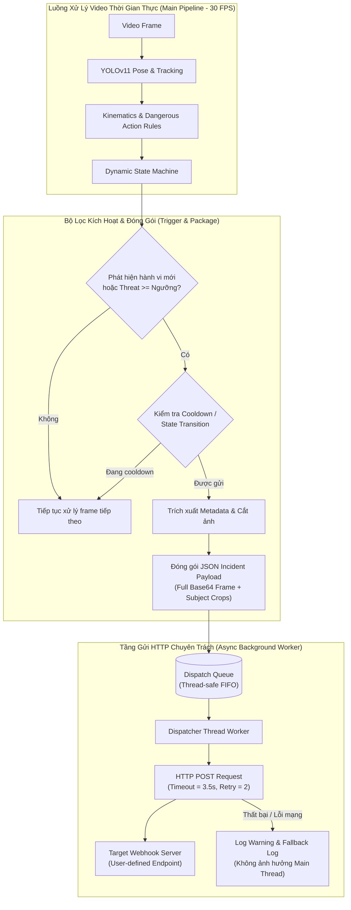
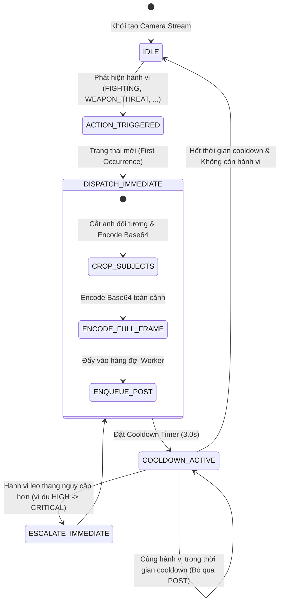

# TÀI LIỆU ĐẶC TẢ KỸ THUẬT (TECHNICAL SPECIFICATION)
## URBAN SAFETY AI-SOC: HỆ THỐNG GỬI SỰ KIỆN POST WEBHOOK ĐẾN SERVER VỚI METADATA ĐẦY ĐỦ, ẢNH TOÀN CẢNH, ẢNH ĐỐI TƯỢNG VÀ TỌA ĐỘ CAMERA
**Mã đặc tả:** `SPEC-URBANSOC-DISPATCH-04`  
**Dự án:** Hệ thống Giám sát An ninh & An toàn Đô thị Thông minh (Urban Safety AI-SOC)  
**Phương pháp luận:** Spec-Driven Development (SDD) & Strict Human-in-the-Loop (AGENTS.md)  
**Tác giả:** AI Assistant (dưới quyền Lead Developer / Principal Architect)  
**Trạng thái:** Chờ phê duyệt (Awaiting Approval)

---

## 1. TỔNG QUAN YÊU CẦU & BỐI CẢNH NGHIỆP VỤ

### 1.1. Yêu cầu từ Principal Architect
> "mỗi khi detect 1 hành động gì đó hãy tiến hành gửi method post lên 1 server (server này tôi tự định nghĩa sau) toàn bộ những metadata cần thiết như timestamp, hình ảnh, hung khí, đối tượng, ảnh đối tượng, vị trí của camera (vị trí này được định nghĩa sau)"

### 1.2. Mục tiêu Kỹ thuật
Xây dựng module **SOC Event Webhook Dispatcher** bất đồng bộ (Non-blocking Asynchronous Dispatcher) để gửi toàn bộ gói sự kiện phát hiện (Incident Event Package) bằng phương thức `HTTP POST` (JSON payload kèm Base64 images hoặc Multipart) lên máy chủ đích:
1. **Dữ liệu định danh & Vị trí Camera (Camera & Geolocation Metadata):**
   - Hỗ trợ cấu hình mềm dẻo thông qua CLI flag (`--webhook-url`, `--camera-id`, `--camera-name`, `--camera-lat`, `--camera-lon`, `--camera-address`), biến môi trường (`SOC_WEBHOOK_URL`, `SOC_CAMERA_CONFIG`), hoặc file cấu hình `configs/camera.json`.
2. **Metadata Nhận dạng & Đe dọa (Detection & Threat Metadata):**
   - `timestamp` (ISO 8601 kèm millisecond, múi giờ địa phương và Unix Epoch ms).
   - `event_id` (Mã UUIDv4 duy nhất cho mỗi sự kiện).
   - `primary_action` (Tên hành vi nguy hiểm kích hoạt: `WEAPON_THREAT`, `FIGHTING`, `SNATCHING`, `PURSUIT`, `RESTRAINING`, `SURROUNDING`, `INTRUSION`, `FALLEN`, ...).
   - `threat_level` (`LOW`, `MEDIUM`, `HIGH`, `CRITICAL`) & `threat_score` ($0.0 - 1.0$).
   - `weapon` (Chi tiết hung khí: cờ `is_weapon_detected`, loại hung khí `weapon_type`, độ tin cậy `confidence`, căn cứ động học).
3. **Dữ liệu Đối tượng & Cắt ảnh Đối tượng (Subjects & Crops):**
   - Danh sách toàn bộ đối tượng liên quan (`subjects`): `track_id`, vai trò (`suspect`, `victim`, `participant`, `bystander`), `behavior`, bounding box `[x1, y1, x2, y2]`, tốc độ di chuyển, hướng di chuyển.
   - **Ảnh cắt từng đối tượng (Subject Cropped Images):** Cắt vùng hộp bao đối tượng từ frame gốc (có padding an toàn $10\%$), nén JPEG chất lượng cao và mã hóa `base64`.
4. **Ảnh Toàn cảnh Sự kiện (Full Frame Snapshot):**
   - Ảnh chụp toàn cảnh thời điểm phát hiện có vẽ bounding box và khung xương tư thế (Annotated Snapshot), nén JPEG và mã hóa `base64`.
5. **Cơ chế Hàng Đợi Bất Đồng Bộ (Non-blocking Queue Worker):**
   - Việc gọi HTTP POST được thực thi trong một `Worker Thread` chuyên trách sử dụng hàng đợi `queue.Queue`.
   - **Cam kết không nghẽn Pipeline (Zero FPS Impact):** Nếu server phản hồi chậm (2 - 5 giây) hoặc mất mạng, luồng đọc camera và suy luận AI vẫn duy trì 30 FPS mượt mà.
6. **Bộ lọc Chống Spam Sự kiện (Event Throttling & Debounce):**
   - Khi một hành vi diễn ra liên tục qua hàng trăm frame (ví dụ ẩu đả 5 giây = 150 frames), hệ thống áp dụng cơ chế Cooldown / Deduplication (mặc định: gửi ngay lập tức khi phát hiện mới hoặc khi leo thang mức độ đe dọa, sau đó áp dụng cooldown 3.0s cho cùng đối tượng) nhằm tránh làm quá tải server nhận.

---

## 2. KIẾN TRÚC HỆ THỐNG & SƠ ĐỒ LUỒNG DỮ LIỆU (DATA FLOW & MERMAID)

### 2.1. Sơ đồ Luồng Gửi Webhook Không Khóa (Non-blocking Dispatch Pipeline)



### 2.2. Máy Trạng Thái Bộ Lọc Cooldown Sự Kiện (Webhook Throttle State Machine)



---

## 3. CẤU TRÚC JSON SCHEMA ĐẦU RA CỦA WEBHOOK (PAYLOAD SCHEMA CONTRACT)

Payload được gửi đi bằng phương thức `POST` với `Content-Type: application/json`:

```json
{
  "event_id": "EVT-20261107-143000-a1b2c3d4",
  "timestamp": "2026-11-07T14:30:15.234+07:00",
  "timestamp_ms": 1794036615234,
  "camera": {
    "camera_id": "CAM_01",
    "name": "Khu vực Cổng Chính - Phố Đi Bộ",
    "zone_id": "ZONE_ALPHA_01",
    "address": "Nguyễn Huệ, Phường Bến Nghé, Quận 1, TP. Hồ Chí Minh",
    "latitude": 10.776889,
    "longitude": 106.700806
  },
  "detection": {
    "primary_action": "WEAPON_THREAT",
    "threat_level": "CRITICAL",
    "threat_score": 0.96,
    "is_urgent": true,
    "reasoning": "Detected tactical two-handed firearm pointing towards target (wrists converged, arm extended).",
    "weapon": {
      "is_weapon_detected": true,
      "weapon_types": ["FIREARM_TACTICAL_GRIP"],
      "confidence": 0.96,
      "description": "Tactical two-handed aiming posture detected with high wrist convergence."
    },
    "subjects": [
      {
        "track_id": 1,
        "role": "suspect",
        "behavior": "WEAPON_THREAT",
        "threat_level": "CRITICAL",
        "threat_score": 0.96,
        "bbox": [180, 110, 310, 440],
        "speed": 0.42,
        "confidence": 0.92,
        "crop_image_base64": "data:image/jpeg;base64,/9j/4AAQSkZJRgABAQ..."
      },
      {
        "track_id": 2,
        "role": "victim",
        "behavior": "HANDS_UP",
        "threat_level": "HIGH",
        "threat_score": 0.78,
        "bbox": [420, 130, 530, 450],
        "speed": 0.10,
        "confidence": 0.89,
        "crop_image_base64": "data:image/jpeg;base64,/9j/4AAQSkZJRgABAQ..."
      }
    ],
    "full_image": {
      "format": "jpeg",
      "width": 640,
      "height": 480,
      "image_base64": "data:image/jpeg;base64,/9j/4AAQSkZJRgABAQ..."
    },
    "audio": {
      "is_audio_active": true,
      "audio_threat_detected": true,
      "event_type": "SCREAM",
      "confidence": 0.94,
      "rms_db": -12.4
    }
  },
  "audit": {
    "pipeline_fps": 28.5,
    "model_version": "YOLOv11-Pose-SOC-v2.0",
    "dispatcher_queue_depth": 0
  }
}
```

---

## 4. GIAO DIỆN HÀM & CẤU TRÚC LỚP (INTERFACES & IMPLEMENTATION DESIGN)

### 4.1. Định nghĩa Data Schemas (`src/urbansoc/domain/webhook_models.py`)

```python
from dataclasses import dataclass, field
from typing import List, Dict, Optional, Any

@dataclass
class CameraLocationConfig:
    """Cấu hình định danh và vị trí địa lý của camera."""
    camera_id: str = "CAM_01"
    name: str = "Camera Giám Sát Trung Tâm"
    zone_id: str = "ZONE_DEFAULT"
    address: str = "Đang cập nhật vị trí"
    latitude: float = 0.0
    longitude: float = 0.0

@dataclass
class SubjectCropData:
    """Dữ liệu chi tiết và ảnh cắt của từng đối tượng tham gia sự kiện."""
    track_id: int
    role: str                       # suspect | victim | participant | bystander
    behavior: str
    threat_level: str
    threat_score: float
    bbox: List[int]                 # [x1, y1, x2, y2]
    speed: float
    confidence: float
    crop_image_base64: str          # data:image/jpeg;base64,...

@dataclass
class WebhookIncidentPayload:
    """Gói dữ liệu hoàn chỉnh gửi qua HTTP POST."""
    event_id: str
    timestamp: str
    timestamp_ms: int
    camera: CameraLocationConfig
    primary_action: str
    threat_level: str
    threat_score: float
    is_urgent: bool
    reasoning: str
    weapon_info: Dict[str, Any]
    subjects: List[SubjectCropData]
    full_image_base64: str
    audio_info: Dict[str, Any]
    audit_metadata: Dict[str, Any]
```

### 4.2. Bộ Gửi Webhook Bất Đồng Bộ (`src/urbansoc/telemetry/webhook_dispatcher.py`)

```python
class WebhookDispatcher:
    """Quản lý hàng đợi và luồng nền gửi HTTP POST sự kiện đến server ngoài."""
    def __init__(
        self,
        server_url: Optional[str] = None,
        camera_config: Optional[CameraLocationConfig] = None,
        min_threat_level: str = "LOW",  # Mức đe dọa tối thiểu để gửi POST (LOW = gửi mọi hành vi)
        cooldown_seconds: float = 3.0,  # Thời gian chống gửi lặp cho cùng track
        timeout: float = 3.5,
        max_retries: int = 2,
    ) -> None: ...

    def dispatch_frame_event(
        self,
        frame: np.ndarray,
        annotated_frame: np.ndarray,
        analysis_result: SOCFrameAnalysisResult,
        audio_result: Optional[AudioAnalysisResult] = None,
    ) -> bool: ...

    def shutdown(self) -> None: ...
```

---

## 5. RÀNG BUỘC KỸ THUẬT & AN TOÀN (CONSTRAINTS & FAIL-SAFE)

1. **Cam kết Không Chặn Luồng (Non-blocking Latency Guarantee):**
   - Hàm `dispatch_frame_event` chỉ thực hiện encode và đẩy payload vào `queue.Queue` trong vòng $< 8\text{ ms}$.
   - Luồng nền `DispatcherThread` thực thi lệnh `requests.post()` hoàn toàn tách biệt.
2. **Cơ chế Chống Rò rỉ Bộ nhớ (Bounded Queue with Drop Policy):**
   - Hàng đợi có giới hạn kích thước tối đa (`maxsize=50`). Nếu server mất kết nối trong thời gian dài và hàng đợi đầy, các sự kiện cũ nhất sẽ bị hủy bỏ (Drop oldest with warning log) để tránh tràn RAM của hệ thống SOC.
3. **Tuân thủ Dual HITL (AGENTS.md CD-04):**
   - Gói dữ liệu gửi đi đóng vai trò là luồng thông báo sự kiện / Webhook Telemetry.
   - Các gói này luôn mang cờ `verification_status: "AI_AUTO_DETECTED_PENDING_SOC_CONFIRMATION"` để hệ thống server tiếp nhận nắm rõ đây là dữ liệu cảnh báo sớm từ AI, hỗ trợ Vận hành viên giám sát từ xa.

---

[WAITING FOR SPEC APPROVAL]
