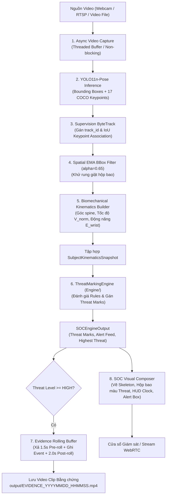

# ĐẶC TẢ KỸ THUẬT: PHÂN HỆ THU NHẬN VIDEO, YOLO11-POSE & BỘ ĐỆM BẰNG CHỨNG (AI/)
**Mã tài liệu:** `SPEC-URBAN-AI-PIPELINE-01`  
**Dự án:** Hệ thống Giám sát An ninh & An toàn Đô thị Thông minh (Urban Safety AI-SOC)  
**Phân hệ:** Tầng 1 (Input & Ingestion Layer) & Tầng 2 (AI/Pose Analytics & Visual Composer)  
**Cơ chế thực thi:** Spec-Driven Development (SDD) — Giai đoạn 1 (Stage 1 Specification)  
**Trạng thái:** Chờ phê duyệt từ Lead Architect (`[WAITING FOR SPEC APPROVAL]`)

---

## 1. MỤC TIÊU & TỔNG QUAN KIẾN TRÚC

Phân hệ **`AI/`** đóng vai trò là "mắt thần" của hệ thống Urban Safety AI-SOC, chịu trách nhiệm kết nối trực tiếp với nguồn camera thực tế và chuyển hóa dữ liệu hình ảnh thô thành dữ liệu động học chuẩn hóa (`SubjectKinematicsSnapshot`) để cấp cho Động cơ Phân tích (`Engine/` & `Rule/`):

1. **Thu nhận Khung hình Bất đồng bộ (Non-blocking Video Ingestion):** Hỗ trợ đa nguồn (Webcam trực tiếp, Camera an ninh RTSP, Video tệp tin ngoại tuyến, hoặc luồng giả lập). Luồng đọc khung hình tách rời khỏi luồng suy luận AI để chống nghẽn camera.
2. **Trích xuất Khung xương & Bám vết (YOLO11-Pose + Supervision ByteTrack):** Phát hiện 17 khớp giải phẫu COCO-17, gán và bảo toàn `track_id`, áp dụng bộ lọc EMA ($\alpha = 0.65$) khử rung lắc hộp bao.
3. **Bộ chuyển đổi Động học Sinh trắc (Biomechanical Kinematics Builder):** Tính toán góc cột sống ($\theta_{\text{spine}}$), vận tốc rơi hông, vận tốc dịch chuyển chuẩn hóa ($V_{\text{norm}}$), động năng dịch chuyển cổ tay ($E_{\text{wrist}}$) và tạo đối tượng `SubjectKinematicsSnapshot`.
4. **Bộ đệm Bằng chứng Tự động (Evidence Rolling Buffer):** Lưu đệm xoay vòng 1.5s trước sự cố; tự động kích hoạt ghi hình và đóng gói video MP4 kèm 2.0s sau sự cố khi mức đe dọa đạt `HIGH` hoặc `CRITICAL`.
5. **Bộ soạn thảo Trực quan SOC (Visual Composer & HUD):** Vẽ khung xương, hộp bao đổi màu theo Threat Mark (Xanh/Vàng/Cam/Đỏ), đồng hồ kiểm toán thời gian thực và bảng đo xa Diagnostic Telemetry.



---

## 2. ĐỊNH NGHĨA DỮ LIỆU & SCHEMA GIAO TIẾP (INPUT/OUTPUT SCHEMAS)

Phân hệ `AI/` tái sử dụng hoàn toàn và cấp dữ liệu chuẩn cho các schema đã được định nghĩa tại `Engine/threat_models.py`.

### 2.1. Cấu hình Nguồn Video (Stream Configuration)
```python
from pydantic import BaseModel
from typing import Tuple, Optional

class StreamConfig(BaseModel):
    source_type: str                   # "webcam" | "rtsp" | "file" | "simulated"
    source_uri: str                    # "0" (Webcam index), "rtsp://...", hoặc "path/to/video.mp4"
    target_resolution: Tuple[int, int] = (640, 480)
    target_fps: float = 20.0
    auto_reconnect: bool = True
    max_reconnect_attempts: int = 5
```

### 2.2. Dữ liệu Đầu ra của Bộ Đệm Bằng chứng (Evidence Package Metadata)
```python
class EvidencePackageMetadata(BaseModel):
    incident_id: str                   # INC_YYYYMMDD_HHMMSS_TRACKID
    timestamp_start: str               # ISO-8601
    timestamp_end: str                 # ISO-8601
    duration_seconds: float
    frame_count: int
    trigger_threat_level: str          # HIGH | CRITICAL
    trigger_behavior: str              # FIGHTING_STRIKE | FALLEN_COLLAPSE | ...
    involved_track_ids: list[int]
    video_filepath: str                # output/EVIDENCE_20261107_143000_FIGHTING.mp4
    reasoning_summary: str
```

---

## 3. THIẾT KẾ CHI TIẾT CÁC MODULE CON TRONG `AI/`

### 3.1. Module `AI/stream_reader.py` (Thu nhận Khung hình Bất đồng bộ)
- **Trách nhiệm:** Mở luồng video bằng OpenCV `VideoCapture`, duy trì hàng đợi đệm khung hình bằng luồng phụ (Background Grabber Thread) với kích thước tối đa 2 frames (luôn ưu tiên khung hình mới nhất để loại bỏ độ trễ tích lũy).
- **Cơ chế Fallback:** Nếu camera vật lý không kết nối được hoặc rớt luồng, tự động chuyển sang chế độ giả lập (`SimulatedFrameGenerator`) với nền radar giám sát để hệ thống không bị crash đột ngột.

### 3.2. Module `AI/pose_extractor.py` (YOLO11-Pose & ByteTrack)
- **Trách nhiệm:**
  - Nạp mô hình `yolo11n-pose.pt` (hoặc cấu hình tùy chỉnh).
  - Tự động nhận diện phần cứng (`cuda` nếu có Nvidia GPU, ngược lại dùng `cpu`).
  - Chạy suy luận khung xương đơn giai đoạn (Single-stage Inference).
  - Sử dụng `supervision.ByteTrack` với các tham số chống tráo ID:
    - `track_activation_threshold = 0.25`
    - `lost_track_buffer = 45` (tăng cường bám vết khi đối tượng bị che khuất tạm thời)
    - `minimum_matching_threshold = 0.80` (ràng buộc IoU chặt chẽ)
  - Áp dụng bộ lọc EMA Spatial Smoothing cho tọa độ hộp bao:
    $$\text{bbox}_{t} = 0.65 \cdot \text{bbox}_{\text{raw}} + 0.35 \cdot \text{bbox}_{t-1}$$
  - Liên kết 17 khớp giải phẫu chuẩn COCO với từng `track_id`.

### 3.3. Module `AI/kinematics_builder.py` (Xây dựng Snapshot Động học)
- **Trách nhiệm:** Biến đổi các điểm tọa độ pixel thành đặc trưng vật lý có ý nghĩa:
  - **Góc cột sống $\theta_{\text{spine}}$:** Góc hợp bởi vector trung điểm hai vai $(S_x, S_y)$ và trung điểm hai hông $(H_x, H_y)$ so với trục thẳng đứng:
    $$\theta_{\text{spine}} = \arctan\left(\frac{|S_x - H_x|}{\max(1e-4, |S_y - H_y|)}\right) \times \frac{180}{\pi}$$
  - **Tỷ lệ co cụm cơ thể (Aspect Ratio):** $H / W$.
  - **Vận tốc dịch chuyển chuẩn hóa ($V_{\text{norm}}$):** Độ dời tâm hộp bao qua $\Delta t$, chuẩn hóa theo chiều cao cơ thể (body-heights/sec).
  - **Động năng cổ tay ($E_{\text{wrist}}$):** Bình phương vận tốc trung bình của khớp cổ tay trái và phải giữa 2 khung hình liên tiếp.
  - **Đóng gói đối tượng:** Trả về đối tượng `SubjectKinematicsSnapshot` hoàn chỉnh.

### 3.4. Module `AI/evidence_buffer.py` (Bộ đệm Bằng chứng Xoay vòng)
- **Trách nhiệm:**
  - Duy trì hàng đợi `deque` dung lượng $N_{\text{pre}} = \text{FPS} \times 1.5$ frames (bộ đệm trước sự kiện).
  - Khi `highest_threat_level` từ Engine đạt `HIGH` hoặc `CRITICAL`:
    1. Kích hoạt trạng thái `is_recording = True`.
    2. Khởi tạo OpenCV `VideoWriter` native (codec `mp4v`, không phụ thuộc binary ffmpeg cài ngoài).
    3. Xả toàn bộ $1.5\text{s}$ hình ảnh quá khứ từ bộ đệm vào tệp tin.
    4. Ghi tiếp tục các khung hình trong khi sự kiện đang diễn ra.
    5. Khi sự kiện kết thúc (threat hạ xuống dưới `HIGH`), duy trì ghi thêm $2.0\text{s}$ khung hình hậu sự kiện ($N_{\text{post}} = \text{FPS} \times 2.0$).
    6. Đóng tệp, lưu vào `output/EVIDENCE_YYYYMMDD_HHMMSS_{BEHAVIOR}.mp4` và xuất bản ghi `EvidencePackageMetadata`.

### 3.5. Module `AI/visual_composer.py` (Soạn thảo Giao diện HUD SOC)
- **Trách nhiệm:** Trực quan hóa toàn bộ dữ liệu phân tích lên từng khung hình hiển thị:
  - **Khung xương COCO-17:** Vẽ các thanh xương (bones) và khớp (joints) tô màu theo cấp độ đe dọa (Xanh lá, Vàng, Cam, Đỏ).
  - **Corner Bounding Box:** Hộp bao với 4 góc viền góc hiện đại.
  - **Behavior & Threat Header:** Hiển thị thẻ định danh `ID #<track_id> | <BEHAVIOR> [<threat_score>%]`.
  - **Top Dashboard Bar:** Hiển thị Tên phân hệ, Đồng hồ kiểm toán chuẩn ISO-8601 (`TIME: YYYY-MM-DD HH:MM:SS.mmm`), Huy hiệu cảnh báo sự cố khẩn cấp, chỉ số FPS và độ trễ suy luận.
  - **Alert Box Debug HUD:** Bảng đo xa sinh trắc học ở góc dưới màn hình (hỗ trợ phím tắt `[d]` để bật/tắt).

### 3.6. Module `AI/pipeline.py` (Điều phối Pipeline Toàn diện)
- **Trách nhiệm:** Class chính `UrbanSafetyAIPipeline` đóng gói toàn bộ luồng xử lý:
  - Vòng lặp: Đọc frame $\to$ Trích xuất Pose $\to$ Xây dựng Kinematics $\to$ Gọi `ThreatMarkingEngine.process_frame()` $\to$ Cập nhật Evidence Buffer $\to$ Vẽ HUD $\to$ Trả về Frame hiển thị và Metadata SOC.

---

## 4. RÀNG BUỘC KỸ THUẬT & HIỆU NĂNG (PERFORMANCE & NON-BLOCKING)

1. **Hiệu năng & FPS:**
   - Pipeline hoàn chỉnh (YOLO11-Pose + ByteTrack + Kinematics + Engine + Rolling Buffer + HUD Composer) phải đạt tối thiểu **$\ge 18 - 20$ FPS** trên vi xử lý Intel Core i5/i7 (CPU) và **$\ge 45$ FPS** trên GPU Nvidia CUDA.
   - Độ trễ toàn chu trình từ lúc thu nhận frame đến lúc xuất kết quả $\le 50\text{ms}$.
2. **Bộ nhớ RAM & Chống rò rỉ:**
   - Bộ đệm Rolling Buffer sử dụng `deque` với `maxlen` cố định, giải phóng vùng nhớ tự động, dung lượng RAM chiếm dụng cho bộ đệm $\le 150\text{MB}$.
3. **Độ tin cậy SOC:**
   - Xử lý mượt mà khi người đi ra khỏi khung hình (không để lại memory leak).
   - Tự động đóng tệp video an toàn khi người dùng bấm `q` hoặc ngắt luồng.

---

## 5. KỊCH BẢN KIỂM THỬ XÁC MINH (STAGE 1 TEST CRITERIA)

Bộ kiểm thử của phân hệ `AI/` sẽ thẩm định:
1. **Kiểm thử Thu nhận Luồng:** Đọc trơn tru luồng giả lập và tính toán FPS chính xác.
2. **Kiểm thử Biomechanical Kinematics:** Chuyển đổi chính xác 17 keypoints sang góc nghiêng $\theta_{\text{spine}}$ và động năng cổ tay $E_{\text{wrist}}$.
3. **Kiểm thử Rolling Buffer:** Kích hoạt sự kiện khẩn cấp $\implies$ Tệp MP4 bằng chứng được tạo ra, chứa đầy đủ khung hình trước và sau sự kiện, mở đọc được bình thường bằng OpenCV.
4. **Kiểm thử HUD Overlay:** Render đầy đủ đồng hồ kiểm toán, hộp bao phân màu theo Threat Mark và khung Debug Box mà không làm biến dạng dữ liệu gốc.

---

[WAITING FOR SPEC APPROVAL]
