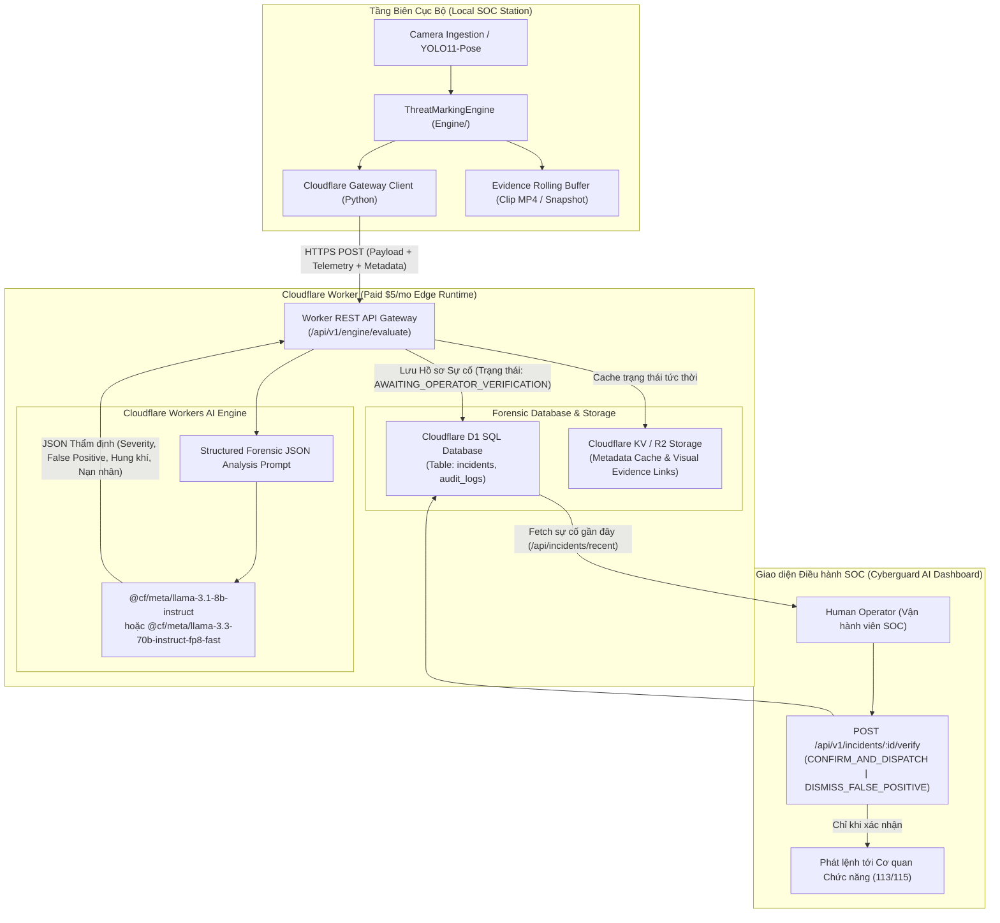

# ĐẶC TẢ KỸ THUẬT: TÍCH HỢP CLOUDFLARE WORKER AI & HỆ THỐNG LƯU TRỮ SỰ CỐ AN NINH ĐÔ THỊ
**Mã tài liệu:** `SPEC-CLOUDFLARE-WORKER-AI-01`  
**Dự án:** Hệ thống Giám sát An ninh & An toàn Đô thị Thông minh (Urban Safety AI-SOC)  
**Phân hệ:** Tầng 2 & Tầng 4 (Cloud Edge AI Analytics, Forensic Incident Vault & HITL Dispatch Gateway)  
**Cơ chế thực thi:** Spec-Driven Development (SDD) — Giai đoạn 1 (Stage 1 Specification)  
**Trạng thái:** Chờ phê duyệt từ Lead Architect (`[WAITING FOR SPEC APPROVAL]`)

---

## 1. MỤC TIÊU & TỔNG QUAN KIẾN TRÚC

Hệ thống kết nối trực tiếp với **Cloudflare Workers (Gói Paid $5/tháng)** nhằm mở rộng năng lực tính toán biên, tận dụng **Cloudflare Workers AI** (Mô hình ngôn ngữ lớn Llama 3.3 / Llama 3.1 / DeepSeek R1 Distill) để đóng vai trò **Thẩm định viên Trí tuệ Nhân tạo Độc lập (Secondary AI Forensic Validator)** cho các kết quả gửi về từ Local Engine:

1. **Thẩm định Rủi ro trên Thang điểm 10 (`severity_score_10`):** Đánh giá mức độ nguy hiểm thực tế của sự cố từ mức 1.0 (vô hại/sinh hoạt bình thường) đến 10.0 (bạo lực sát thương/khẩn cấp đe dọa tính mạng).
2. **Đánh giá Nguy cơ Báo động Giả (`false_positive_probability`):** Phân tích ngữ cảnh sinh trắc học và động học (ví dụ: ôm nhau chào hỏi, tập thể dục, cúi buộc dây giày, vũ đạo) để lọc bỏ báo động giả từ các quy tắc hình học của CV Engine.
3. **Trích xuất & Lưu trữ Hồ sơ Sự cố Đa chiều (Cloudflare D1 SQL Vault):**
   - **Thời gian & Không gian:** Timestamp chuẩn ISO-8601, `camera_id`, vị trí địa lý, tọa độ GPS (`latitude`, `longitude`).
   - **Đặc điểm Đối tượng (Subject Features):** Tư thế, biểu hiện hung hãn, ước tính vóc dáng, trang phục, hành vi che chắn.
   - **Hung khí & Vật thể Khả nghi (Weapons / Suspicious Objects):** Nhận diện chỉ dấu hung khí (vật tày, dao kiếm, vũ khí giấu trong người, đồ vật biến dạng).
   - **Tình trạng Nạn nhân & Người xung quanh (Victim & Bystanders):** Đánh giá có người bị tấn công, bỏ chạy, ngã gục hay đám đông vây quanh.
   - **Khuyến nghị Điều phối Tác chiến (Tactical Dispatch Recommendation):** Đề xuất hành động tức thời cho Vận hành viên (gọi cảnh sát khu vực, điều xe cấp cứu 115, tiếp tục giám sát camera).
4. **Bảo toàn Chốt chặn Vận hành viên (Operational HITL Compliance):** Toàn bộ sự cố lưu vào Cloudflare D1 mặc định ở trạng thái `AWAITING_OPERATOR_VERIFICATION`. Tuyệt đối không phát lệnh điều phối tự động nếu chưa có sự phê duyệt từ Vận hành viên qua API xác thực.



---

## 2. ĐỊNH NGHĨA DỮ LIỆU & SCHEMA (STRICT STRUCTURED SCHEMAS)

### 2.1. Payload Gửi từ Local Engine lên Cloudflare Worker (`EvaluationRequestPayload`)
```typescript
interface EvaluationRequestPayload {
  incident_id?: string;                        // Optional UUID nếu đã tạo tại local
  camera_id: string;                           // ID camera: "cam_server_room_01"
  location_name: string;                       // Tên địa điểm: "Khu vực Cổng A - Đại học SGU"
  latitude: number;                            // Tọa độ GPS Vĩ độ: 10.7591
  longitude: number;                           // Tọa độ GPS Kinh độ: 106.6782
  timestamp: string;                           // ISO-8601: "2026-11-07T14:30:00.000Z"
  frame_index: number;                         // Chỉ số frame video
  engine_behavior: string;                     // "FIGHTING_STRIKE" | "FALLEN_COLLAPSE" | ...
  engine_category: string;                     // "IN_PROGRESS_CRIME" | "PRE_CRIME" | ...
  engine_threat_level: string;                 // "LOW" | "MEDIUM" | "HIGH" | "CRITICAL"
  engine_threat_score: number;                 // 0.00 đến 1.00 từ Engine local
  primary_subject_id: number;                  // track_id đối tượng chính
  interacting_subject_ids: number[];           // Danh sách track_id đối tác tương tác
  telemetry: {
    spine_angle_deg: number;                   // Góc nghiêng cột sống
    aspect_ratio: number;                      // Tỷ lệ H/W hộp bao
    velocity_norm: number;                     // Vận tốc dịch chuyển chuẩn hóa
    wrist_kinetic_energy: number;              // Động năng cổ tay
    dwell_time_seconds: number;                // Thời gian đối tượng xuất hiện
    state_dwell_seconds: number;               // Thời gian duy trì hành vi
    bounding_box: [number, number, number, number]; // [x1, y1, x2, y2]
  };
  evidence_clip_url?: string;                  // URL video clip nếu đã upload (R2/Public)
  snapshot_url?: string;                       // URL ảnh chụp khung xương (nếu có)
  diagnostic_reasoning: string;                // Diễn giải từ Rule & Engine local
}
```

### 2.2. Schema Đầu ra Thẩm định của Cloudflare Workers AI (`AIEvaluationOutput`)
Đầu ra từ mô hình Workers AI bắt buộc phải trả về JSON tuân thủ schema nghiêm ngặt:

```typescript
interface AIEvaluationOutput {
  severity_score_10: number;                   // Thang điểm 10 (1.0 đến 10.0, bước 0.1)
  false_positive_probability: number;          // Xác suất báo động giả (0.00 đến 1.00)
  is_false_positive: boolean;                  // True nếu false_positive_probability >= 0.70
  threat_verdict: "CONFIRMED_THREAT" | "BENIGN_ACTIVITY" | "SUSPICIOUS_MONITOR" | "CRITICAL_EMERGENCY";
  subject_features: {
    posture_assessment: string;                // "Hung hăng, chuẩn bị ra đòn / Co cụm phòng thủ"
    suspicious_concealment: boolean;           // Có dấu hiệu giấu tay/vật khả nghi hay không
    movement_intent: string;                   // "Tiến công đối phương / Tháo chạy / Bất động"
    estimated_threat_actor_count: number;      // Số lượng đối tượng có dấu hiệu phạm tội
  };
  weapons_identified: {
    has_weapon_indicator: boolean;
    weapon_type: "NONE" | "BLUNT_OBJECT" | "EDGED_WEAPON" | "CONCEALED_FIREARM" | "IMPROVISED_WEAPON";
    weapon_confidence: number;                 // 0.00 đến 1.00
    description: string;                       // "Tay phải vung vật dài nghi là gậy kim loại"
  };
  victim_assessment: {
    has_victim_present: boolean;
    victim_track_id?: number;
    victim_condition: "NONE" | "UNDER_ATTACK" | "FALLEN_UNRESPONSIVE" | "FLEEING_INJURED";
    bystander_count: number;                   // Số lượng người ngoài cuộc chứng kiến
  };
  dispatch_recommendation: {
    priority: "ROUTINE" | "URGENT" | "IMMEDIATE_RESPONSE" | "DISMISS";
    recommended_units: ("POLICE" | "AMBULANCE" | "FIRE_RESCUE" | "SECURITY_GUARD")[];
    action_notes: string;                      // "Điều phối tổ tuần tra Công an Phường can thiệp gấp"
  };
  investigation_summary: string;               // Tóm tắt phân tích pháp y tổng hợp
}
```

### 2.3. Cấu trúc Bản ghi Cơ sở dữ liệu Cloudflare D1 SQL Schema (`incidents`)
```sql
CREATE TABLE IF NOT EXISTS incidents (
    id TEXT PRIMARY KEY,                       -- UUID: INC_YYYYMMDD_HHMMSS_XXXXXX
    timestamp TEXT NOT NULL,                   -- ISO-8601
    camera_id TEXT NOT NULL,                   -- cam_01, cam_gate_a,...
    location_name TEXT NOT NULL,               -- Địa chỉ / Khu vực
    latitude REAL NOT NULL,                    -- Vĩ độ GPS
    longitude REAL NOT NULL,                   -- Kinh độ GPS
    engine_behavior TEXT NOT NULL,             -- Hành vi từ Engine cục bộ
    engine_threat_score REAL NOT NULL,         -- Điểm 0.0 - 1.0 từ Engine
    ai_severity_score_10 REAL NOT NULL,        -- Điểm 1.0 - 10.0 từ Cloudflare Workers AI
    false_positive_prob REAL NOT NULL,         -- 0.0 - 1.0
    is_false_positive INTEGER NOT NULL,        -- 0 hoặc 1
    threat_verdict TEXT NOT NULL,              -- CONFIRMED_THREAT, CRITICAL_EMERGENCY,...
    subject_features TEXT NOT NULL,            -- JSON string
    weapons_identified TEXT NOT NULL,          -- JSON string
    victim_assessment TEXT NOT NULL,           -- JSON string
    dispatch_recommendation TEXT NOT NULL,     -- JSON string
    investigation_summary TEXT NOT NULL,       -- Văn bản lý giải điều tra
    evidence_clip_url TEXT,                    -- Đường dẫn video clip MP4
    snapshot_url TEXT,                         -- Đường dẫn ảnh snapshot
    operator_status TEXT NOT NULL DEFAULT 'AWAITING_OPERATOR_VERIFICATION', -- HITL
    operator_id TEXT,                          -- ID Vận hành viên xác nhận
    verified_at TEXT,                          -- Thời điểm xác nhận
    operator_notes TEXT,                       -- Ghi chú của Vận hành viên
    created_at DATETIME DEFAULT CURRENT_TIMESTAMP
);

CREATE INDEX IF NOT EXISTS idx_incidents_timestamp ON incidents(timestamp DESC);
CREATE INDEX IF NOT EXISTS idx_incidents_status ON incidents(operator_status);
CREATE INDEX IF NOT EXISTS idx_incidents_camera ON incidents(camera_id);
```

---

## 3. THIẾT KẾ CHI TIẾT CLOUDFLARE WORKER (`CloudflareWorker/`)

### 3.1. Cấu hình Worker (`wrangler.toml`)
- Cấu hình tương thích với gói **Cloudflare Workers Paid**:
  - `name = "urban-safety-soc-worker"`
  - `main = "src/index.ts"`
  - `compatibility_date = "2024-09-23"`
  - **Workers AI Binding:** `[ai]` `binding = "AI"`
  - **D1 Database Binding:** `[[d1_databases]]` `binding = "DB"`, `database_name = "urban_soc_db"`
  - **KV Binding (Tùy chọn):** `[[kv_namespaces]]` `binding = "INCIDENT_CACHE"`

### 3.2. Lựa chọn Mô hình AI (Workers AI Model Selection)
- Sử dụng mô hình suy luận ngôn ngữ có khả năng trích xuất JSON cấu trúc cực kỳ chính xác:
  - **Mô hình chính:** `@cf/meta/llama-3.3-70b-instruct-fp8-fast` (trên gói Paid) hoặc `@cf/meta/llama-3.1-8b-instruct`.
  - Khả năng fallback: `@cf/deepseek-ai/deepseek-r1-distill-qwen-32b` nếu mô hình chính quá tải.
- Sử dụng chế độ nhiệt độ thấp (`temperature: 0.1`) và System Prompt ép khuôn JSON chuẩn (Strict JSON Mode) nhằm loại bỏ hội thoại thừa.

### 3.3. Các Endpoint API Cốt lõi của Worker
1. **`POST /api/v1/engine/evaluate` (Đánh giá sự cố từ Engine):**
   - Nhận payload telemetry từ Python Local Gateway.
   - Gọi Workers AI để chấm điểm thang 10, đo xác suất false-positive, bóc tách đặc điểm đối tượng, hung khí và nạn nhân.
   - Ghi dữ liệu vào D1 với trạng thái `AWAITING_OPERATOR_VERIFICATION`.
   - Trả về JSON thẩm định cho Client.
2. **`GET /api/v1/incidents` (Lấy danh sách sự cố phục vụ Dashboard SOC):**
   - Hỗ trợ phân trang (`limit`, `offset`), lọc theo `camera_id`, `status` (`AWAITING_OPERATOR_VERIFICATION`, `OPERATOR_CONFIRMED`), `severity_min`.
   - Cung cấp dữ liệu theo chuẩn [standard.md](file:///c:/Users/admin/OneDrive/Tài%20liệu/SGU/Hackathon/Promptacus---Hackathon-/Dashboard/Back%20End/standard.md) cho menu Incident Feed.
3. **`GET /api/v1/incidents/:id` (Xem chi tiết hồ sơ sự cố & bằng chứng):**
   - Trả về toàn bộ trường dữ liệu phục vụ điều tra viên SOC.
4. **`POST /api/v1/incidents/:id/verify` (Chốt chặn HITL — Vận hành viên xác thực):**
   - **Bảo mật & Quyền hạn:** Chỉ chấp nhận lệnh khi có `operator_id` và token xác thực.
   - Nhận 1 trong 3 hành động:
     - `CONFIRM_AND_DISPATCH`: Xác nhận sự cố thực, chuyển trạng thái sang `OPERATOR_CONFIRMED`, sẵn sàng gửi lệnh sang Cơ quan chức năng.
     - `DOWNGRADE_MONITOR`: Hạ mức cảnh báo, đưa vào diện theo dõi định kỳ.
     - `DISMISS_FALSE_POSITIVE`: Hủy cảnh báo giả, ghi nhận phản hồi để tinh chỉnh AI.

---

## 4. THIẾT KẾ CLIENT KẾT NỐI PHÍA PYTHON (`Engine/cloudflare_client.py`)

Trong mã nguồn cục bộ (Python), một lớp điều phối `CloudflareSOCClient` được bổ sung:
- **Cơ chế Lọc ngưỡng & Chống tràn (Rate-limiting & Threshold Gate):**
  - Không gửi tràn lan từng frame lên Cloudflare để tiết kiệm băng thông và tối ưu hạn ngạch.
  - Chỉ gửi yêu cầu thẩm định khi:
    1. `ThreatLevel` đạt `HIGH` hoặc `CRITICAL`.
    2. Có sự kiện chuyển đổi trạng thái (`is_escalated = True`).
    3. Hoặc heartbeat định kỳ ($2.0\text{s}$/lần) cho sự cố đang tiếp diễn.
- **Xử lý Bất đồng bộ & Dự phòng Ngoại tuyến (Asynchronous & Resilient Retry):**
  - Gửi request qua `urllib` hoặc `requests` với timeout $3.0\text{s}$.
  - Nếu mất kết nối Internet hoặc Cloudflare phản hồi lỗi: Lưu sự cố vào hàng đợi ngoại tuyến tạm thời trên đĩa cục bộ (`output/offline_incidents.jsonl`) để tự động gửi lại khi có mạng, đảm bảo không làm gián đoạn vòng lặp camera FPS của AI SOC.

---

## 5. RÀNG BUỘC KỸ THUẬT, HIỆU NĂNG & CHI PHÍ ($5 PAID PLAN)

1. **Ràng buộc Thời gian Chờ (Latency Constraints):**
   - Thời gian gọi Workers AI và ghi D1 $\le 1200\text{ms}$ / sự cố.
   - Do chạy bất đồng bộ với vòng lặp camera, thời gian này **hoàn toàn không làm ảnh hưởng tới FPS của luồng video cục bộ** ($\ge 20$ FPS).
2. **Quản lý Hạn ngạch & Chi phí (Cloudflare $5 Paid Quota):**
   - Gói Paid $5/tháng bao gồm 10 triệu lượt gọi Worker/tháng và hạn mức Workers AI dồi dào.
   - Nhờ cơ chế lọc ngưỡng ở Client, chỉ các sự cố rủi ro cao mới kích hoạt Workers AI (ước tính $< 5000$ lượt gọi AI/ngày trong môi trường giám sát thực tế).
3. **Bảo mật (Zero Trust & API Tokens):**
   - Giao tiếp giữa Local Client và Cloudflare Worker được bảo vệ bằng Header `Authorization: Bearer <CF_SOC_SECRET_KEY>`.

---

## 6. KỊCH BẢN KIỂM THỬ XÁC MINH (STAGE 1 TEST CRITERIA)

Kịch bản kiểm thử sau bắt buộc phải đạt yêu cầu trước khi nghiệm thu:
1. **Kiểm thử Schema D1 & Khởi tạo Database:** Chạy migration SQL tạo bảng `incidents` và các chỉ mục không phát sinh lỗi.
2. **Kiểm thử Workers AI Prompt Evaluation:** Bơm dữ liệu giả lập sự cố ẩu đả (`FIGHTING_STRIKE`) $\to$ Workers AI trả về JSON hợp lệ với `severity_score_10 >= 8.0`, `is_false_positive = false`, nhận diện được đối tác tương tác.
3. **Kiểm thử Nhận diện Báo động Giả (False Positive Test):** Bơm dữ liệu giả lập người cúi xuống nhặt rác $\to$ Workers AI trả về `is_false_positive = true`, `severity_score_10 <= 3.0`.
4. **Kiểm thử Chốt chặn HITL (Operator Verification Gate):** Xác nhận không thể kích hoạt lệnh Dispatch nếu trạng thái trong D1 chưa được chuyển sang `OPERATOR_CONFIRMED`.
5. **Kiểm thử Client Python Ngoại tuyến:** Ngắt mạng giả lập $\to$ Client ghi vào `offline_incidents.jsonl` và tự động gửi lại khi kết nối phục hồi.

---

[WAITING FOR SPEC APPROVAL]
