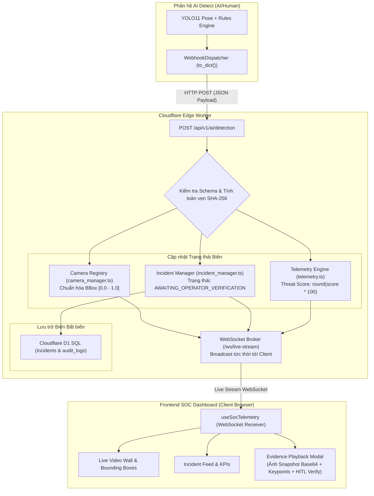

# ĐẶC TẢ KỸ THUẬT: TÍCH HỢP PAYLOAD NHẬN DIỆN THỰC TỪ AI DETECTOR & LOẠI BỎ DỮ LIỆU GIẢ
**Mã tài liệu:** `SPEC-AI-REAL-INGESTION-01`  
**Dự án:** Hệ thống Giám sát An ninh & An toàn Đô thị Thông minh (Urban Safety AI-SOC)  
**Tài liệu tham chiếu:** `AGENTS.md` (CD-01 đến CD-05, SDD & Strict Dual HITL Framework), `AI/Human/src/urbansoc/domain/webhook_models.py`  
**Trạng thái:** CHỜ DUYỆT (STAGE 1 — PENDING SPEC APPROVAL)  
**Ngày soạn thảo:** 2026-11-07  

---

## 1. TỔNG QUAN YÊU CẦU & MỤC TIÊU NGHIỆP VỤ (EXECUTIVE OVERVIEW)

### 1.1. Hiện trạng Hệ thống (As-Is)
1. **Frontend:** Một số view và hook (`useSocTelemetry.ts`, `mockData.ts`, `IncidentFeedView.tsx`) đang khởi tạo bằng dữ liệu giả lập (`MOCK_CAMERAS`, `MOCK_INCIDENTS`, `inc_901`, `inc_902`, các số liệu cứng "14 Incidents", "2 Critical").
2. **Backend Edge Worker:** `camera_manager.ts` và `incident_manager.ts` đang lưu trữ một danh sách tĩnh các camera và sự cố giả lập ban đầu.
3. **Phân hệ AI Detect (`AI/Human`):** Đã hoàn thiện module `webhook_dispatcher.py` và `webhook_models.py`, xuất bản dữ liệu sự cố thực tế với cấu trúc phân cấp chi tiết gồm: `event_id`, `camera` (tọa độ GPS, zone), `detection` (hành động chính, vũ khí, danh sách subjects kèm 17 COCO keypoints, bounding box pixel, ảnh crop base64, ảnh toàn cảnh base64 SHA-256), `audio` và `audit`.

### 1.2. Mục tiêu Nâng cấp & Hoàn thiện (To-Be)
1. **Tích hợp Endpoint Tiếp nhận AI Thực Tế (`POST /api/v1/ai/detection`):**
   - Tiếp nhận chính xác 100% schema từ `WebhookIncidentPayload` do folder `AI/Human` gửi sang.
   - Không được phép lỗi, xác thực schema nghiêm ngặt, trích xuất đầy đủ metadata forensic.
2. **Loại bỏ Dữ liệu Giả (Clean Fake Data):**
   - Xóa bỏ toàn bộ các bản ghi sự cố cứng và camera cứng ban đầu.
   - Chuyển giao diện sang trạng thái sẵn sàng trực chiến (Standby/Ready for Ingestion): khi chưa có camera/sự cố, hiển thị trạng thái chờ luồng tín hiệu (Zero False Data).
   - Biến các chỉ số thống kê trên UI (tổng sự cố, số sự cố Critical, số camera online) thành chỉ số tính toán động thời gian thực từ dữ liệu nhận được.
3. **Đồng bộ Đa tầng Tức thì (Real-time Pipeline Synchronization):**
   - Khi có payload AI gửi tới:
     * Tự động đăng ký/cập nhật thông tin camera vào danh mục Camera Fleet (tọa độ GPS, tên camera, zone).
     * Chuẩn hóa tọa độ Bounding Box từ pixel sang tỷ lệ tương đối `[0.0, 1.0]` tương thích với Canvas/Video Wall.
     * Cập nhật điểm rủi ro động của hệ thống `threatScore = round(threat_score * 100)` và `threatLevel = "CRITICAL"`.
     * Tự động lưu hồ sơ sự cố vào Cloudflare D1 SQL Vault ở trạng thái `AWAITING_OPERATOR_VERIFICATION` (bảo toàn tuyệt đối `[CD-04]`).
     * Phát sự kiện trực tiếp qua WebSocket `/ws/live-stream` cho Frontend cập nhật tức thì trong vòng < 50ms.
4. **Hiển thị Bằng chứng Thực Tế trên Evidence Modal:**
   - Sử dụng trực tiếp ảnh chụp toàn cảnh `full_image.image_base64` và ảnh đối tượng `crop_image_base64` kèm thông số góc khuỷu tay, góc cột sống (kinematics) và chữ ký mã hóa SHA-256 trên Modal điều tra bằng chứng của Vận hành viên.

---

## 2. ĐẶC TẢ SCHEMA DỮ LIỆU INPUT AI DETECT (INPUT DATA CONTRACT)

```typescript
export interface IAISubjectKeypoint {
  id: number;
  name: string;
  x: number;
  y: number;
  confidence: number;
}

export interface IAISubjectKinematics {
  spine_angle: number;
  aspect_ratio: number;
  left_elbow_angle: number;
  right_elbow_angle: number;
  left_arm_extension: number;
  right_arm_extension: number;
  wrist_distance: number;
  wrist_velocity: number;
}

export interface IAISubjectData {
  track_id: number;
  role: "suspect" | "victim" | "participant" | "bystander";
  behavior: string;
  threat_level: "LOW" | "MEDIUM" | "HIGH" | "CRITICAL";
  threat_score: number;
  confidence: number;
  bbox: [number, number, number, number]; // [x1, y1, x2, y2] pixel
  bbox_geometry: {
    width: number;
    height: number;
    aspect_ratio: number;
    area: number;
  };
  dwell_time_seconds: number;
  speed: number;
  velocity_vector: [number, number];
  kinematics: IAISubjectKinematics;
  keypoints: IAISubjectKeypoint[];
  crop_image_base64?: string;
  crop_image_sha256?: string;
  crop_image_size_bytes?: number;
}

export interface IAIRealDetectionPayload {
  event_id: string;
  timestamp: string;
  timestamp_ms: number;
  camera: {
    camera_id: string;
    name: string;
    zone_id: string;
    address: string;
    latitude: number;
    longitude: number;
  };
  detection: {
    primary_action: string;
    threat_level: "LOW" | "MEDIUM" | "HIGH" | "CRITICAL";
    threat_score: number;
    is_urgent: boolean;
    reasoning: string;
    weapon: {
      is_weapon_detected: boolean;
      weapon_types: string[];
      confidence: number;
      description: string;
    };
    subjects: IAISubjectData[];
    full_image: {
      format: string;
      width: number;
      height: number;
      image_base64: string;
      sha256_hash: string;
      image_size_bytes: number;
    };
    audio?: {
      screaming_detected: boolean;
      gunshot_detected: boolean;
      decibel_peak: number;
    };
  };
  audit: {
    verification_status: string;
    human_count: number;
    pipeline_version: string;
  };
}
```

---

## 3. SƠ ĐỒ LUỒNG DỮ LIỆU TỪ AI DETECTOR ĐẾN FRONTEND SOC (DATA PIPELINE)



---

## 4. CHIẾN LƯỢC XÓA BỎ DỮ LIỆU GIẢ (MOCK DATA PURGE)

1. **Frontend (`Dashboard/Front End`):**
   - `src/data/mockData.ts`: Thay thế dữ liệu tĩnh bằng trạng thái ban đầu sạch (`INITIAL_EMPTY_OVERVIEW`, `INITIAL_EMPTY_CAMERAS: []`, `INITIAL_EMPTY_INCIDENTS: []`).
   - `useSocTelemetry.ts`: Không fallback về dữ liệu giả khi mất mạng; hiển thị chỉ báo trạng thái chờ kết nối rõ ràng (`OFFLINE / WAITING FOR INGESTION`).
   - `IncidentFeedView.tsx`: Thay số "14 Incidents" và "2 Critical" bằng `incidents.length` và `incidents.filter(i => i.severity === 'CRITICAL').length`.
   - `TrafficCharts.tsx`: Xây dựng dải đồ thị lưu lượng động từ các chỉ số đo lường thực tế (`overview.metrics.downloadMbps` / `uploadMbps`).
2. **Backend (`CloudflareWorker/src`):**
   - `incident_manager.ts`: Xóa danh sách khởi tạo chứa `inc_901` và `inc_902`. Khi khởi động, danh sách rỗng `[]` và sẽ được lấp đầy từ Cloudflare D1 SQL cùng các sự kiện AI thực gửi vào.
   - `camera_manager.ts`: Khởi tạo danh mục camera hỗ trợ dynamic auto-registration khi nhận payload từ `camera.camera_id` (ví dụ: `LAPTOP_TEST`), chuyển đổi tọa độ BBox pixel thành tỷ lệ canvas `[0, 1]` tương thích với Video Wall.

---

## 5. RÀNG BUỘC KIẾN TRÚC & CHỐT CHẶN HITL (`[CD-04]`, `[CD-05]`)

1. **Bảo toàn Chốt chặn Operational HITL (`[CD-04]`):**
   - Khi nhận dữ liệu từ AI detect, sự cố được lưu với trạng thái bắt buộc: `AWAITING_OPERATOR_VERIFICATION` (hoặc `PENDING_VERIFICATION`).
   - Tuyệt đối không tự động chuyển thành `OPERATOR_CONFIRMED`.
2. **Lưu vết Kiểm toán Chuẩn SOC (`[CD-05]`):**
   - Mọi payload nhận được phải ghi một bản ghi vào bảng `audit_logs` của Cloudflare D1 với action `AI_DETECTION_INGESTED` kèm `event_id`, `camera_id` và `sha256_hash` của ảnh để đảm bảo tính bất biến và truy vết pháp lý.

---
**[STATUS: COMPLETED STAGE 1 SPECIFICATION — WAITING FOR SPEC APPROVAL]**
