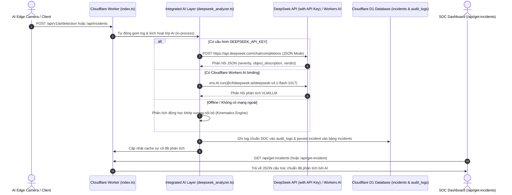

# ĐẶC TẢ KỸ THUẬT: TÍCH HỢP TỰ ĐỘNG LỚP AI PHÂN TÍCH TRONG MÃ NGUỒN & HỖ TRỢ DEEPSEEK API KEY
**Mã tài liệu:** `SPEC-INTEGRATED-AI-LAYER-01`  
**Dự án:** Urban Safety AI-SOC (CyberGuard AI v2.1)  
**Phương pháp:** Spec-Driven Development (SDD) & Strict HITL  
**Trạng thái:** Chờ phê duyệt (Stage 1 — Specification)

---

## 1. MỤC TIÊU NGHIỆP VỤ & BỐI CẢNH YÊU CẦU

Theo yêu cầu từ Kiến trúc sư:
1. **Lớp AI Phân Tích Nội Tại Tự Động (In-Process Integrated AI Layer):**
   - Loại bỏ việc bắt buộc người dùng hoặc client bên ngoài phải gọi endpoint phân tích thủ công (`POST /api/v1/deepseek/analyze`).
   - Ngay khi có bất kỳ `POST` request chứa sự cố hoặc phát hiện AI gửi tới hệ thống (`/api/v1/ai/detection`, `/api/incidents`), hoặc khi frontend/client truy vấn `GET /api/get-incidents` (hoặc `/api/get-incident`), mã nguồn sẽ **tự động kích hoạt lớp AI phân tích ngay lập tức** trong quy trình xử lý nội bộ.
2. **Đầu Ra Của `GET /api/get-incidents` & `GET /api/get-incident` Phải Do AI Trực Tiếp Sinh Ra:**
   - Cung cấp dữ liệu JSON đã được mô hình AI phân tích cấu trúc, bao gồm: mức độ nghiêm trọng (`severity`), thẩm định đe dọa (`threat_verdict`), mô tả tư thế/động học đối tượng (`object_description`), dòng thời gian bằng chứng (`timeline`), tóm tắt điều tra (`investigation_summary`).
3. **Cơ Chế Cắm API Key Linh Hoạt (Pluggable DeepSeek API Key):**
   - Hỗ trợ biến môi trường `DEEPSEEK_API_KEY` (hoặc `OPENAI_API_KEY`, `AI_API_KEY`) để gọi trực tiếp DeepSeek API (`https://api.deepseek.com/chat/completions`) với mô hình `deepseek-chat` / `deepseek-reasoner` ở chế độ JSON (`response_format: { type: "json_object" }`).
   - Cơ chế đa tầng dự phòng (Multi-tier Failover):
     - **Tầng 1:** DeepSeek Direct API (nếu cấu hình `DEEPSEEK_API_KEY`).
     - **Tầng 2:** Cloudflare Workers AI (`env.AI.run("@cf/deepseek-ai/deepseek-v4.1-flash-1017", ...)`).
     - **Tầng 3:** Động cơ Động học Khớp xương Nội bộ (Local Forensic Kinematics Engine) tính toán dựa trên góc khuỷu tay, độ duỗi cánh tay, vận tốc cổ tay để đảm bảo hệ thống không bao giờ bị gián đoạn kể cả khi mất kết nối mạng.
4. **Chuẩn Hóa Nhật Ký Kiểm Toán SOC (Standard SOC Structured Audit Logging):**
   - Sau khi phân tích xong, AI tự động xuất bản ghi log theo chuẩn SOC (`IStandardSocLogEntry`) lưu đồng thời vào cơ sở dữ liệu Cloudflare D1 (`audit_logs`) và bộ nhớ đệm rolling memory.
   - Song song, endpoint `GET /api/get-incidents` (và alias `GET /api/get-incident`) trả về danh sách các sự cố kèm bản ghi log đã parse thành JSON hoàn chỉnh.

---

## 2. KIẾN TRÚC LUỒNG DỮ LIỆU & MÁY TRẠNG THÁI (DATA FLOW & STATE MACHINE)



---

## 3. ĐẶC TẢ SCHEMA DỮ LIỆU (DATA CONTRACTS)

### 3.1. Cấu hình Biến Môi Trường (Environment Bindings)
Trong `CloudflareWorker/src/types.ts` và `wrangler.toml`:
```typescript
export interface Env {
  DB?: D1Database;
  AI?: any;
  ASSETS?: Fetcher;
  DEFAULT_AI_MODEL?: string;
  DEEPSEEK_API_KEY?: string;      // API Key trực tiếp của DeepSeek
  DEEPSEEK_API_URL?: string;      // URL mặc định: https://api.deepseek.com/chat/completions
  DEEPSEEK_MODEL?: string;        // Model mặc định: deepseek-chat
  OPENAI_API_KEY?: string;        // Dự phòng tương thích OpenAI
  ALLOWED_ORIGINS?: string;
  ALLOWED_IPS?: string;
  ENFORCE_IP_WHITELIST?: string;
}
```

### 3.2. Cấu Trúc Nhật Ký Kiểm Toán Chuẩn SOC (`IStandardSocLogEntry`)
```typescript
export interface IStandardSocLogEntry {
  log_id: string;                 // Mã định danh bản ghi log duy nhất (VD: SOC_LOG_1794058...)
  timestamp: string;              // ISO-8601 UTC
  log_level: "INFO" | "WARNING" | "CRITICAL";
  source: "AI_INTEGRATED_LAYER";
  event_id: string;               // Mã sự cố liên kết
  camera_id: string;              // Mã camera ghi nhận
  model_provider: "DEEPSEEK_DIRECT_API" | "CLOUDFLARE_WORKERS_AI" | "LOCAL_KINEMATICS_ENGINE";
  model_name: string;             // VD: "deepseek-chat" hoặc "@cf/deepseek-ai/deepseek-v4.1-flash-1017"
  latency_ms: number;             // Thời gian AI thực thi phân tích
  threat_score: number;           // 0.00 -> 1.00
  severity: "LOW" | "MEDIUM" | "HIGH" | "CRITICAL";
  object_description: {
    role: "suspect" | "victim" | "bystander";
    primary_action: string;
    posture_details: string;
    weapon_detected: string | null;
    weapon_confidence: number;
    kinematics_summary: string;
  };
  investigation_summary: string;
  evidence_timeline: {
    event_trigger: string;
    pre_event_seconds: number;
    post_event_seconds: number;
    duration_seconds: number;
  };
  sha256_hash: string | null;
  operator_status: "AWAITING_OPERATOR_VERIFICATION"; // Bắt buộc tuân thủ HITL [CD-04]
}
```

### 3.3. Cấu Trúc JSON Phản Hồi Cho `GET /api/get-incidents` & `GET /api/get-incident`
```json
{
  "success": true,
  "count": 1,
  "window_seconds": 120,
  "timestamp": "2026-11-07T13:45:00.000Z",
  "provider": "DEEPSEEK_DIRECT_API",
  "model": "deepseek-chat",
  "incidents": [
    {
      "id": "EVT_TEST_1794058335893",
      "timestamp": "2026-11-07T13:45:00.000Z",
      "camera_id": "CAM_EAST_GATE_01",
      "location_name": "Cổng Phía Đông",
      "severity": "CRITICAL",
      "threat_score": 0.96,
      "operator_status": "AWAITING_OPERATOR_VERIFICATION",
      "object_description": {
        "primary_action": "WEAPON_THREAT",
        "role": "suspect",
        "posture_details": "Tư thế thủ vũ khí nguy hiểm góc duỗi tay 168 độ",
        "weapon_detected": "FIREARM_TACTICAL_STANCE",
        "weapon_confidence": 0.94,
        "kinematics_summary": "Góc khuỷu tay phải: 168°, Độ duỗi tay: 0.38m, Vận tốc cổ tay: 450px/s",
        "keypoints_count": 17
      },
      "deepseek_analysis": {
        "model": "deepseek-chat",
        "threat_verdict": "CONFIRMED_TACTICAL_THREAT",
        "investigation_summary": "Phát hiện đối tượng nghi vấn mang vũ khí ngắn trong tư thế chuẩn bị tấn công.",
        "analyzed_at": "2026-11-07T13:45:01.200Z"
      },
      "timeline": {
        "event_trigger": "13:45:00",
        "pre_event_seconds": 10,
        "post_event_seconds": 10,
        "duration_seconds": 20
      },
      "visual_evidence": {
        "snapshot_url": "data:image/jpeg;base64,...",
        "crop_url": "data:image/jpeg;base64,...",
        "sha256_hash": "e3b0c44298fc1c149afbf4c8996fb92427ae41e4649b934ca495991b7852b855"
      },
      "soc_audit_log": {
        "log_id": "SOC_LOG_1794058335893",
        "log_level": "CRITICAL",
        "source": "AI_INTEGRATED_LAYER"
      }
    }
  ]
}
```

---

## 4. CHI TIẾT KỸ THUẬT CỦA CÁC THÀNH PHẦN

### 4.1. Tự Động Phân Tích Trong Mã Nguồn (Automatic In-Process Hook)
- Trong `CloudflareWorker/src/index.ts`:
  - Khi có request `POST /api/v1/ai/detection` hoặc `POST /api/incidents`: Sau khi ghi log request vào buffer, hệ thống lập tức gọi `analyzeSingleLogWithIntegratedAI(...)` trong luồng ngầm hoặc trực tiếp trước khi trả response.
  - Khi có request `GET /api/get-incidents` hoặc `GET /api/get-incident`: Hàm `getDeepSeekIncidentsResponse(...)` tự động duyệt các log chưa được phân tích trong khung trượt 2 phút để chạy AI phân tích và trả về ngay kết quả JSON.

### 4.2. Bộ Gọi DeepSeek API Trực Tiếp (Direct DeepSeek API Client)
- Hàm `callDeepSeekApi(prompt, apiKey, options)`:
  - Sử dụng native `fetch` của Cloudflare Worker tới `https://api.deepseek.com/chat/completions`.
  - Body:
    ```json
    {
      "model": "deepseek-chat",
      "messages": [
        {
          "role": "system",
          "content": "You are the CyberGuard Urban Safety AI-SOC Chief Forensic Analyst. Output ONLY valid JSON adhering strictly to the requested schema."
        },
        {
          "role": "user",
          "content": "<prompt with action, kinematics, camera, image evidence>"
        }
      ],
      "response_format": { "type": "json_object" },
      "temperature": 0.1,
      "max_tokens": 500
    }
    ```
  - Parse kết quả JSON an toàn, fallback về Workers AI hoặc Local Kinematics Engine nếu API key hết hạn hoặc lỗi mạng.

### 4.3. Định Tuyến Đồng Thời Cả 2 Endpoint
- Hỗ trợ cả 2 endpoint:
  - `GET /api/get-incident` (số ít)
  - `GET /api/get-incidents` (số nhiều)
  - Cả 2 đều trả về JSON cấu trúc nhất quán như đã đặc tả ở Mục 3.3.

---

## 5. RÀNG BUỘC KIẾN TRÚC & HITL INTEGRITY

1. **[CD-04] Chốt chặn Vận hành viên Bắt buộc:**
   - Dù mô hình DeepSeek trực tiếp hay Workers AI phân loại ở mức `CRITICAL` hay `HIGH`, trường `operator_status` của incident **bắt buộc phải là `AWAITING_OPERATOR_VERIFICATION`**.
   - Tuyệt đối không tự động phát lệnh điều phối cảnh sát khi chưa có chữ ký duyệt của Operator.
2. **[CD-05] Chuẩn hóa Log Kiểm toán:**
   - Mọi lần phân tích AI đều phải sinh ra `IStandardSocLogEntry` và ghi vào `audit_logs` của D1 để phục vụ truy vết tư pháp bất biến.
3. **[CD-06] Tri-Document Sync:**
   - Sau khi hoàn thành triển khai và kiểm thử, cập nhật đồng bộ `AGENTS.md`, `README.md` và `PROJECT_STRUCTURE.md`.

---

**[WAITING FOR SPEC APPROVAL]**
