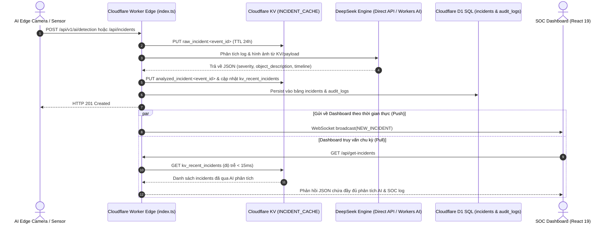

# ĐẶC TẢ KỸ THUẬT: ĐƯỜNG ỐNG LƯU TRỮ LOG INCIDENT VÀO CLOUDFLARE KV, PHÂN TÍCH QUA DEEPSEEK & ĐỒNG BỘ DASHBOARD
**Mã tài liệu:** `SPEC-KV-INCIDENT-PIPELINE-01`  
**Dự án:** Urban Safety AI-SOC (CyberGuard AI v2.1)  
**Phương pháp:** Spec-Driven Development (SDD) & Strict HITL  
**Trạng thái:** Chờ phê duyệt (Stage 1 — Specification)

---

## 1. MỤC TIÊU NGHIỆP VỤ & BỐI CẢNH YÊU CẦU

Kiến trúc sư yêu cầu: *"Hãy viết log incident vào KV để Deepseek xử lý và gửi về dashboard."*

### 1.1. Mục Tiêu Kỹ Thuật:
1. **Lưu Trữ Log Incident Vào Cloudflare KV (`INCIDENT_CACHE`):**
   - Tận dụng Cloudflare KV Namespace (`id: 098d7a2cc02640758d7841ac164886fc`) đã khai báo trong `wrangler.toml`.
   - Khi có bất kỳ request POST sự cố gửi tới (`/api/v1/ai/detection`, `/api/incidents`, `/api/v1/engine/evaluate`), Worker lập tức serialize và ghi bản ghi log vào KV với cơ chế phân vùng khóa có tổ chức.
2. **DeepSeek Đọc & Xử Lý Dữ Liệu Từ KV (In-Process Processing):**
   - Mô hình DeepSeek (Direct API qua `DEEPSEEK_API_KEY` hoặc Workers AI) tiếp nhận dữ liệu log incident từ KV / rolling buffer.
   - Thực hiện phân tích chuyên sâu: đánh giá `severity`, `object_description`, `timeline`, `deepseek_verdict` và sinh bản ghi log kiểm toán chuẩn SOC (`soc_audit_log`).
   - Lưu trữ bản ghi incident đã qua phân tích hoàn chỉnh vào KV namespace: `analyzed_incident:<event_id>` và cập nhật chỉ mục danh sách `kv_recent_incidents`.
3. **Gửi Dữ Liệu Phân Tích Về Dashboard:**
   - **Đường truyền thời gian thực (Push):** Phát sự kiện qua WebSocket stream (`ws://.../ws/live-stream`) với type `"NEW_INCIDENT"`, đính kèm toàn bộ kết quả phân tích DeepSeek để giao diện hiển thị ngay lập tức không cần F5.
   - **Đường truyền truy vấn (Pull):** Cung cấp dữ liệu trực tiếp qua endpoint `GET /api/get-incidents` và `GET /api/get-incident` với nguồn dữ liệu đọc trực tiếp từ KV Cache (độ trễ biên `< 15ms`), fallback về D1 SQL Database và in-memory buffer.

---

## 2. THIẾT KẾ KHÓA DỮ LIỆU CLOUDFLARE KV (KV SCHEMA DESIGN)

| Khóa (Key Pattern) | Kiểu dữ liệu | TTL (Thời gian sống) | Mục đích sử dụng |
|---|---|---|---|
| `raw_incident:<event_id>` | JSON (`IPostRequestLog`) | 86400s (24 giờ) | Lưu trữ bản ghi thô ban đầu nhận được từ edge camera hoặc webhook |
| `analyzed_incident:<event_id>` | JSON (`IDeepSeekIncidentItem`) | 604800s (7 ngày) | Lưu trữ sự cố đã được DeepSeek phân tích đầy đủ kèm SOC log |
| `kv_recent_incidents` | JSON Array (`IDeepSeekIncidentItem[]`) | 86400s (24 giờ) | Danh sách tối đa 100 sự cố phân tích gần nhất phục vụ Dashboard fetch tức thời |
| `soc_audit_log:<log_id>` | JSON (`IStandardSocLogEntry`) | 2592000s (30 ngày) | Nhật ký kiểm toán an ninh SOC lưu trữ bất biến |

---

## 3. SƠ ĐỒ LUỒNG DỮ LIỆU (DATA FLOW DIAGRAM)

---

## 4. RÀNG BUỘC KIẾN TRÚC & HITL INTEGRITY

1. **[CD-04] Dual HITL Integrity:**
   - Mọi bản ghi lưu trữ vào KV (`raw_incident:*`, `analyzed_incident:*`, `kv_recent_incidents`) và gửi tới Dashboard đều **bắt buộc phải có trạng thái khởi tạo `operator_status: "AWAITING_OPERATOR_VERIFICATION"`**.
   - Tuyệt đối không tự ý gán nhãn đã xác nhận trước khi có sự can thiệp của Human Operator.
2. **[CD-05] SOC-Grade Reliability & Zero-Downtime:**
   - Thao tác đọc/ghi KV luôn có khối `try/catch` an toàn và cơ chế in-memory fallback song song. Nếu KV namespace gặp sự cố tạm thời hoặc chạy ở môi trường không có KV binding, hệ thống tự động chuyển tiếp sang bộ đệm bộ nhớ và D1 để không làm nghẽn luồng.
3. **[CD-06] Đồng Bộ Bộ Ba Tài Liệu:**
   - Bắt buộc cập nhật `AGENTS.md`, `README.md` và `PROJECT_STRUCTURE.md` khi hoàn tất.

---

**[WAITING FOR SPEC APPROVAL]**
