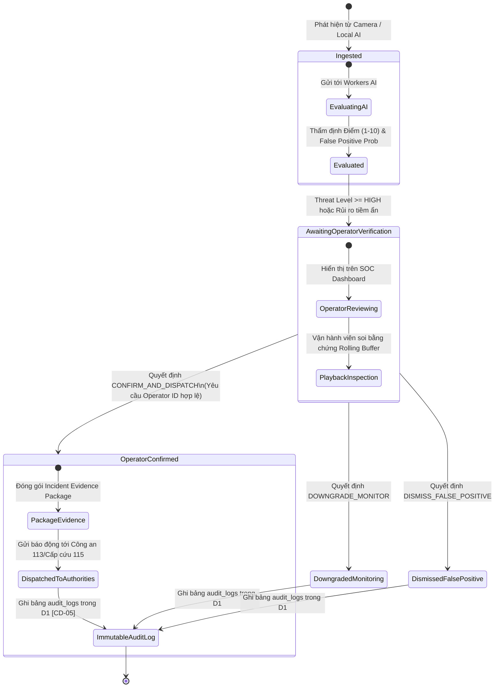

# ĐẶC TẢ KỸ THUẬT: CHUYỂN ĐỔI TOÀN BỘ DASHBOARD FRONTEND & BACKEND SANG CLOUDFLARE WORKER
**Mã tài liệu:** `SPEC-CF-UNIFIED-SOC-01`  
**Dự án:** Hệ thống Giám sát An ninh & An toàn Đô thị Thông minh (Urban Safety AI-SOC)  
**Tài liệu tham chiếu:** `AGENTS.md` (CD-01 đến CD-05, Quy trình 4 bước SDD & HITL Framework)  
**Phân hệ:** Hợp nhất Toàn diện (Edge Unified Stack: React Frontend + Edge REST APIs + WebSockets + Workers AI + D1 Incident Vault)  
**Trạng thái:** CHỜ DUYỆT (STAGE 1 — PENDING SPEC APPROVAL)  
**Ngày soạn thảo:** 2026-11-07  

---

## 1. TỔNG QUAN YÊU CẦU & MỤC TIÊU HỢP NHẤT (EXECUTIVE OVERVIEW)

### 1.1. Hiện trạng Hệ thống (As-Is)
1. **Frontend (`Dashboard/Front End`):** Single Page Application (SPA) viết bằng React 19, TypeScript, Vite, Tailwind CSS v4 với 8 view tác chiến SOC chuyên nghiệp (Dashboard, Live Video Wall, Network Topology, Threat Intelligence, Incident Feed, AI Analyzer, Device Manager, Settings) cùng Modal điều tra bằng chứng video & xác thực HITL.
2. **Backend Node.js (`Dashboard/Back End`):** Máy chủ Express.js kết hợp `ws` WebSocket server chạy trên cổng cục bộ 8000, cung cấp các API đo lường viễn trắc (`/api/soc/overview`), quản lý camera và điều khiển PTZ (`/api/devices/cameras`, `/api/cameras/:id/ptz`), quản lý sự cố & bộ đệm bằng chứng (`/api/incidents/recent`, `/api/incidents/:id/playback`), chốt chặn Operational HITL (`/api/incidents/:id/verify`), và kiểm toán (`/api/soc/audit-logs`).
3. **Cloudflare Edge Gateway (`CloudflareWorker/`):** Đã cấu hình Wrangler với Workers AI Binding (`@cf/deepseek-ai/deepseek-v4.1-flash-1017` / `@cf/meta/llama-3.2-11b-vision-instruct`), Cloudflare D1 SQL Database (`urban_soc_db` ID: `7e878040-e58d-4dfd-9988-2d97a0de223b`), và KV Cache.

### 1.2. Mục tiêu Chuyển đổi (To-Be)
Hợp nhất **toàn bộ 100%** Dashboard Frontend và Backend vào trong dự án **`CloudflareWorker`** thành một kiến trúc **Edge-Native Unified Application**:
- **Frontend SPA Static Assets:** Tích hợp trực tiếp build bundle từ `Dashboard/Front End` vào Worker thông qua cơ chế **Cloudflare Workers Static Assets** (`[assets]` binding của Cloudflare Wrangler). Mọi truy cập vào web root (`/`, `/index.html`, `/assets/*`) sẽ được phân phối tức thì từ Cloudflare Global Edge CDN với độ trễ siêu thấp (< 15ms), hỗ trợ HTML5 Single Page Routing (`not_found_handling = "single-page-application"`).
- **Backend Edge REST APIs:** Chuyển đổi toàn bộ logic từ Express.js (`cameraManager`, `telemetryEngine`, `incidentManager`, `hitlDispatcher`) sang chuẩn TypeScript Edge Fetch Handler, kết nối trực tiếp với Cloudflare D1 SQL và KV Namespace.
- **WebSocket Streaming tại Biên (`/ws/live-stream`):** Tận dụng chuẩn Cloudflare Workers Native WebSocket (`WebSocketPair`) để nâng cấp HTTP sang WebSocket, duy trì phiên kết nối thời gian thực và stream định kỳ (200ms) các chỉ số viễn trắc mạng và tọa độ bám vết AI (bounding boxes) cho Frontend.
- **Workers AI Forensic Evaluator:** Giữ nguyên và liên kết chặt chẽ với `/api/v1/engine/evaluate`, tự động lưu trữ các sự cố được đánh giá vào D1 SQL Database.
- **Bảo toàn Chốt chặn Operational HITL (`[CD-04]` & `[CD-05]`):** Đảm bảo 100% quy trình xác nhận của Vận hành viên (Human Operator) trước khi phát lệnh điều phối đến cơ quan chức năng, ghi nhật ký kiểm toán bất biến (immutable audit logs) vào bảng `audit_logs` của Cloudflare D1.

---

## 2. KIẾN TRÚC HỆ THỐNG HỢP NHẤT (UNIFIED ARCHITECTURE)

```mermaid
flowchart TD
    subgraph CLIENT["Trình duyệt Vận hành viên (Client Browser)"]
        UI["React SPA Dashboard (8 View Tác chiến + Modal HITL)"]
        WS_CLIENT["WebSocket Client (/ws/live-stream)"]
        REST_CLIENT["REST API Fetch Client (/api/...)"]
    end

    subgraph CLOUDFLARE_WORKER["Cloudflare Worker (All-in-One Edge Worker)"]
        FETCH_HANDLER["Worker Fetch Event Handler (src/index.ts)"]
        ROUTER{"URL & Method Router"}
        
        subgraph ASSETS_SERVICE["Workers Static Assets (Edge CDN)"]
            SPA_ASSETS["React Production Bundle (HTML, CSS, JS, Assets)"]
        end

        subgraph BACKEND_EDGE_MODULES["Backend Core Edge Modules"]
            TELEMETRY["Telemetry & Risk Engine (src/telemetry.ts)"]
            CAMERA_MGR["Camera Fleet & PTZ Engine (src/camera_manager.ts)"]
            INCIDENT_MGR["Incident & Evidence Buffer (src/incident_manager.ts)"]
            HITL_GATE["Operational HITL Dispatcher (src/hitl_dispatcher.ts)"]
            WS_BROKER["Native WebSocket Stream Broker (WebSocketPair)"]
        end

        subgraph AI_AND_STORAGE["Workers AI & Edge Data Vault"]
            WORKERS_AI["Cloudflare Workers AI\n(DeepSeek / Llama 3.2 Vision)"]
            D1_VAULT["Cloudflare D1 SQL Vault\n(incidents, audit_logs)"]
            KV_CACHE["Cloudflare KV\n(INCIDENT_CACHE)"]
        end
    end

    subgraph LOCAL_CV_ENGINE["Tầng Trí tuệ Nhân tạo Biên Cục bộ (Local Engine)"]
        YOLO_ENGINE["ThreatMarkingEngine (YOLO11-Pose + Rules)"]
    end

    subgraph EXTERNAL["Cơ quan Chức năng (Dispatch Target)"]
        AUTHORITIES["Công an 113 / Cấp cứu 115 / Đội Phản ứng Nhanh"]
    end

    %% Client Interactions
    UI -->|1. Yêu cầu tải trang /| FETCH_HANDLER
    FETCH_HANDLER -->|Đường dẫn tĩnh /assets/*| ROUTER
    ROUTER -->|Static Asset Request| SPA_ASSETS
    SPA_ASSETS -->|Trả về HTML/JS/CSS Bundle| UI

    REST_CLIENT -->|2. Gọi API REST /api/*| FETCH_HANDLER
    FETCH_HANDLER -->|API Request| ROUTER
    
    WS_CLIENT -->|3. Nâng cấp kết nối /ws/live-stream| FETCH_HANDLER
    FETCH_HANDLER -->|Upgrade: websocket| WS_BROKER
    WS_BROKER -->|Live Tick: Bounding Box & Telemetry (200ms)| WS_CLIENT

    %% API Routing
    ROUTER -->|GET /api/soc/overview| TELEMETRY
    ROUTER -->|GET /api/devices/cameras, POST /ptz| CAMERA_MGR
    ROUTER -->|GET /api/incidents/recent, /playback| INCIDENT_MGR
    ROUTER -->|POST /api/incidents/:id/verify| HITL_GATE
    ROUTER -->|POST /api/v1/engine/evaluate| WORKERS_AI

    %% Local CV to Worker
    YOLO_ENGINE -->|Đẩy kết quả nhận diện tiền/hậu phạm tội| ROUTER

    %% Storage & HITL Connections
    WORKERS_AI -->|Lưu Incident thẩm định| D1_VAULT
    INCIDENT_MGR <-->|Truy vấn dữ liệu sự cố| D1_VAULT
    HITL_GATE -->|Ghi log kiểm toán bất biến CD-05| D1_VAULT
    HITL_GATE -->|Cập nhật trạng thái OPERATOR_CONFIRMED| D1_VAULT

    %% Operational HITL Strict Enforcement
    HITL_GATE -->|CHỈ KHI VẬN HÀNH VIÊN XÁC NHẬN| AUTHORITIES
```

---

## 3. DANH MỤC API ENDPOINTS & GIAO THỨC TRUYỀN THÔNG (API CONTRACTS)

### 3.1. Phân nhóm Endpoints Backend được Chuyển đổi sang Worker

| STT | Phương thức | Endpoint Path | Mục đích Nghiệp vụ | Nguồn Dữ liệu / Xử lý |
|---|---|---|---|---|
| **E-01** | `GET` | `/` hoặc `/*` (ngoài `/api` & `/ws`) | Phục vụ Giao diện Dashboard React SPA | Cloudflare Workers Static Assets (`env.ASSETS`) |
| **E-02** | `GET` | `/api/soc/overview` | Tổng quan an ninh, chỉ số mạng, threatScore, PoE, băng thông | `telemetry.ts` (kết hợp dữ liệu D1) |
| **E-03** | `GET` | `/api/devices/cameras` | Danh sách 4 camera, trạng thái AI streaming và bounding boxes | `camera_manager.ts` (kinematic simulation) |
| **E-04** | `POST` | `/api/cameras/:id/ptz` | Điều khiển PTZ (Zoom, Pan, Tilt, Auto-Focus) | `camera_manager.ts` |
| **E-05** | `GET` | `/api/incidents/recent` | Danh sách sự cố an ninh gần đây cho bảng điều khiển SOC | Kết hợp D1 `incidents` & active incident buffer |
| **E-06** | `GET` | `/api/incidents/:id/playback` | Trích xuất video clip bằng chứng từ Rolling Buffer & VLM reasoning | `incident_manager.ts` (D1 + evidence buffer) |
| **E-07** | `POST` | `/api/incidents/:id/verify` | **Chốt chặn Operational HITL (`[CD-04]`):** Xác nhận / Hạ cấp / Hủy bỏ sự cố | `hitl_dispatcher.ts` (ghi D1 + audit log) |
| **E-08** | `GET` | `/api/soc/audit-logs` | Truy xuất toàn bộ lịch sử kiểm toán bất biến chuẩn SOC (`[CD-05]`) | Bảng `audit_logs` trong Cloudflare D1 |
| **E-09** | `POST` | `/api/v1/engine/evaluate` | Tiếp nhận telemetry từ Local Engine, chạy Workers AI & lưu D1 | `ai_evaluator.ts` + `db.ts` |
| **E-10** | `GET` | `/api/v1/incidents` | Query danh sách sự cố với bộ lọc đa tiêu chí (camera, severity, status) | Bảng `incidents` trong Cloudflare D1 |
| **E-11** | `GET` | `/api/v1/incidents/:id` | Chi tiết 1 sự cố cụ thể kèm thông số đối tượng, hung khí | Bảng `incidents` trong Cloudflare D1 |
| **E-12** | `GET` | `/api/v1/health` | Kiểm tra sức khỏe toàn diện của Edge Worker, AI, D1 và Assets | Phản hồi JSON trạng thái kết nối |
| **E-13** | `GET` | `/ws/live-stream` | **WebSocket Nâng cấp:** Stream Bounding Box & Telemetry liên tục (200ms) | `WebSocketPair` của Cloudflare Worker |

---

## 4. ĐẶC TẢ SCHEMA DỮ LIỆU TYPESCRIPT CHI TIẾT (STRICT DATA SCHEMAS)

```typescript
/**
 * 4.1. Telemetry Overview Schema (/api/soc/overview)
 */
export interface ISocOverviewResponse {
  threatLevel: "LOW" | "MEDIUM" | "HIGH" | "CRITICAL";
  threatScore: number; // 0 - 100
  status: "SAFE" | "GUARDED" | "ELEVATED" | "SEVERE";
  timestampUtc: string; // ISO-8601
  metrics: {
    latencyMs: number;
    downloadMbps: number;
    uploadMbps: number;
    activeNodes: number;
    camerasOnline: number;
    camerasTotal: number;
    packetLossPercent: number;
    openThreats: number;
    criticalThreats: number;
    nvrStoragePercent: number;
    poeLoadWatts: number;
  };
}

/**
 * 4.2. Camera & PTZ State Schema (/api/devices/cameras & /api/cameras/:id/ptz)
 */
export interface IAIBoundingBox {
  id: string;
  label: string; // e.g. "PERSON 98%", "VEHICLE 94%"
  subLabel: string; // "INTRUSION", "LOITERING", "MONITORED"
  severity: "NORMAL" | "HIGH" | "CRITICAL";
  x: number; // Tọa độ chuẩn hóa 0.0 - 1.0
  y: number;
  w: number;
  h: number;
}

export interface IPtzState {
  zoom: number; // 1.0 - 5.0
  pan: number;  // 0 - 360 độ
  tilt: number; // -90 đến +90 độ
  focus: string; // "AUTO" | "LOCKED_99%"
}

export interface ICameraDevice {
  id: string;
  name: string;
  ip: string;
  fps: number;
  bitrateKbps: number;
  status: "ONLINE" | "OFFLINE" | "DEGRADED";
  streamUrl: string;
  ptzEnabled: boolean;
  ptzState: IPtzState;
  boundingBoxes: IAIBoundingBox[];
}

export interface IPtzCommandRequest {
  action: "ZOOM_IN" | "ZOOM_OUT" | "PAN" | "AUTO_FOCUS";
  speed?: number; // mặc định 1
}

/**
 * 4.3. Incident & Evidence Playback Schema (/api/incidents/recent & /api/incidents/:id/playback)
 */
export interface IIncidentItem {
  id: string;
  title: string;
  subTitle: string;
  sourceIp: string;
  category: "NETWORK" | "PHYSICAL_CAMERA";
  severity: "LOW" | "MEDIUM" | "HIGH" | "CRITICAL";
  timestamp: string;
  cameraId?: string | null;
  cameraSnapshots?: {
    preEventSnapshotUrl?: string;
    eventPeakSnapshotUrl?: string;
  } | null;
  playbackUrl?: string | null;
  status: "PENDING_VERIFICATION" | "OPERATOR_CONFIRMED" | "DOWNGRADED_MONITORING" | "DISMISSED";
  vlmAnalysis?: string;
}

export interface IIncidentPlaybackResponse {
  incidentId: string;
  title: string;
  cameraId?: string | null;
  timestamp: string;
  bufferRange: {
    preEventSeconds: number;
    postEventSeconds: number;
    totalDurationSeconds: number;
  };
  vlmReasoning?: string;
  visualEvidence: {
    preEventSnapshot: string | null;
    eventPeakSnapshot: string | null;
    streamPlaybackUrl: string | null;
  };
  status: string;
}

/**
 * 4.4. Chốt chặn Operational HITL Schema (/api/incidents/:id/verify) - Tuân thủ [CD-04]
 */
export interface IHitlVerificationRequest {
  operatorId: string; // BẮT BUỘC: Không được để trống [CD-04]
  decision: "CONFIRM_AND_DISPATCH" | "DOWNGRADE_MONITOR" | "DISMISS_FALSE_POSITIVE";
  notes?: string;
  verifiedAt?: string; // ISO-8601
}

export interface IIncidentDispatchPackage {
  packageId: string; // PKG-timestamp
  incidentId: string;
  dispatchedByOperator: string;
  verifiedAt: string;
  coordinates: {
    latitude: number;
    longitude: number;
  };
  urgency: "IMMEDIATE_INTERVENTION" | "MONITOR_ONLY" | "NONE";
  notes: string;
  evidenceClipUrl?: string;
}

export interface IHitlVerificationResponse {
  success: boolean;
  decision: string;
  auditEntry: {
    auditId: string;
    incidentId: string;
    operatorId: string;
    decision: string;
    timestamp: string;
    status: string;
  };
  incidentPackage: IIncidentDispatchPackage | null;
  systemThreatScore: number;
}

/**
 * 4.5. WebSocket Live Protocol (/ws/live-stream)
 */
export type WebSocketServerMessage =
  | {
      type: "CONNECTED";
      serverTime: string;
    }
  | {
      type: "TELEMETRY_AND_AI_TICK";
      cameras: ICameraDevice[];
      timestamp: number;
    };
```

---

## 5. MÁY TRẠNG THÁI & CHUYỂN ĐỔI RỦI RO (THREAT STATE MACHINE & HITL WORKFLOW)

Hệ thống tuân thủ nghiêm ngặt máy trạng thái chuyển đổi sự cố theo tiêu chuẩn an ninh tác chiến đô thị:



### Ràng buộc Bất biến của Chốt chặn Vận hành viên (Dual HITL Enforcement):
1. **[HITL-01]** Mọi trường hợp sự cố mới nạp vào hệ thống, cấm tuyệt đối sinh trạng thái `OPERATOR_CONFIRMED` một cách tự động. Giá trị khởi tạo bắt buộc là `AWAITING_OPERATOR_VERIFICATION` (hoặc `PENDING_VERIFICATION`).
2. **[HITL-02]** API Endpoint `/api/incidents/:id/verify` bắt buộc kiểm tra sự tồn tại của chuỗi `operatorId`. Nếu thiếu hoặc rỗng, trả về HTTP `400 Bad Request` kèm thông báo vi phạm bảo mật `SECURITY VIOLATION: Operator ID is mandatory for HITL verification [CD-04]`.
3. **[HITL-03]** Gói hồ sơ sự cố điều phối (`IncidentDispatchPackage`) chỉ được tạo ra khi và chỉ khi `decision === 'CONFIRM_AND_DISPATCH'`.

---

## 6. CẤU TRÚC THƯ MỤC DỰ ÁN HỢP NHẤT TRONG `CloudflareWorker/`

Toàn bộ ứng dụng sau khi chuyển đổi sẽ được tổ chức tinh gọn và chuẩn hóa trong thư mục `CloudflareWorker/`:

```
CloudflareWorker/
├── dist/                              # Thư mục chứa Static Assets build ra từ React Vite Frontend
├── node_modules/                      # Dependencies (TypeScript, Wrangler, @cloudflare/workers-types, v.v.)
├── src/
│   ├── ai_evaluator.ts                # Cloudflare Workers AI Evaluation Engine (DeepSeek / Llama 3.2)
│   ├── camera_manager.ts              # Quản lý danh sách Camera, mô phỏng bounding box & điều khiển PTZ
│   ├── db.ts                          # Tương tác cơ sở dữ liệu Cloudflare D1 SQL (incidents & audit_logs)
│   ├── hitl_dispatcher.ts             # Operational HITL Dispatcher & Đóng gói hồ sơ sự cố [CD-04]
│   ├── incident_manager.ts            # Quản lý sự cố gần đây & Rolling Buffer Playback
│   ├── index.ts                       # Worker Router chính: xử lý REST, WebSockets và Assets fallback
│   ├── telemetry.ts                   # Real-time Telemetry & Dynamic Threat Scoring Engine
│   ├── types.ts                       # Tất cả Data Interfaces & Schemas chuẩn hóa
│   └── websocket.ts                   # Quản lý WebSocket Server qua Cloudflare Native WebSocketPair
├── schema.sql                         # SQL Schema cho bảng incidents và audit_logs của D1
├── package.json                       # Scripts build frontend, deploy worker, database migration
├── pnpm-lock.yaml                     # Lockfile
├── tsconfig.json                      # Cấu hình TypeScript cho Cloudflare Workers
└── wrangler.toml                      # Cấu hình Cloudflare Worker, AI, D1, KV và [assets] binding
```

---

## 7. RÀNG BUỘC HIỆU NĂNG, TÍNH SẴN SÀNG & XỬ LÝ LỖI (SLA & FALLBACKS)

1. **Độ trễ phản hồi (Response Latency):**
   - Các API REST (`/api/soc/overview`, `/api/devices/cameras`, `/api/incidents/recent`): Thời gian xử lý tại Edge P95 < 25ms.
   - Workers AI Forensic Evaluation (`/api/v1/engine/evaluate`): Thời gian suy luận LLM P95 < 1500ms.
   - Static Asset Serving: P95 < 15ms qua Cloudflare CDN Cache.
2. **Cơ chế Fallback khi D1 Database hoặc Workers AI gặp sự cố:**
   - Nếu `env.DB` chưa sẵn sàng: Endpoint `/api/incidents/recent` tự động fallback sang bộ nhớ đệm (in-memory buffer) để bảng điều khiển SOC không bị gián đoạn hiển thị.
   - Nếu `env.AI` gặp lỗi hoặc cạn quota neurons: `WorkersAIEvaluator` tự động kích hoạt `fallbackEvaluate` theo mô hình tính toán động học (kinematic rules) để đảm bảo không bỏ sót sự cố nguy hiểm.
3. **Cơ chế WebSocket Resilience:**
   - Nếu kết nối WebSocket bị đứt, frontend tự động kích hoạt retry sau 3 giây.
   - Frontend đồng thời duy trì chu kỳ Polling REST song song mỗi 2000ms qua `fetchData` trong `useSocTelemetry.ts`, đảm bảo bảng điều khiển luôn có dữ liệu sống ngay cả khi mạng client chặn WebSocket.
4. **Cấu hình Static Assets trong `wrangler.toml`:**
   ```toml
   [assets]
   directory = "./dist"
   binding = "ASSETS"
   html_handling = "auto-trailing-slash"
   not_found_handling = "single-page-application"
   ```

---

## 8. TIÊU CHÍ NGHIỆM THU (ACCEPTANCE CRITERIA)

- [ ] **Giao diện Dashboard:** Truy cập URL của Cloudflare Worker (hoặc `http://localhost:8787` khi chạy `wrangler dev`) hiển thị 100% giao diện React SOC với đầy đủ 8 view tác chiến, hiển thị sắc nét, không lỗi font hoặc vỡ layout.
- [ ] **Kết nối Backend liền mạch:** Chỉ báo trạng thái kết nối trên `TopHeader` hiển thị xanh lá (`CONNECTED`), dữ liệu đo lường viễn trắc (Threat Score, Latency, Bitrate, PoE) cập nhật động liên tục.
- [ ] **Live Camera & AI Detections:** 4 camera hiển thị video wall kèm bounding boxes tự động bám vết mượt mà.
- [ ] **Điều khiển PTZ:** Bấm các nút Zoom In, Zoom Out, Pan, Auto-Focus gửi lệnh tới Worker và cập nhật trạng thái camera thành công.
- [ ] **Điều tra Sự cố & Playback:** Mở Modal bằng chứng sự cố hiển thị ảnh snapshot trước và trong sự kiện, xem được lý giải phân tích từ AI/VLM.
- [ ] **Bảo toàn Chốt chặn Operational HITL (`[CD-04]`):** Bấm xác nhận điều phối hoặc hủy báo động giả yêu cầu đúng `operatorId`, cập nhật trạng thái sự cố và lưu vết bất biến vào D1 `audit_logs` (`[CD-05]`).
- [ ] **Deploy Sẵn sàng lên Cloudflare:** Chạy lệnh `pnpm run build && wrangler deploy` không gặp lỗi biên dịch TypeScript, bundle static assets được tải lên Cloudflare Workers thành công.

---
**[STATUS: COMPLETED STAGE 1 SPECIFICATION — WAITING FOR SPEC APPROVAL]**
