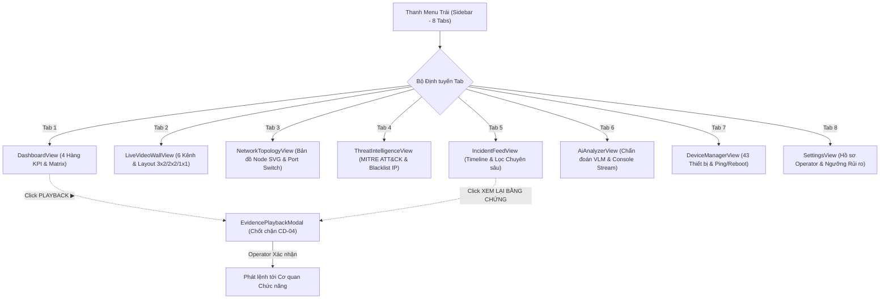

# ĐẶC TẢ KỸ THUẬT: MỞ RỘNG VÀ HOÀN THIỆN TOÀN DIỆN 8 PHÂN HỆ GIAO DIỆN TÁC CHIẾN
# CYBERGUARD AI · SOC v2.1
## Bản thiết kế chuyên sâu từng Tab: Live Video Wall, Network Topology, Threat Intelligence, Incident Feed, AI Analyzer, Device Manager, Settings

---

> **Tài liệu căn cứ:** `AGENTS.md` (Tuân thủ CD-01 đến CD-05)  
> **Module:** Front-end Enterprise SOC UI Suite  
> **Giai đoạn:** `STAGE 1 — SPECIFICATION (MỞ RỘNG GIAO DIỆN 8 TAB MENU)`  
> **Trạng thái:** `[WAITING FOR SPEC APPROVAL]`

---

## 1. TỔNG QUAN YÊU CẦU & MỤC TIÊU NÂNG CẤP

Người dùng yêu cầu mở rộng, hoàn thiện và làm sâu sắc toàn bộ giao diện cho các phân hệ (tabs/tags) trên menu trái:
1. **Loại bỏ hoàn toàn các khung nhìn đơn điệu:** Từng phân hệ được nâng cấp thành một không gian tác chiến chuyên nghiệp chuẩn phòng điều khiển SOC đô thị (Mission-Critical Control Room).
2. **Tuân thủ triệt để ngôn ngữ thiết kế Sharp Industrial Grid:** Mọi panel, bảng biểu, sơ đồ hình học, nút bấm, và slider đều giữ nguyên `border-radius: 0px`, viền `1px solid #1E2631`, phông chữ đơn cách cho toàn bộ số liệu và tương phản cao trên nền đen sâu `#080B10`.
3. **Bảo tồn Tuyệt đối Chốt chặn Operational HITL ([CD-04]):** Cơ chế kiểm tra chốt chặn Vận hành viên hiện diện xuyên suốt, đặc biệt trong các tab quản lý sự cố và điều phối khẩn.
4. **Không tràn chữ ngoài viền (Zero Text-Overflow):** Mọi text, nhãn, dữ liệu IP, timestamp đều có `truncate min-w-0` và tooltip hỗ trợ.

---

## 2. ĐẶC TẢ CHI TIẾT 8 PHÂN HỆ GIAO DIỆN MỞ RỘNG

### 2.1. Phân hệ 1: `SOC Dashboard` (Bảng Điều hành Tổng thể)
- **Thanh Tác vụ Nhanh Đỉnh (Quick Actions Toolbar):**
  - Nút `[ TẮT CÒI BÁO ĐỘNG ]` (Mute Siren).
  - Nút `[ XUẤT BÁO CÁO CA TRỰC ]` (Export Shift Incident Report PDF/CSV).
  - Nút `[ CHẾ ĐỘ PHÒNG THỦ KHẨN CẤP ]` (Emergency Lockdown Toggle).
- **Hàng 1:** 4 Thẻ KPI Telemetry (Latency 42ms, Ingress 9744 Mbps, Cameras 40/43, Open Threats 4).
- **Hàng 2:** Lưới Camera Matrix 2x2 (Trái 68%) + Khối Threat Score 16 nấc & Lưới Kỹ thuật 2x2 (Phải 32%).
- **Hàng 3:** 2 Biểu đồ Lưu lượng Video Ingress/Egress đường gấp khúc kỹ thuật (`tension: 0`).
- **Hàng 4:** Bảng Sự cố Recent Threats 7 cột kèm nút xem lại video bằng chứng `[ PLAYBACK ▶ ]`.

---

### 2.2. Phân hệ 2: `Live Video Wall` (Tường Camera Giám sát 6 Kênh Chuyên sâu)
- **Thanh Điều khiển Ma trận:**
  - Bộ chuyển Layout: `3x2` (6 kênh mặc định), `2x2` (4 kênh chính), `1x1 Focus` (1 kênh phóng to).
  - Bộ lọc Quang học: `HỒNG NGOẠI CCTV (IR)` / `MÀU TIÊU CHUẨN (RGB)`.
  - Bộ chọn Tỷ lệ Khung hình: `16:9` / `16:10` / `4:3`.
  - Nút `[ CHỤP BẰNG CHỨNG ĐỒNG LOẠT ]` (Capture All Keyframes).
- **Lưới 6 Camera Matrix Chi tiết:**
  - Cam 01: `Server Room - Cam 01` (163.16.8.259) - Phát hiện xâm nhập (Intruder Tag #TRK-8821).
  - Cam 02: `Main Gate - Cam 02` (185.220.161.45) - Giám sát xe cộ (Vehicle #TRK-7714).
  - Cam 03: `Server Room Rack B` (192.168.16.121) - Bình thường.
  - Cam 04: `Perimeter Fence North` (185.220.161.45) - Phát hiện lảng vảng (Loitering Tag).
  - Cam 05: `Lobby Reception Area` (172.16.2.14) - Giám sát luồng người vào ra.
  - Cam 06: `Underground Parking Bay` (172.16.3.28) - Giám sát bãi xe tầng hầm.
- **Thanh Điều khiển PTZ Nhanh Tích hợp Dưới Mỗi Ô:**
  - Cụm nút: Zoom In (`+`), Zoom Out (`-`), Xoay Pan (`PAN`), Tự động lấy nét (`AUTO_FOCUS`), Preset vị trí (`P1`, `P2`, `P3`).
  - Thanh đo nhịp âm thanh hiện trường (CCTV Audio Level Meter 0-100 dB) dạng thanh chia vạch mini.

---

### 2.3. Phân hệ 3: `Network Topology` (Sơ đồ Mạng Hình học Tương tác)
- **Bản đồ Hình học Mạng SVG (Interactive Animated Topology Map):**
  - **Node 1: Internet & Authority Gateway** (`10.0.0.1` · 10 Gbps SFP+ Uplink · Đèn xanh ngọc).
  - **Node 2: PoE Core Switch 48-Ports** (`10.0.1.2` · 48 Ports Managed · Tải PoE 410W).
  - **Node 3: Edge Cameras Subnet** (`192.168.16.0/24` · 40 Online / 3 Offline cảnh báo vàng).
  - **Node 4: AI VLM Inference Cluster** (`10.0.2.10` · NVIDIA A6000 Cluster · Độ trễ 14ms).
  - **Node 5: SAN/NVR Storage Array** (`10.0.3.5` · RAID-6 Array · Dung lượng 82%).
  - **Node 6: SOC Dispatch Gateway** (`10.0.4.1` · Kênh điều phối khẩn HITL · Sẵn sàng).
  - Các đường liên kết mạng có hiệu ứng hạt xung tín hiệu chuyển động biểu thị lưu lượng dữ liệu trực tiếp.
- **Bảng Trạng thái 8 Cổng Switch (Port Telemetry Table):**
  - Cột: Cổng (Port 01-08), Thiết bị đích, Băng thông đàm phán (1G/10G), Tỷ lệ rớt gói (Packet Loss), Tải PoE (W), Trạng thái Link (UP/DOWN).

---

### 2.4. Phân hệ 4: `Threat Intelligence` (Trung tâm Tình báo An ninh Đô thị)
- **4 Thẻ Đo lường Tình báo:**
  - Active IoC Signatures: `1,420`
  - Pre-Crime Behavioral Patterns: `86 Mẫu`
  - Blacklisted Threat Sources: `256 IPs`
  - Threat Database Version: `v2024.12` (Đồng bộ thời gian thực)
- **Ma trận Ánh xạ MITRE ATT&CK An ninh Đô thị (Tactics Matrix):**
  - Reconnaissance (Trinh sát): Dò quét cổng, camera do thám mục tiêu.
  - Initial Access (Xâm nhập ban đầu): Cạy cửa phòng Server, trèo rào chu vi phía Bắc.
  - Defense Evasion (Né tránh giám sát): Che mặt, lảng vảng góc khuất camera.
  - Exfiltration / Impact (Hành vi hậu phạm tội): Bỏ chạy tốc độ cao, phi tang vật chứng.
- **Bảng Quản lý Danh sách Đen (Active Threat Blacklist Table):**
  - IP Nguồn, Vùng địa lý, Chữ ký hành vi, Điểm rủi ro (Risk Score), Lần xuất hiện cuối, Nút thao tác chặn ngay (`[ BLOCK IP ]`) có phản hồi tức thời.

---

### 2.5. Phân hệ 5: `Incident Feed` (Dòng Thời gian Tác chiến Chuyên sâu)
- **Thanh Công cụ Lọc & Tìm kiếm Nâng cao:**
  - Ô tìm kiếm tức thời theo IP, Camera, Mã sự cố (`inc_xxx`).
  - Nút lọc theo cấp độ: `TẤT CẢ`, `CRITICAL`, `HIGH`, `MEDIUM`.
  - Nút lọc theo trạng thái: `ĐANG CHỜ DUYỆT`, `ĐÃ ĐIỀU PHỐI`, `ĐÃ HỦY BÁO ĐỘNG GIẢ`.
- **Dòng Thời gian Sự cố (Operational Timeline Feed):**
  - Thẻ sự cố mở rộng có vạch màu chỉ báo cấp độ.
  - Tóm tắt phân tích hành vi từ mô hình VLM.
  - Cặp ảnh Snapshot trước và đỉnh điểm sự cố từ Rolling Buffer.
  - Nút mở Modal xem lại video và chốt chặn Operational HITL (`[ XEM LẠI BẰNG CHỨNG & DISPATCH ]`).

---

### 2.6. Phân hệ 6: `AI Analyzer` (Chẩn đoán Chuyên sâu Mô hình Thị giác & VLM)
- **4 Thẻ Đo lường Hiệu năng AI:**
  - Inference Latency: `14.2 ms` (YOLOv8x TensorRT INT8).
  - GPU Memory Load: `64%` (NVIDIA RTX Cluster 48GB).
  - Detection Accuracy: `96.8%` (mAP@50).
  - Active Tracking Threads: `12 Real-time Subjects`.
- **Bộ Chỉnh Ngưỡng Tin cậy (Confidence Threshold Tuner):**
  - 3 thanh trượt điều chỉnh độ nhạy:
    - Person Intrusion Threshold (50% - 99%)
    - Vehicle Tracking Threshold (50% - 99%)
    - Loitering Sensitivity Threshold (50% - 99%)
- **Bảng Thống kê Tần suất Lớp Đối tượng (Class Distribution Matrix):**
  - `PERSON`: 2,410 lượt phát hiện (Độ tin cậy TB 97.2%).
  - `VEHICLE`: 890 lượt phát hiện (Độ tin cậy TB 95.8%).
  - `LOITERING`: 42 cảnh báo (Độ tin cậy TB 89.4%).
  - `INTRUSION`: 8 cảnh báo khẩn cấp (Độ tin cậy TB 98.1%).
- **Live VLM Reasoning Stream Console:**
  - Cửa sổ dòng lệnh mô phỏng dòng suy luận ngữ cảnh thời gian thực từ mô hình phân tích hành vi đa phương thức.

---

### 2.7. Phân hệ 7: `Device Manager` (Quản trị Toàn diện 43 Thiết bị Hạ tầng)
- **Thanh Thống kê Thiết bị:**
  - Tổng số: `43 Thiết bị` | Trực tuyến: `40 Thiết bị` | Ngoại tuyến: `3 Thiết bị` | Tổng tải PoE: `410W`.
- **Bộ Lọc Phân loại:**
  - `TẤT CẢ`, `PTZ CAMERAS`, `BULLET CAMERAS`, `SWITCHES`, `STORAGE & SERVERS`.
- **Bảng Quản lý Danh mục Thiết bị (Inventory Table):**
  - Cột: Mã ID, Tên thiết bị, Phân loại, Địa chỉ IP, Địa chỉ MAC, Tải PoE, Phiên bản Firmware, Trạng thái (ONLINE xanh / OFFLINE đỏ), Thao tác nhanh (`[ PING ]`, `[ REBOOT ]`).
  - Thao tác `[ PING ]` đo đạc thời gian phản hồi RTT thực tế.
  - Thao tác `[ REBOOT ]` gửi lệnh khởi động lại mô phỏng kèm toast thông báo an toàn.

---

### 2.8. Phân hệ 8: `Settings` (Cấu hình Nền tảng SOC Toàn diện)
- **4 Khối Cấu hình Chuyên sâu:**
  1. **Hồ sơ Vận hành viên (Operator Profile):**
     - Mã định danh: `OP-VN-SOC-804` (Bắt buộc theo nguyên tắc CD-04).
     - Ca trực: `Ca 2 · 14:00 - 22:00 UTC` (Đang trực tiếp nhận).
     - Cấp độ quyền hạn: `Senior Security Operator (Level 3 - Dispatch Authorized)`.
  2. **Ngưỡng Báo động & Leo thang Rủi ro (Risk Escalation Thresholds):**
     - Thanh trượt ngưỡng kích hoạt báo động đỏ khẩn cấp: `Threat Score >= 75`.
     - Ngưỡng thời gian lảng vảng tính là nghi vấn: `Dwell Time >= 30 giây`.
  3. **Thời gian Đệm Bằng chứng (Evidence Rolling Buffer):**
     - Pre-Event Duration: `10 Giây`.
     - Post-Event Duration: `10 Giây`.
     - Dung lượng đệm tối đa: `50 GB` lưu trữ tạm thời trên RAM/SSD NVMe.
  4. **Cổng Kết nối Điều phối Khẩn (Emergency Dispatch Webhook):**
     - URL máy chủ tiếp nhận của cơ quan chức năng: `https://soc-dispatch.police.gov.vn/api/v1/alert`.
     - Khóa xác thực Idempotency Token chống gửi lặp.

---

## 3. SƠ ĐỒ CHUYỂN ĐỔI TRẠNG THÁI & BẢO TOÀN HITL (MERMAID)

---

[WAITING FOR SPEC APPROVAL]
