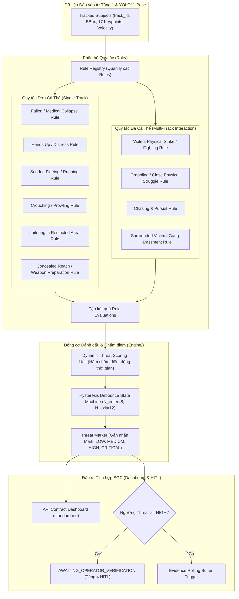
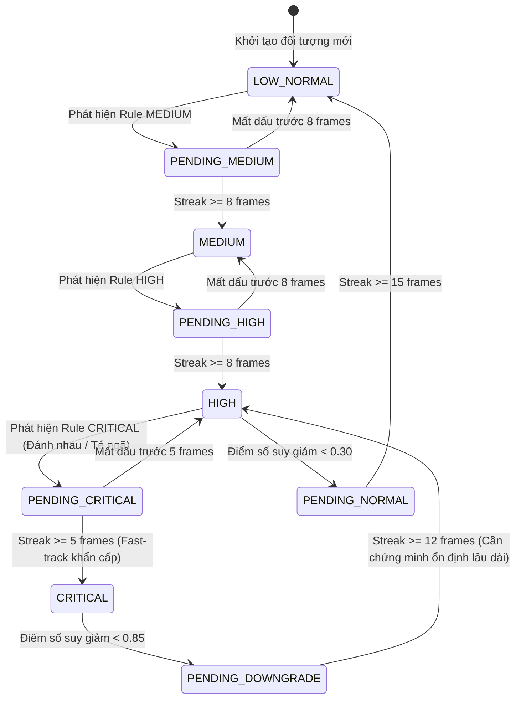

# ĐẶC TẢ KỸ THUẬT: HỆ THỐNG QUY TẮC NHẬN DIỆN HÀNH VI (RULE) & ĐỘNG CƠ ĐÁNH DẤU MỨC ĐỘ ĐE DỌA (ENGINE)
**Mã tài liệu:** `SPEC-URBAN-RULE-ENGINE-01`  
**Dự án:** Hệ thống Giám sát An ninh & An toàn Đô thị Thông minh (Urban Safety AI-SOC)  
**Phân hệ:** Tầng 2 (AI/Pose & Behavior Analytics) & Tầng 3 (Tracking & Dynamic Threat Scoring)  
**Cơ chế thực thi:** Spec-Driven Development (SDD) — Giai đoạn 1 (Stage 1 Specification)  
**Trạng thái:** Chờ phê duyệt từ Lead Architect (`[WAITING FOR SPEC APPROVAL]`)

---

## 1. MỤC TIÊU & TỔNG QUAN KIẾN TRÚC

Dựa trên kết quả phân tích hệ thống `Hackathon-Test-` và các ràng buộc tối cao trong `AGENTS.md`, phân hệ này tách bạch rõ ràng giữa hai trách nhiệm nghiệp vụ:
1. **Thư mục `Rule/` (Behavior Rules System):** Chịu trách nhiệm chứa các quy tắc hình học, động học và phân tích tương tác không gian - thời gian từ dữ liệu khung xương (COCO-17 Keypoints) và hộp bao (Bounding Box) để phát hiện các mẫu hành vi cụ thể (hành vi đơn lẻ và hành vi tương tác đa cá thể).
2. **Thư mục `Engine/` (Threat Scoring & Marking Engine):** Chịu trách nhiệm tổng hợp điểm số từ các Rule, áp dụng hàm chấm điểm động theo chuỗi thời gian (Temporal Threat Scoring), vận hành máy trạng thái trễ (Hysteresis Debounce) để khử hiện tượng nhảy nhãn (Anti-Flapping), và gán nhãn mức độ đe dọa (**Threat Mark**) cho từng đối tượng trước khi đẩy sang Tầng 4 (Operational HITL & Dashboard).



---

## 2. ĐỊNH NGHĨA DỮ LIỆU & SCHEMA (STRICT STRUCTURED SCHEMAS)

Tất cả các thành phần trong `Rule/` và `Engine/` bắt buộc phải sử dụng các schema dữ liệu chuẩn hóa, tương thích với chuẩn đầu ra của Urban Safety AI-SOC và API Contract trong `Dashboard/Back End/standard.md`.

```python
from enum import Enum
from typing import List, Tuple, Dict, Optional, Any
from pydantic import BaseModel, Field


class ThreatLevel(str, Enum):
    """4 cấp độ đe dọa chuẩn SOC tương ứng với các Mark hiển thị."""
    LOW = "LOW"          # An toàn / Sinh hoạt bình thường (Xanh lá)
    MEDIUM = "MEDIUM"    # Nghi vấn / Tiền phạm tội mức nhẹ (Vàng)
    HIGH = "HIGH"        # Rủi ro cao / Báo động màn hình SOC (Cam)
    CRITICAL = "CRITICAL"# Khẩn cấp / Đang xảy ra hành vi bạo lực hoặc nguy hiểm (Đỏ)


class BehaviorCategory(str, Enum):
    """Phân nhóm bản chất hành vi theo nghiệp vụ an ninh đô thị."""
    BENIGN = "BENIGN"                      # Bình thường
    PRE_CRIME = "PRE_CRIME"                # Dấu hiệu tiền phạm tội
    IN_PROGRESS_CRIME = "IN_PROGRESS_CRIME"# Hành vi đang diễn ra
    POST_CRIME = "POST_CRIME"              # Hành vi hậu phạm tội
    MEDICAL_DISTRESS = "MEDICAL_DISTRESS"  # Khẩn cấp y tế / Cầu cứu


class BehaviorType(str, Enum):
    """Danh mục hành vi mở rộng phục vụ AI-SOC."""
    NORMAL = "NORMAL"
    CROUCHING_PROWLING = "CROUCHING_PROWLING"
    LOITERING = "LOITERING"
    CONCEALED_REACH = "CONCEALED_REACH"
    HANDS_UP_DISTRESS = "HANDS_UP_DISTRESS"
    SUDDEN_FLEEING = "SUDDEN_FLEEING"
    FIGHTING_STRIKE = "FIGHTING_STRIKE"
    GRAPPLING_STRUGGLE = "GRAPPLING_STRUGGLE"
    CHASING_PURSUIT = "CHASING_PURSUIT"
    SURROUNDED_VICTIM = "SURROUNDED_VICTIM"
    FALLEN_COLLAPSE = "FALLEN_COLLAPSE"


class KeypointData(BaseModel):
    """Tọa độ và độ tin cậy của 1 khớp giải phẫu (COCO-17)."""
    id: int
    name: str
    x: float
    y: float
    confidence: float


class SubjectKinematicsSnapshot(BaseModel):
    """Dữ liệu động học của một đối tượng tại một thời điểm."""
    track_id: int
    bbox: Tuple[int, int, int, int]           # (x1, y1, x2, y2)
    centroid: Tuple[float, float]             # (cx, cy)
    keypoints: Dict[int, KeypointData]        # keypoint_id -> KeypointData
    spine_angle_deg: float                    # Góc nghiêng cột sống so với phương thẳng đứng (0° đến 90°)
    aspect_ratio: float                       # Chiều cao / Chiều rộng (H / W)
    velocity_norm: float                      # Vận tốc dịch chuyển chuẩn hóa (body-heights / sec)
    wrist_kinetic_energy: float               # Động năng dịch chuyển 2 cổ tay
    dwell_time_seconds: float                 # Thời gian xuất hiện liên tục trong khung hình


class RuleEvaluationResult(BaseModel):
    """Kết quả đánh giá từ một Rule riêng lẻ."""
    rule_name: str
    behavior_type: BehaviorType
    category: BehaviorCategory
    matched: bool
    confidence: float = Field(ge=0.0, le=1.0)
    base_threat_score: float = Field(ge=0.0, le=1.0)
    reasoning: str
    interacting_with_track_ids: List[int] = Field(default_factory=list)
    metadata: Dict[str, Any] = Field(default_factory=dict)


class SubjectThreatMark(BaseModel):
    """Nhãn Mark đánh dấu mức độ đe dọa được gán cho một đối tượng sau khi qua Engine."""
    track_id: int
    threat_level: ThreatLevel
    threat_score: float = Field(ge=0.0, le=1.0)
    confirmed_behavior: BehaviorType
    behavior_category: BehaviorCategory
    dwell_time_seconds: float
    state_dwell_seconds: float                 # Thời gian duy trì liên tục ở Mark hiện tại
    is_escalated: bool                         # Đánh dấu có sự leo thang mức đe dọa hay không
    requires_operator_attention: bool          # Cờ kích hoạt Operational HITL (Threat >= HIGH)
    interacting_partners: List[int] = Field(default_factory=list)
    diagnostic_summary: str
    color_hex: str                             # Mã màu trực quan: #00E676 (Green), #FFD600 (Yellow), #FF9100 (Orange), #FF1744 (Red)


class SOCEngineOutput(BaseModel):
    """Gói dữ liệu hoàn chỉnh của Engine sau mỗi frame, tương thích API contract."""
    frame_index: int
    timestamp: str                             # ISO-8601: YYYY-MM-DD HH:MM:SS.mmm
    subjects_count: int
    threat_marks: List[SubjectThreatMark]
    highest_threat_level: ThreatLevel
    highest_threat_score: float
    active_alerts: List[str]
    audit_events: List[Dict[str, Any]]
```

---

## 3. THIẾT KẾ CHI TIẾT PHÂN HỆ QUY TẮC (`Rule/`)

Mỗi quy tắc là một lớp (class) độc lập kế thừa từ `BaseBehaviorRule`. Thiết kế theo kiến trúc **Plugin/Registry Pattern** cho phép bật/tắt hoặc bổ sung các quy tắc mới mà không cần chỉnh sửa mã nguồn cốt lõi.

### 3.1. Giao diện Quy tắc Cơ sở (`BaseBehaviorRule`)
```python
from abc import ABC, abstractmethod

class BaseBehaviorRule(ABC):
    """Lớp trừu tượng định nghĩa giao diện chuẩn cho mọi Rule."""

    def __init__(self, name: str, enabled: bool = True) -> None:
        self.name = name
        self.enabled = enabled

    @abstractmethod
    def evaluate(
        self,
        subject: SubjectKinematicsSnapshot,
        history: List[SubjectKinematicsSnapshot],
        all_subjects: Dict[int, SubjectKinematicsSnapshot]
    ) -> RuleEvaluationResult:
        """Thực hiện kiểm tra logic sinh trắc học và trả về kết quả đánh giá."""
        pass
```

### 3.2. Danh mục Quy tắc Đơn Cá Thể (Single-Subject Rules)

#### Rule 1: `FallenCollapseRule` (Té ngã / Nằm gục / Khẩn cấp y tế)
- **Bản chất:** Phát hiện nạn nhân bị ngã quỵ xuống đất hoặc nằm bất động.
- **Điều kiện kích hoạt:**
  - Góc nghiêng cột sống $\theta_{\text{spine}} \ge 55^\circ$ **HOẶC** Tỷ lệ co cụm $H/W \le 0.90$.
  - Đồng thời vận tốc dịch chuyển thân thể $V_{\text{norm}} \le 0.40$ (loại trừ động tác trượt thể thao tốc độ cao).
- **Phân loại:** `BehaviorType.FALLEN_COLLAPSE` — Category: `MEDICAL_DISTRESS`.
- **Mức đe dọa cơ sở:** `base_threat_score = 0.95` (`CRITICAL`).

#### Rule 2: `HandsUpDistressRule` (Giơ tay đầu hàng / Cầu cứu khẩn thiết)
- **Bản chất:** Phát hiện cử chỉ giơ hai tay qua đầu trong tình huống bị đe dọa, khống chế hoặc cần hỗ trợ khẩn cấp.
- **Điều kiện kích hoạt:**
  - $Y_{\text{left\_wrist}} < Y_{\text{head}}$ **VÀ** $Y_{\text{right\_wrist}} < Y_{\text{head}}$ (cả 2 cổ tay cao hơn mũi/mắt).
  - Khoảng cách giữa 2 cổ tay $\text{Dist}(W_{\text{left}}, W_{\text{right}}) > 0.4 \times W_{\text{shoulder}}$ (tránh động tác gãi đầu hoặc chải tóc).
- **Phân loại:** `BehaviorType.HANDS_UP_DISTRESS` — Category: `MEDICAL_DISTRESS`.
- **Mức đe dọa cơ sở:** `base_threat_score = 0.78` (`HIGH`).

#### Rule 3: `SuddenFleeingRule` (Bỏ chạy đột ngột / Tháo chạy)
- **Bản chất:** Phát hiện đối tượng tăng tốc độ dịch chuyển bất thường vượt ngưỡng đi bộ hoặc chạy chậm thông thường.
- **Điều kiện kích hoạt:**
  - Vận tốc dịch chuyển chuẩn hóa qua 5 frames:
    $$V_{\text{norm}} = \frac{\Delta \text{Centroid} / \Delta t}{\text{Body Height}} \ge 1.85\ \text{heights/sec}$$
  - Gia tốc tức thời $a_{\text{norm}} = \frac{V_t - V_{t-1}}{\Delta t} \ge 1.2\ \text{heights/sec}^2$.
- **Phân loại:** `BehaviorType.SUDDEN_FLEEING` — Category: `POST_CRIME`.
- **Mức đe dọa cơ sở:** `base_threat_score = 0.82` (`HIGH`).

#### Rule 4: `CrouchingProwlingRule` (Cúi khom / Lén lút / Đột nhập)
- **Bản chất:** Đối tượng hạ thấp trọng tâm, di chuyển khom lưng để ẩn nấp hoặc tránh tầm nhìn an ninh.
- **Điều kiện kích hoạt:**
  - Tỷ lệ khung bao $H/W < 1.30$, góc cột sống $\theta_{\text{spine}} \in [25^\circ, 50^\circ]$.
  - Tọa độ hông hạ thấp gần bằng đầu gối ($|Y_{\text{hip}} - Y_{\text{knee}}| \le 0.45 \times \text{thigh\_length}$).
- **Phân loại:** `BehaviorType.CROUCHING_PROWLING` — Category: `PRE_CRIME`.
- **Mức đe dọa cơ sở:** `base_threat_score = 0.58` (`MEDIUM`).

#### Rule 5: `LoiteringRule` (Lảng vảng bất thường khu vực cấm / Nhạy cảm)
- **Bản chất:** Đối tượng nán lại trong một phạm vi không gian hẹp quá thời gian quy định mà không có hoạt động di chuyển rõ ràng.
- **Điều kiện kích hoạt:**
  - Thời gian xuất hiện $T_{\text{dwell}} \ge 10.0\text{s}$.
  - Độ dịch chuyển ròng (Net Displacement) từ vị trí đầu tiên $\le \max(120\text{px}, 2.5 \times W_{\text{body}})$.
- **Leo thang động:**
  - $10.0\text{s} \le T_{\text{dwell}} < 20.0\text{s} \implies \text{Score} = 0.52$ (`MEDIUM`).
  - $T_{\text{dwell}} \ge 20.0\text{s} \implies \text{Score} = 0.72$ (`HIGH`).
- **Phân loại:** `BehaviorType.LOITERING` — Category: `PRE_CRIME`.

#### Rule 6: `ConcealedReachRule` (Dấu tay sau lưng / Thò tay vào túi áo nghi vấn hung khí)
- **Bản chất:** Phát hiện hành vi che giấu một hoặc hai bàn tay liên tục ở vùng thắt lưng/sau hông, một chỉ dấu tiền phạm tội phổ biến khi mang hung khí.
- **Điều kiện kích hoạt:**
  - Cổ tay biến mất khỏi tầm nhìn (độ tin cậy keypoint $< 0.20$) trong khi vai và khuỷu tay gập về phía sau lưng hoặc đút sâu vào vùng hông.
  - Tư thế duy trì liên tục $\ge 3.0\text{s}$ ở trạng thái đứng/tiến lại gần đối tượng khác.
- **Phân loại:** `BehaviorType.CONCEALED_REACH` — Category: `PRE_CRIME`.
- **Mức đe dọa cơ sở:** `base_threat_score = 0.65` (`HIGH`).

---

### 3.3. Danh mục Quy tắc Đa Cá Thể (Multi-Subject Interaction Rules)

Các quy tắc tương tác duyệt qua các cặp đối tượng $(P_i, P_j)$ với bộ lọc sơ cấp bán kính tiếp xúc để đảm bảo hiệu năng.

#### Rule 7: `FightingStrikeRule` (Ẩu đả / Đấm đá / Xô xát trực diện)
- **Bản chất:** Hai đối tượng ở cự ly tiếp xúc cận chiến có cử động vung tay/chân với gia tốc và động năng cao.
- **Điều kiện kích hoạt:**
  1. *Cự ly không gian:* Khoảng cách tâm $\text{Dist}(C_1, C_2) < 1.35 \times \overline{W}_{\text{body}}$.
  2. *Động năng cổ tay:*
     $$V_{\text{wrist}}^{(1)} + V_{\text{wrist}}^{(2)} > 1200.0\ \text{px/s} \quad \text{hoặc} \quad \left(V_{\text{wrist}}^{(1)} > 800.0 \ \text{và} \ V_{\text{wrist}}^{(2)} > 800.0\right)$$
  3. *Loại trừ:* Cả hai người đều không nằm ở trạng thái `FALLEN_COLLAPSE`.
- **Phân loại:** `BehaviorType.FIGHTING_STRIKE` — Category: `IN_PROGRESS_CRIME`.
- **Mức đe dọa cơ sở:** `base_threat_score = 0.95` (`CRITICAL`).

#### Rule 8: `GrapplingStruggleRule` (Vật lộn / Giằng co thân thể / Cưỡng bức)
- **Bản chất:** Hai đối tượng dính sát vào nhau, diện tích hộp bao giao nhau cao (Overlap/IoU lớn) và biến thiên góc cột sống mạnh mẽ mà không có vận tốc vung tay nhanh như đấm bốc.
- **Điều kiện kích hoạt:**
  1. *Độ chồng lấn hộp bao:* $\text{IoU}(\text{bbox}_1, \text{bbox}_2) \ge 0.35$ hoặc $\text{Dist}(C_1, C_2) \le 0.75 \times \overline{W}$.
  2. *Biến thiên cột sống:* $\Delta \theta_{\text{spine}} / \Delta t > 35^\circ/\text{s}$ ở cả hai người.
  3. *Thời gian giằng co:* Duy trì liên tục $\ge 1.0\text{s}$.
- **Phân loại:** `BehaviorType.GRAPPLING_STRUGGLE` — Category: `IN_PROGRESS_CRIME`.
- **Mức đe dọa cơ sở:** `base_threat_score = 0.92` (`CRITICAL`).

#### Rule 9: `ChasingPursuitRule` (Truy đuổi / Rượt đuổi tốc độ cao)
- **Bản chất:** Một đối tượng chạy trước và một đối tượng chạy sau theo cùng một hướng vector vận tốc với cự ly duy trì hoặc thu hẹp dần.
- **Điều kiện kích hoạt:**
  1. Cả hai đối tượng đều có vận tốc $V_{\text{norm}} \ge 1.6\ \text{heights/sec}$.
  2. Cosine góc giữa hai vector vận tốc $\cos(\vec{v}_1, \vec{v}_2) \ge 0.85$ (cùng hướng di chuyển).
  3. Khoảng cách giữa hai người $\text{Dist}(C_1, C_2) \in [1.0, 4.0] \times \overline{H}_{\text{body}}$.
- **Phân loại:** `BehaviorType.CHASING_PURSUIT` — Category: `IN_PROGRESS_CRIME`.
- **Mức đe dọa cơ sở:** `base_threat_score = 0.86` (`CRITICAL`).

#### Rule 10: `SurroundedVictimRule` (Bao vây nạn nhân / Bắt nạt hội đồng)
- **Bản chất:** Một đối tượng đứng yên hoặc co cụm bị từ 2 đối tượng khác trở lên bao vây xung quanh trong bán kính hẹp.
- **Điều kiện kích hoạt:**
  1. Đối tượng trung tâm $P_0$ có vận tốc thấp ($V_{\text{norm}} \le 0.5$).
  2. Có ít nhất 2 đối tượng khác $P_k$ thỏa mãn $\text{Dist}(C_0, C_k) \le 1.8 \times \overline{H}_0$.
  3. Góc phương vị (Azimuth angle) phân bố bao bọc xung quanh $P_0$ (tổng góc mở $\ge 160^\circ$).
- **Phân loại:** `BehaviorType.SURROUNDED_VICTIM` — Category: `PRE_CRIME`.
- **Mức đe dọa cơ sở:** `base_threat_score = 0.80` (`HIGH`).

---

## 4. THIẾT KẾ CHI TIẾT ĐỘNG CƠ ĐÁNH DẤU MỨC ĐỘ (`Engine/`)

Phân hệ `Engine/` chịu trách nhiệm biến các phán đoán rời rạc từ các Rule thành **đánh giá rủi ro động thống nhất (Unified Dynamic Threat Score)** và gán nhãn **Threat Mark** có kiểm soát.

### 4.1. Thuật toán Chấm điểm Rủi ro Động (Dynamic Temporal Threat Scoring Formula)

Điểm số đe dọa của đối tượng tại khung hình $t$ ký hiệu là $S_t \in [0.0, 1.0]$, được tính theo mô hình hồi quy làm mượt kết hợp tích lũy thời gian:

$$S_t = \lambda \cdot S_{t-1} + (1 - \lambda) \cdot S_{\text{rule\_max}} + \Delta S_{\text{dwell}} + \Delta S_{\text{interaction}}$$

Trong đó:
- $\lambda = 0.70$: Hệ số quán tính thời gian (giữ độ ổn định, tránh biến động sốc).
- $S_{\text{rule\_max}}$: Điểm đe dọa cao nhất từ tất cả các Rule trùng khớp trong khung hình hiện tại:
  $$S_{\text{rule\_max}} = \max_{r \in \text{Matched Rules}} \left( \text{base\_threat\_score}_r \times \text{confidence}_r \right)$$
- $\Delta S_{\text{dwell}}$: Điểm tích lũy theo thời gian duy trì hành vi nghi vấn ($T_{\text{state\_dwell}}$):
  $$\Delta S_{\text{dwell}} = \min\left(0.15, \ \beta \cdot \ln(1 + T_{\text{state\_dwell}})\right) \quad (\beta \approx 0.05)$$
- $\Delta S_{\text{interaction}}$: Trọng số cộng dồn khi có sự tương tác bạo lực với đối tượng khác:
  $$\Delta S_{\text{interaction}} = 0.10 \quad \text{nếu đối tác tương tác cũng có } S \ge 0.60$$

### 4.2. Thang Đo Phân Hạng Mark (Threat Mark Thresholds)

Dựa trên giá trị $S_t$ đã tính, Engine ánh xạ thành 4 cấp độ Mark chuẩn:

| Cấp độ Mark | Khoảng điểm ($S_t$) | Màu sắc HUD / Dashboard | Hành động Hệ thống |
| :--- | :---: | :---: | :--- |
| **`LOW`** | $[0.00, \ 0.29]$ | **#00E676 (Xanh lá)** | Giám sát thường kỳ; không kích hoạt bộ đệm; không gửi cảnh báo. |
| **`MEDIUM`** | $[0.30, \ 0.59]$ | **#FFD600 (Vàng)** | Tăng tần suất lấy mẫu; ghi log nội bộ; chuẩn bị Rolling Buffer. |
| **`HIGH`** | $[0.60, \ 0.84]$ | **#FF9100 (Cam)** | Khóa và kích hoạt ghi Rolling Buffer; đẩy sự kiện lên màn hình SOC; yêu cầu Vận hành viên chú ý. |
| **`CRITICAL`** | $[0.85, \ 1.00]$ | **#FF1744 (Đỏ)** | Khóa Rolling Buffer trích xuất video clip; kích hoạt chuông báo động giao diện SOC; đưa vào hàng đợi `AWAITING_OPERATOR_VERIFICATION`. |

### 4.3. Máy Trạng Thái Trễ Chống Nhảy Mark (Hysteresis Debounce State Machine)

Để ngăn chặn hiện tượng nhảy nhãn Mark (ví dụ: đang `NORMAL` nhảy sang `HIGH` rồi lại về `NORMAL` trong vòng 1 khung hình):



- **Quy tắc Leo thang (Escalation):**
  - Chuyển từ mức thấp lên mức cao hơn đòi hỏi chuỗi liên tục $N_{\text{enter}} = 8$ khung hình.
  - Riêng các sự cố khẩn cấp đe dọa tính mạng (`CRITICAL`: `FIGHTING_STRIKE`, `FALLEN_COLLAPSE`), áp dụng cơ chế **Fast-Track** với $N_{\text{enter}} = 5$ khung hình (~0.25 giây ở 20 FPS) để bảo vệ tính mạng người dân kịp thời.
- **Quy tắc Hạ cấp (Downgrade):**
  - Chuyển từ mức cao về mức thấp hơn đòi hỏi $N_{\text{exit}} = 12 \to 15$ khung hình liên tiếp chứng minh đối tượng đã trở lại hành vi bình thường.

---

## 5. RÀNG BUỘC KỸ THUẬT, HIỆU NĂNG & DỰ PHÒNG LỖI

### 5.1. Ràng buộc Hiệu năng (Performance Constraints)
- **Tốc độ xử lý:** Tổng thời gian thực thi của cả Phân hệ `Rule/` và `Engine/` không được vượt quá **$12\text{ms}$ / frame** trên CPU thông thường với số lượng 10 người trong khung hình.
- **Tối ưu hóa $O(N^2)$ của Multi-Subject Rules:**
  - Áp dụng bộ lọc cự ly thô dựa trên khoảng cách hộp bao:
    $$\Delta X = |C_{x1} - C_{x2}|, \quad \Delta Y = |C_{y1} - C_{y2}|$$
  - Nếu $\Delta X > 2.5 \times \max(W_1, W_2)$ hoặc $\Delta Y > 2.0 \times \max(H_1, H_2)$, bỏ qua ngay lập tức không tính toán động năng khớp xương.

### 5.2. Cơ chế Xử lý Lỗi & Khuyết Điểm (Fallback & Missing Keypoints)
- Nếu một khớp quan trọng (ví dụ: cổ tay hoặc đầu gối) có độ tin cậy thấp ($< 0.25$) do bị che khuất tạm thời (occlusion):
  - Rule phải sử dụng giá trị nội suy từ khung hình trước đó ($t-1$) trong bộ đệm lịch sử (`history`).
  - Nếu mất dấu khớp $> 5$ khung hình liên tiếp, Rule tự động hạ độ tin cậy (`confidence = confidence * 0.6`) và ghi chú thích vào trường `reasoning`.
- Tuyệt đối nghiêm cấm việc dùng `try ... except: pass` gây mất dấu dữ liệu kiểm toán. Mọi ngoại lệ tính toán toán học (chia cho 0 khi khoảng cách bằng 0) phải dùng hằng số $\epsilon = 1e-4$.

---

## 6. KỊCH BẢN KIỂM THỬ XÁC MINH (STAGE 1 TEST CRITERIA)

Bản đặc tả này yêu cầu bộ kiểm thử sau phải được thỏa mãn trước khi nghiệm thu:
1. **Kiểm thử Đơn vị Quy tắc (Rule Unit Tests):**
   - 10 kịch bản dữ liệu tổng hợp (Synthetic Skeleton Datasets) kiểm chứng độc lập từng Rule từ 1 đến 10.
2. **Kiểm thử Khử Nhảy Mark (Anti-Flapping Jitter Test):**
   - Bơm chuỗi xung nhiễu 3 frames có hành vi đánh nhau xen giữa chuỗi bình thường $\implies$ Engine không được phép kích hoạt Mark `CRITICAL`.
3. **Kiểm thử Leo thang Đánh nhau (Fighting Fast-track Test):**
   - Bơm chuỗi 6 frames tiếp xúc cự ly gần có vận tốc vung tay $> 1400\ \text{px/s} \implies$ Engine phải xác nhận Mark `CRITICAL` chính xác tại frame thứ 5.
4. **Kiểm thử Khả năng Tương thích JSON Contract:**
   - Dữ liệu `SOCEngineOutput` tuần tự hóa thành JSON phải tương thích hoàn toàn với các trường mà Dashboard yêu cầu tại `standard.md`.

---

[WAITING FOR SPEC APPROVAL]
