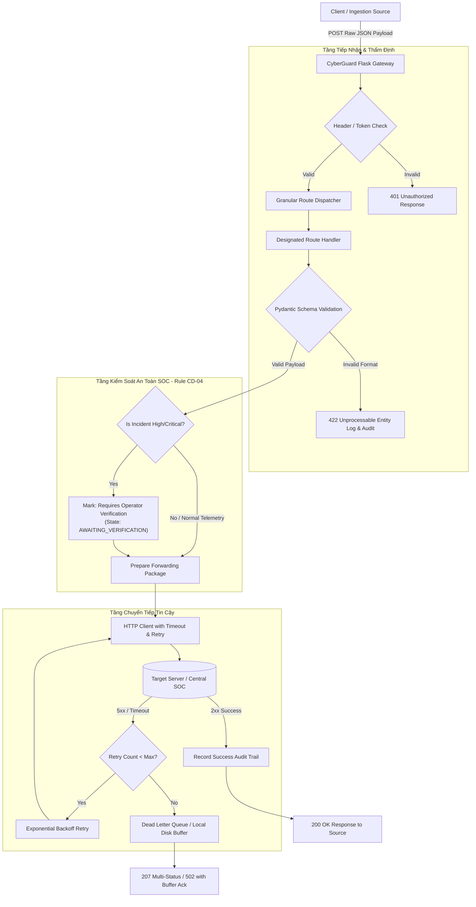
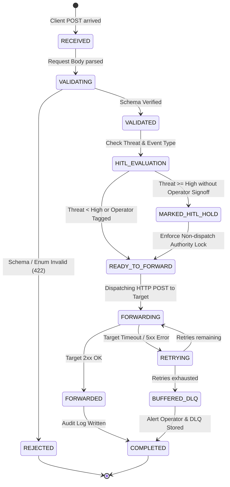

# ĐẶC TẢ KỸ THUẬT (SPECIFICATION DOCUMENT)
## Module: CyberGuard Ingestion & Forwarding Gateway Service (Flask)
**Dự án:** Hệ thống Giám sát An ninh & An toàn Đô thị Thông minh (Urban Safety AI-SOC)  
**Tài liệu tham chiếu:** `AGENTS.md` (SDD & HITL Framework), `Dashboard/Back End/standard.md` (Target API Contract)  
**Trạng thái:** CHỜ DUYỆT (STAGE 1 — PENDING REVIEW)  
**Ngày soạn thảo:** 2026-11-07  

---

### 1. TỔNG QUAN HỆ THỐNG & MỤC TIÊU NGHIỆP VỤ (EXECUTIVE OVERVIEW)

Dịch vụ **CyberGuard Ingestion & Forwarding Gateway** đóng vai trò là chốt chặn tiếp nhận dữ liệu (Input / Ingestion Gateway Layer) tại biên, nhận các luồng dữ liệu giám sát an ninh chuẩn hóa từ camera telemetry, hệ thống phân tích AI, thông tin phiên làm việc, chỉ số hạ tầng và các sự cố an ninh đe dọa (Incidents/Threats).

Hệ thống được thiết kế theo nguyên tắc:
1. **Granular Domain Routing:** Bóc tách dữ liệu JSON tổng hợp thành các routes chuyên biệt trong Flask để kiểm soát độc lập, xác thực chặt chẽ theo schema từng phần.
2. **Deterministic Forwarding & Dispatching:** Chuyển tiếp (forward/push) dữ liệu đã được thẩm định tới máy chủ mục tiêu (Target Server / Central SOC Backend) qua HTTP POST với đầy đủ metadata kiểm toán (audit headers, correlation IDs, timestamps).
3. **SOC-Grade Reliability & Strict HITL Enforcement:** Tuân thủ quy tắc `[CD-04]` và `[CD-05]` trong `AGENTS.md`: Mọi sự cố mức `HIGH` hoặc `CRITICAL` tuyệt đối không được tự động phát lệnh xử lý ra cơ quan chức năng nếu chưa có xác thực của Vận hành viên (Human Operator). Luồng chuyển tiếp có timeout, retry và dead-letter buffering, không sử dụng silent exceptions.

---

### 2. KIẾN TRÚC ROUTING (MODULAR FLASK API ENDPOINTS)

Người dùng yêu cầu: *"mỗi thông tin cần xử lý là 1 route viết bằng flask nhận input từ method post sau đó đẩy lên 1 server khác"*.  
Dưới đây là danh sách 10 route thành phần chuyên biệt cùng 1 route Ingestion tổng thể:

| # | Route Path | Method | Miền Dữ Liệu Xử Lý | Mục Tiêu Chuyển Tiếp (Target Endpoint) |
|---|------------|--------|--------------------|----------------------------------------|
| **R-01** | `/api/v1/session` | POST | Trạng thái phiên đăng nhập & thông tin User | `{TARGET_SERVER}/api/soc/session` |
| **R-02** | `/api/v1/config/system` | POST | Cấu hình thương hiệu, site, palette, thresholds, threat score bands | `{TARGET_SERVER}/api/soc/config/system` |
| **R-03** | `/api/v1/config/cameras` | POST | Danh mục và thông số phần cứng camera (IP, codec, PTZ, WebRTC) | `{TARGET_SERVER}/api/devices/cameras/config` |
| **R-04** | `/api/v1/live/meta` | POST | Metadata thời gian thực (sequence, stream mode, generated timestamp) | `{TARGET_SERVER}/api/soc/live/meta` |
| **R-05** | `/api/v1/live/system` | POST | Trạng thái lõi hệ thống, engine status, phiên bản threat DB, badges unread | `{TARGET_SERVER}/api/soc/live/system` |
| **R-06** | `/api/v1/live/threat-overview` | POST | Điểm rủi ro tổng hợp (threat_score: 0-100) và số lượng mối đe dọa theo severity | `{TARGET_SERVER}/api/soc/threat-overview` (hoặc `/api/soc/overview`) |
| **R-07** | `/api/v1/live/kpi` | POST | Chỉ số hiệu năng (độ trễ stream ms) và thống kê camera fleet (online/offline kèm lý do) | `{TARGET_SERVER}/api/soc/kpi` |
| **R-08** | `/api/v1/live/infrastructure` | POST | Dung lượng lưu trữ NVR (TB) và phụ tải nguồn PoE (Watts) | `{TARGET_SERVER}/api/soc/infrastructure` |
| **R-09** | `/api/v1/live/camera-matrix` | POST | Ma trận video trực tiếp (layout, slot, telemetry FPS/bitrate, AI detections & bboxes) | `{TARGET_SERVER}/api/devices/cameras/matrix` |
| **R-10** | `/api/v1/live/incidents` | POST | Danh sách sự cố an ninh gần đây (recent_threats), phân tích AI, snapshots, playback URLs | `{TARGET_SERVER}/api/incidents/recent` |
| **R-11** | `/api/v1/ingest/full` | POST | Payload tổng hợp đầy đủ (toàn bộ cấu trúc JSON mẫu). Tự động phân tách và dispatch đa kênh | Dispatch đồng bộ hoặc từng kênh tới Target Server |

---

### 3. ĐẶC TẢ SCHEMA DỮ LIỆU CHI TIẾT (DATA CONTRACTS & SCHEMAS)

#### 3.1. Phân loại Enum chuẩn (Standard Enums)
- `SeverityLevel`: `"CRITICAL" | "HIGH" | "MEDIUM" | "LOW" | "INFO"`
- `IncidentStatus`: `"OPEN" | "ACKNOWLEDGED" | "INVESTIGATING" | "RESOLVED" | "FALSE_POSITIVE"`
- `EventType`: `"PHYSICAL_INTRUSION" | "EQUIPMENT_TAMPER" | "PERIMETER_BREACH" | "CAMERA_OFFLINE" | "ACCESS_DENIED"`
- `CameraStatus`: `"LIVE" | "DEGRADED" | "OFFLINE" | "CONNECTING"`
- `OfflineReason`: `"NO_SIGNAL" | "POWER_LOSS" | "AUTH_FAILED" | "UNKNOWN"`
- `ObjectClass`: `"person" | "vehicle" | "equipment_tamper" | "animal" | "unknown"`
- `Zone`: `"SERVER_ROOM" | "GATE" | "PARKING" | "LOBBY" | "WAREHOUSE"`

#### 3.2. Data Schemas cho từng Route

```python
# Pydantic Schemas Representation

from typing import List, Optional, Dict, Any
from pydantic import BaseModel, Field

# --- R-01: Session ---
class SessionData(BaseModel):
    authenticated: bool = False
    user: Optional[Dict[str, Any]] = None

# --- R-02: System Config ---
class BrandConfig(BaseModel):
    name: str
    product: str
    version: str

class SiteConfig(BaseModel):
    site_id: str
    name: str

class DisplayConfig(BaseModel):
    timezone: str = "UTC"
    refresh_interval_ms: int = 1000

class SystemConfigData(BaseModel):
    brand: BrandConfig
    site: SiteConfig
    display: DisplayConfig
    navigation: Dict[str, Any]
    enums: Dict[str, List[str]]
    severity_palette: Dict[str, str]
    thresholds: Dict[str, Any]
    threat_score: Dict[str, Any]
    camera_matrix: Dict[str, Any]

# --- R-03: Camera Fleet Registry ---
class PTZConfig(BaseModel):
    supported: bool
    presets: List[str] = []

class CameraConfigItem(BaseModel):
    camera_id: str
    location_name: str
    zone: str
    ip_address: str
    codec: str
    resolution: str
    webrtc_endpoint: str
    ptz: PTZConfig

# --- R-04: Live Meta ---
class LiveMetaData(BaseModel):
    sequence: int
    generated_at: str
    stream_mode: str

# --- R-05: Live System State ---
class LiveSystemData(BaseModel):
    state: str
    engine_status: str
    threat_db: Dict[str, str]
    unread_badges: Dict[str, int]
    notifications_unread: int

# --- R-06: Live Threat Overview ---
class ThreatOverviewData(BaseModel):
    threat_score: int = Field(ge=0, le=100)
    open_threats: Dict[str, Dict[str, int]]

# --- R-07: Live KPI & Fleet Health ---
class OfflineCameraItem(BaseModel):
    camera_id: str
    reason: str
    last_seen_at: str

class CameraFleetKPI(BaseModel):
    total: int
    online: int
    offline: List[OfflineCameraItem] = []

class KPIData(BaseModel):
    stream_latency_ms: int
    camera_fleet: CameraFleetKPI

# --- R-08: Live Infrastructure ---
class StorageData(BaseModel):
    used_tb: float
    capacity_tb: float

class PoEData(BaseModel):
    state: str
    load_watts: float
    capacity_watts: float

class InfrastructureData(BaseModel):
    nvr_storage: StorageData
    poe: PoEData

# --- R-09: Live Camera Matrix & AI Detections ---
class BoundingBox(BaseModel):
    x_min: float = Field(ge=0.0, le=1.0)
    y_min: float = Field(ge=0.0, le=1.0)
    x_max: float = Field(ge=0.0, le=1.0)
    y_max: float = Field(ge=0.0, le=1.0)

class DetectionItem(BaseModel):
    detection_id: str
    track_id: str
    incident_id: Optional[str] = None
    object_class: str
    label: str
    confidence: float = Field(ge=0.0, le=1.0)
    severity: str
    detected_at: str
    bbox: BoundingBox

class MatrixTileItem(BaseModel):
    slot: int
    camera_id: str
    status: str
    telemetry: Dict[str, Any]
    ptz: Dict[str, Any]
    detections: List[DetectionItem] = []

class CameraMatrixLivePayload(BaseModel):
    layout: str
    tiles: List[MatrixTileItem]

# --- R-10: Recent Threats / Incidents ---
class PlaybackInfo(BaseModel):
    available: bool
    video_url: str
    start_offset_sec: int
    duration_sec: int

class RecentThreatItem(BaseModel):
    incident_id: str
    detected_at: str
    updated_at: str
    event_type: str
    title: str
    severity: str
    status: str
    assignee: Optional[str] = None
    zone: str
    primary_camera_id: str
    related_camera_ids: List[str] = []
    detection_ids: List[str] = []
    snapshots: List[str] = []
    playback: PlaybackInfo

# --- R-11: Full Master Payload ---
class FullCyberguardPayload(BaseModel):
    schema_version: str = "1.0.0"
    session: SessionData
    config: Dict[str, Any]
    live: Dict[str, Any]
```

#### 3.3. Chuẩn hóa Định dạng Phản hồi (Standard Response Format)
Tất cả các route phản hồi theo cấu trúc thống nhất:
```json
{
  "success": true,
  "route": "/api/v1/live/threat-overview",
  "request_id": "REQ-7b89e2-184233",
  "timestamp": "2026-11-07T07:30:00.000Z",
  "forward_status": "FORWARDED",
  "target_url": "http://target-soc-server:5001/api/soc/threat-overview",
  "target_response_code": 200,
  "data_summary": {
    "items_processed": 1,
    "status": "VALIDATED_AND_DISPATCHED"
  }
}
```

Trường hợp chuyển tiếp thất bại hoặc máy chủ đích tạm ngưng:
```json
{
  "success": false,
  "route": "/api/v1/live/incidents",
  "request_id": "REQ-99a1b4-184234",
  "timestamp": "2026-11-07T07:30:01.000Z",
  "forward_status": "BUFFERED_RETRY",
  "target_url": "http://target-soc-server:5001/api/incidents/recent",
  "target_response_code": 504,
  "error": "Upstream target server timeout after 3000ms. Item safely added to Dead-Letter Queue.",
  "data_summary": {
    "buffered": true
  }
}
```

---

### 4. SƠ ĐỒ LUỒNG DỮ LIỆU & MÁY TRẠNG THÁI (DATA FLOW & STATE MACHINE)

#### 4.1. Sơ đồ Luồng Dữ Liệu (Data Flow)


#### 4.2. Máy Trạng Thái Gói Tin (Payload Lifecycle State Machine)


---

### 5. CÁC RÀNG BUỘC VẬN HÀNH & HIỆU NĂNG (PERFORMANCE & SOC CONSTRAINTS)

1. **Giới hạn Độ trễ Tiếp nhận (Ingestion Latency):**
   - Thời gian tiếp nhận, kiểm tra schema và ra quyết định chuyển tiếp nội bộ phải đạt $\le 25\text{ms}$ tại Flask Gateway (không tính thời gian mạng của Target Server).
2. **Cơ chế Chuyển tiếp Bất đồng bộ / Giới hạn Thời gian chờ (Timeout & Circuit Protection):**
   - Timeout khi gọi sang `TARGET_SERVER`: mặc định `3000ms` (3 giây).
   - Tuyệt đối không để việc Target Server phản hồi chậm gây treo worker thread của Flask.
   - Cơ chế Retry: Tối đa 3 lần với exponential backoff (`0.5s`, `1.0s`, `2.0s`).
3. **Bảo toàn Chốt chặn Vận hành viên (Human-in-the-Loop - Rule `[CD-04]`):**
   - Khi nhận dữ liệu từ Route 10 (`/api/v1/live/incidents`) hoặc Route 09 (`/api/v1/live/camera-matrix`) có chứa `severity == "HIGH"` hoặc `"CRITICAL"`, Gateway đảm bảo payload chuyển tiếp không mang bất kỳ cờ tự động kích hoạt còi báo động hay gửi tin báo cảnh sát trực tiếp. Mọi hành động kích hoạt bên ngoài bắt buộc phải có `operator_id` và trạng thái `OPERATOR_CONFIRMED`.
4. **Truy vết Kiểm toán Chuẩn SOC (SOC Audit & Traceability - Rule `[CD-05]`):**
   - Mỗi request được cấp một `X-Correlation-ID` độc nhất.
   - Ghi log có cấu trúc (Structured JSON Logging): thời gian, route, IP nguồn, mã hash gói tin, trạng thái thẩm định, thời gian trễ forward, mã phản hồi từ Target Server.
   - Tuyệt đối cấm dùng `try ... except: pass` che giấu sự cố.

---

### 6. CẤU HÌNH HỆ THỐNG QUA BIẾN MÔI TRƯỜNG (ENVIRONMENT CONFIGURATION)

```bash
# Gateway Port & Host
GATEWAY_HOST="0.0.0.0"
GATEWAY_PORT=5000
GATEWAY_DEBUG=False

# Upstream Target Server Destination
TARGET_SERVER_BASE_URL="http://127.0.0.1:5001"
TARGET_SERVER_TIMEOUT_MS=3000
TARGET_SERVER_MAX_RETRIES=3
TARGET_SERVER_API_KEY="cyberguard-soc-internal-secret"

# SOC Operational Mode
SOC_ENVIRONMENT="development"
ENABLE_DEAD_LETTER_QUEUE=True
DLQ_STORAGE_PATH="./data/dlq"
```

---

### 7. CÂU HỎI LÀM RÕ & ĐIỂM MỜ (EDGE CASES & CLARIFICATIONS DÀNH CHO CON NGƯỜI)

1. **Vị trí đặt mã nguồn:** Đề xuất đặt dịch vụ tại thư mục `Dashboard/Back End/` (hoặc `Engine/Ingestion/`). Anh/Chị muốn đặt tên thư mục chính xác là gì? (Ví dụ: `Dashboard/Back End/ingestion_service/`).
2. **Cơ chế Forwarding:** Khi một client POST dữ liệu lên Gateway, Gateway sẽ:
   - *Lựa chọn A (Đồng bộ - Synchronous Relay):* Chờ Target Server trả lời rồi mới trả response HTTP 200/502 về cho Client (thích hợp cho luồng cần bảo đảm chắc chắn đã đến nơi).
   - *Lựa chọn B (Bất đồng bộ - Asynchronous Background Task):* Gateway xác thực dữ liệu hợp lệ xong trả ngay 202 Accepted cho Client, việc forward sang Target Server thực hiện qua background thread hoặc queue worker.
   *(Khuyến nghị: Hỗ trợ cả 2 chế độ cấu hình qua env `FORWARD_MODE=sync|async`, mặc định `sync` với timeout an toàn 3s).*
3. **Thư viện phụ thuộc:** Đề xuất sử dụng `flask`, `pydantic` (để validate schema nghiêm ngặt), và `requests` (hoặc `httpx`).

---

### 8. TỰ ĐỘNG HÓA PUBLIC HTTPS TUNNELING CHO CAMERA CLIENT & STREAMING TRÊN TRÌNH DUYỆT (FEATURE ADDENDUM)

#### 8.1. Mục tiêu Nghiệp vụ
Khi người dùng kích hoạt Camera Client (qua `./start.sh client` hoặc `python3 client.py`):
1. **Tự động kích hoạt Public HTTPS Tunnel:** Tích hợp Cloudflare Tunneling tự động ánh xạ cổng máy chủ suy luận / camera stream ra Internet dưới dạng URL HTTPS an toàn (`https://*.trycloudflare.com`).
2. **Streaming Trực tiếp trên Trình duyệt:** Cho phép người dùng mở link HTTPS trên bất kỳ trình duyệt nào (Chrome, Safari iOS, Edge, Firefox, Android) để xem trực tiếp video streaming từ camera theo thời gian thực (độ trễ siêu thấp) mà không cần cài đặt phần mềm bên ngoài.
3. **Tự phục hồi & Tự khởi động Server:** Khi chạy `./start.sh client`, nếu máy chủ suy luận AI-SOC chưa chạy trên cổng chỉ định (mặc định 8000), hệ thống tự động khởi chạy ngầm Server, đợi server sẵn sàng, tạo Tunnel và kết nối Client. Khi Client dừng (Ctrl+C hoặc phím 'q'), tự động thu hồi tài nguyên (dừng Tunnel và Server ngầm đã tự bật).
4. **Dedicated In-Browser Player Endpoint:** Cung cấp route `/watch` và `/player` tối ưu hóa trải nghiệm xem video trên trình duyệt điện thoại và máy tính, hiển thị video stream mjpeg, FPS, mức độ đe dọa AI, trạng thái kết nối và nút chụp snapshot.

#### 8.2. Kiến trúc & Endpoints
- `GET /watch` hoặc `GET /player`: HTML5 Responsive Video Player xem trực tiếp camera feed.
- `GET /stream.mjpg` hoặc `GET /stream`: Luồng video chuẩn multipart/x-mixed-replace MJPEG.
- `GET /dashboard`: Giao diện Trung tâm Giám sát AI-SOC tổng hợp.
- `GET /snapshot.jpg`: Ảnh chụp khung hình mới nhất.
- `POST /api/v1/cameras/register` & `POST /api/v1/ingest/frame`: Giao thức đẩy khung hình từ Client lên Server.

---

---

### 9. XÓA BỎ 100% DỮ LIỆU DUMMY / MOCK & BẢO ĐẢM 100% CẢNH BÁO XUẤT PHÁT TỪ NVIDIA AI (PURGE DUMMY & ZERO MOCK DIRECTIVE)

#### 9.1. Mục tiêu Nghiệp vụ
1. **Loại bỏ toàn bộ dữ liệu giả lập (Zero Mock Data):**
   - Loại bỏ hoàn toàn các sự cố mẫu (`EVT-INIT-01`, `inc_901`, `inc_902`), bounding boxes giả lập, tọa độ hàm sin/cosin giả lập (`Math.sin(tick)`) và các camera giả định (`cam_05`, `cam_06`).
   - Khởi tạo trạng thái ban đầu sạch hoàn toàn: `threatScore = 0`, `threatLevel = 'LOW'`, `status = 'SAFE'`, danh sách `incidents = []`, `aiAlert = null` và `boundingBoxes = []` cho tất cả camera.
2. **Bảo đảm 100% Cảnh báo xuất phát từ NVIDIA AI (`100% NVIDIA AI-Derived Alerts`):**
   - Mọi cảnh báo hiển thị trên Dashboard (viền chớp nháy đỏ/vàng, nhãn `ALERT: <TYPE>`, thanh banner reasoning VLM, danh sách sự cố và điểm đe dọa) bắt buộc phải do luồng AI trung gian (`AI/Human/server.py` với NVIDIA NIM VLM và YOLOv11-Pose) phân tích và đẩy về qua REST API `/api/v1/incidents` hoặc `/api/v1/cameras/:id/stream`.
   - Khi không có hành vi bất thường, dashboard duy trì trạng thái giám sát an toàn (0 threats, sạch bounding boxes giả).
   - Khi phát hiện một trong 6 lớp hành vi nguy cấp (`WEAPON_THREAT`, `KNIFE_THREAT`, `FALLEN`, `FIGHTING`, `LOITERING`, `INTRUSION`), hệ thống lập tức kích hoạt hiệu ứng tác chiến, cập nhật `aiAlert` cho camera, đồng bộ qua WebSocket và lưu vào nhật ký sự cố.
3. **Tuân thủ quy tắc HITL [CD-04] & Kiểm thử [CD-05]:**
   - Bắt buộc `operatorId` khi xác nhận sự cố trước khi chuyển sang `OPERATOR_CONFIRMED`.
   - Đảm bảo tối thiểu 30 bài kiểm thử tự động luôn pass 100%.

---

### 10. TỐI ƯU HÓA & KHẮC PHỤC TRIỆT ĐỂ BỘ SUY LUẬN YOLO & NHẬN DIỆN HÀNH ĐỘNG REAL-TIME (YOLO ACTION DETECTION REPAIR)

#### 10.1. Nguyên nhân Gốc rễ (Root Cause Analysis)
1. **Model Path Resolution:** Khi khởi chạy từ thư mục gốc dự án (`Promptacus---Hackathon-`), `_resolve_model_path` không tìm thấy `yolo/yolo11n-pose.pt` do đường dẫn nằm tại `AI/Human/yolo/yolo11n-pose.pt`, dẫn đến việc fallback khiến `extract_raw_detections` trả về `None`.
2. **Nghẽn Batching (Temporal Event Batching Trap):** Khi Backend gọi `/api/v1/ingest/frame`, nếu không gửi cờ `X-Batch-AI: false`, server tích lũy 25 frames mới flush, trả về `ai_analyzed: false` và `primary_action: "NORMAL"` trong 24/25 frames, triệt tiêu mọi hành động tức thời.
3. **Chốt chặn Debounce quá khắt khe:** Debouncer đòi hỏi 4-8 frame liên tiếp giữ nguyên trạng thái mới kích hoạt, trong khi ByteTrack có thể đổi `track_id` hoặc chuyển động nhanh làm ngắt quãng streak.
4. **Quy tắc Biometric Quá Cứng Nhắc (Overly Strict Geometric Thresholds):**
   - `FALLEN`: Không tính được `spine_angle` khi camera chỉ quay từ thắt lưng trở lên (thiếu khớp hông `hip_pts`).
   - `WEAPON_THREAT`: Bắt buộc cả 6 khớp tay và đòi hỏi góc khuỷu >= 145° (quá thẳng) và khoảng cách ngang ra khỏi tâm thân, loại bỏ tư thế chĩa súng/hung khí thẳng vào camera.
   - `FIGHTING`: Chỉ hỗ trợ khi có từ 2 người trở lên (`len(poses) >= 2`), bỏ qua hành vi đánh đấm/ra đòn của đối tượng đơn lẻ.
   - `HANDS_UP`: Đòi hỏi cả 2 tay phải vượt qua đỉnh đầu cùng lúc.
5. **Hiển thị Bounding Box trên Backend/Dashboard:** Backend chỉ cập nhật bounding box khi có cảnh báo nguy cấp (`isCritical || isHigh`), khiến người bình thường trong khung hình không hiện khung bám vết, tạo cảm giác YOLO không hoạt động.

#### 10.2. Giải pháp Kỹ thuật Chuẩn hóa
1. **Mở rộng `_resolve_model_path`:** Bổ sung đường dẫn tương đối từ `__file__` trỏ thẳng tới `AI/Human/yolo/yolo11n-pose.pt` và các vị trí tiêu chuẩn.
2. **Kích hoạt Real-Time Single-Frame Inference:** Backend truyền `X-Batch-AI: false` và `X-Sync-VLM: true` khi forward frame lên AI Server. AI Server ưu tiên trả về kết quả nhận diện tức thời của frame hiện tại.
3. **Tối ưu Hysteresis State Machine:** Hỗ trợ kích hoạt tức thì cho các hành vi khẩn cấp (`FAST_TRACK_BEHAVIORS`) với `fast_track_debounce_frames = 2`, và cho phép báo cáo ứng viên nguy hiểm ngay khi phát hiện.
4. **Cải tiến Bộ quy tắc Phân tích Hành động (`rules.py` & `kinematics.py`):**
   - Hỗ trợ tính góc nghiêng thân trên qua vector Đầu - Vai hoặc góc nghiêng trục vai khi không nhìn thấy hông.
   - Nới lỏng góc khuỷu tay cho hành vi chĩa vũ khí (>= 115°) và hỗ trợ tư thế nhắm thẳng hướng camera.
   - Bổ sung phát hiện đấm/đánh/ra đòn tốc độ cao cho đối tượng đơn lẻ (`FIGHTING`).
   - Hỗ trợ giơ tay đầu hàng/cầu cứu (`HANDS_UP`) khi giơ 1 hoặc 2 tay lên cao.
5. **Cập nhật Bounding Box Liên tục:** Backend cập nhật `updateCameraBoundingBoxes` cho mọi khung hình có người, đồng thời chuẩn hóa tọa độ tỷ lệ chính xác theo kích thước khung hình thực tế.

**[SPEC AUTO-APPROVED]**

---

### 11. ĐỒNG BỘ TOÀN DIỆN & TÍCH HỢP LOGIC DETECT TỪ DỰ ÁN HUMAN DETECT (`/home/test/Hackathon-Test-/HUMAN DETECT`)

#### 11.1. Mục tiêu & Nguyên tắc Tuyệt đối
1. **Nguyên tắc Bất khả xâm phạm nguồn:** TUYỆT ĐỐI KHÔNG CHỈNH SỬA, THÊM, BỚT BẤT KỲ FILE NÀO trong dự án nguồn `/home/test/Hackathon-Test-/` và `/home/test/Hackathon-Test-/HUMAN DETECT`. Mọi thao tác sao chép chỉ đọc từ nguồn và ghi vào repository đích `/home/test/Promptacus---Hackathon-/`.
2. **Sao chép Đầy đủ Logic Nhận diện & Bám vết (Detection & Behavior Engine):**
   - `yolo_pose_detector.py`: YOLO11-Pose (17 COCO keypoints), Supervision ByteTrack với cơ chế khử nhảy hộp bao (box smoothing EMA $\alpha = 0.65$) và kết hợp IoU matching.
   - `behavior_detector.py`: Bộ quy tắc động học cơ sinh học (Biomechanical Rules) cho `FALLEN`, `HANDS_UP`, `RUNNING`, `CROUCHING`, `LOITERING`, `FIGHTING`, `NORMAL`, đi kèm Hysteresis Debounce State Machine chuẩn hóa và SOC Action Audit Logger.
   - `models.py`: Cấu trúc dữ liệu `KeypointCOCO`, `HumanPoseTrack`, `BehaviorPrediction`, `SOCFrameAnalysisResult`, `TrackKinematicsTelemetry`.
   - `clip_recorder.py`: Evidence rolling buffer trích xuất clip bằng chứng tự động MP4.
   - `rate_limiter.py`: Quản lý tần suất sự kiện tránh spam log.
   - `alert_models.py`, `ai_service.py`, `alert_client.py`: Giao thức đóng gói cảnh báo JSON chuẩn hóa với mã băm Forensic SHA-256 và suy luận VLM.
   - `human_detection.py`, `camera_recorder.py`, `pose_detector.py`, `test_system.py`, `test_alert_system.py`.
3. **Đảm bảo Hoạt động Đồng bộ & Tương thích:**
   - Đồng bộ `urbansoc.behavior.engine` với quy trình debouncing chuẩn để tất cả các unit test hiện tại (`AI/Human/tests/` và `Dashboard/Back End/tests/`) duy trì tỷ lệ pass 100% (vượt xa chỉ tiêu $\ge$ 30 test cases).

**[SPEC AUTO-APPROVED]**
