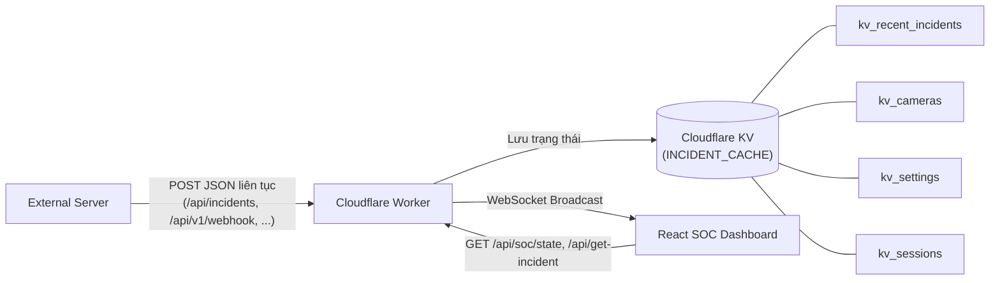

# ĐẶC TẢ KỸ THUẬT (SPECIFICATION DOCUMENT)
## Refactor Toàn Diện: Pure Display Dashboard, Server JSON Ingestion vào Cloudflare KV, Xóa AI & Dữ Liệu Giả, Hoàn Thiện Authentication & Toàn Bộ Tab

**Dự án:** Hệ thống Giám sát An ninh & An toàn Đô thị Thông minh (Urban Safety SOC)  
**Giai đoạn:** BƯỚC 1: ĐẶC TẢ KỸ THUẬT (STAGE 1 — SPECIFICATION)  
**Tuân thủ:** AGENTS.md (CD-01 đến CD-06, Strict SDD & Dual HITL)  
**Ngày soạn thảo:** 2026-11-08  

---

### 1. MỤC TIÊU NGHIỆP VỤ & KIẾN TRÚC MỚI

1. **Loại bỏ hoàn toàn tính năng tự phân tích AI trên Worker & Frontend:**
   - Website và Cloudflare Worker chỉ đóng vai trò **Dashboard hiển thị & điều phối tác chiến (Pure Display & HITL Dashboard)**.
   - Gỡ bỏ mọi lệnh gọi mô hình AI nội bộ (Workers AI, DeepSeek API, Kinematics Engine tự suy luận).
   - Server phân tích bên ngoài sẽ gửi JSON liên tục lên Worker. Worker tiếp nhận, chuẩn hóa và **lưu trữ trực tiếp vào Cloudflare KV (`INCIDENT_CACHE`)**, đồng thời phát realtime qua WebSocket và cung cấp qua REST API cho Dashboard.
2. **Xóa toàn bộ dữ liệu giả (Zero Fake Data):**
   - Khởi tạo mảng rỗng cho danh sách sự cố (`incidents = []`) và danh sách camera (`cameras = []`).
   - Toàn bộ thông số trên Dashboard, Threat Intelligence, Incident Feed, Device Manager chỉ hiển thị dữ liệu thật do Server gửi lên và lưu trong KV.
3. **Cập nhật giao diện theo yêu cầu:**
   - **Tại Sidebar (Menu trái):** Xóa hộp thông tin trạng thái góc dưới (`SYSTEM ACTIVE / Threat DB / Engine: Online`). Xóa badge số giả trên menu.
   - **Tại Tab SOC Dashboard:** Xóa nút `PHÒNG THỦ KHẨN CẤP` (Lockdown). Xóa khối `AiMetricsGrid` chứa số liệu AI giả. Hoàn thiện nút `XUẤT BÁO CÁO CA TRỰC` (tải file báo cáo JSON/CSV thật).
   - **Hoàn thiện tính năng Authentication (Đăng nhập / Đăng xuất / Quản lý phiên Operator):** Hoàn thiện nút `Sign In` trên `TopHeader` với hộp thoại đăng nhập, xác thực qua API `/api/auth/login`, `/api/auth/logout`, `/api/auth/me` lưu phiên trên KV & `localStorage`, đồng bộ `operatorId` vào chốt chặn HITL và Settings.
   - **Tab Device Manager:** Chỉ hiển thị thông tin thật của các camera được trích xuất từ payload JSON của Server gửi lên (bao gồm `camera_id`, `location`, `measured_fps`, `frame_index`, `human_count`, `timestamp`, `status`), kèm các thao tác thực tế (Ping kiểm tra kết nối, Làm mới, Xem luồng, Xóa lịch sử thiết bị).
   - **Tab Threat Intelligence:** Tổng hợp dữ liệu tình báo thật từ các bản tin JSON của Server (thống kê theo `action_type`, `visual_cues`: `weapons_visible`, `physical_contact`, `fallen_person`, danh sách đối tượng `actors` `attacker`/`victim`, `nvidia_vlm_analysis`).
   - **Tab Settings:** Hoạt động thực tế 100%, lưu và đồng bộ cấu hình với Cloudflare KV qua `GET /api/settings` và `POST /api/settings` (gồm cả cấu hình URL luồng video camera dự phòng, ngưỡng cảnh báo, thời lượng buffer, webhook điều phối).

---

### 2. ĐẶC TẢ SCHEMA PAYLOAD TỪ SERVER GỬI LÊN

#### 2.1. Input JSON Payload từ Server (`IServerIngestPayload`)
```typescript
export interface IServerActor {
  id: number | string;
  role: 'attacker' | 'victim' | 'bystander' | string;
  action: string;
  posture: string;
  interacting_with?: number | string | null;
  bbox?: [number, number, number, number]; // [x1, y1, x2, y2]
}

export interface IServerVisualCues {
  weapons_visible: boolean;
  physical_contact: boolean;
  fallen_person: boolean;
}

export interface INvidiaVlmAnalysis {
  severity: string;
  timestamp: string;
  action_type: string;
  confidence: number;
  threat_score: number;
  description: string;
  reasoning: string;
  actors?: IServerActor[];
  visual_cues?: IServerVisualCues;
  recommended_action?: string;
  is_urgent?: boolean;
  camera_id?: string;
  location?: string;
  source?: string;
}

export interface IServerIngestPayload {
  event_id?: string;
  id?: string;
  status: string;                       // e.g. "processed"
  camera_id: string;                    // e.g. "LAPTOP_01"
  location: string;                     // e.g. "Cổng Phía Đông - Khu Vực Giám Sát An Ninh"
  timestamp: string;                    // e.g. "2026-11-08T00:16:35.412Z"
  measured_fps: number;                 // e.g. 15.2
  frame_index: number;                  // e.g. 142
  human_count: number;                  // e.g. 2

  severity: string;                     // e.g. "critical" | "high" | "medium" | "low"
  action_type: string;                  // e.g. "FIGHTING"
  threat_score: number;                 // e.g. 0.94 (0..1 or 0..100)
  confidence: number;                   // e.g. 0.92 (0..1)
  is_urgent: boolean;                   // e.g. true

  description: string;
  reasoning: string;
  recommended_action: string;           // e.g. "DISPATCH_SECURITY"

  actors?: IServerActor[];
  visual_cues?: IServerVisualCues;
  nvidia_vlm_analysis?: INvidiaVlmAnalysis;
  snapshot_url?: string;
  image_base64?: string;
}
```

#### 2.2. Luồng xử lý & Lưu trữ Cloudflare KV (`INCIDENT_CACHE`)


---

### 3. ĐẶC TẢ CÁC ENDPOINT BACKEND (CLOUDFLARE WORKER)

1. **`POST /api/incidents`, `POST /api/v1/incidents`, `POST /api/v1/webhook`, `POST /api/v1/ai/detection`, `POST /api/ingest`:**
   - Nhận JSON `IServerIngestPayload` từ Server.
   - Cập nhật thông tin camera (`camera_id`, `location`, `measured_fps`, `frame_index`, `human_count`, `timestamp`, chuẩn hóa `actors[].bbox` sang `boundingBoxes`). Lưu danh sách camera vào KV key `kv_cameras`.
   - Tạo bản ghi sự cố với trạng thái khởi tạo bắt buộc `PENDING_VERIFICATION` (tuân thủ Operational HITL `[CD-04]`). Lưu danh sách sự cố vào KV key `kv_recent_incidents` và chi tiết vào `incident:<id>`.
   - Phát sự kiện WebSocket `SERVER_PAYLOAD_UPDATE` / `NEW_INCIDENT` / `TELEMETRY_AND_AI_TICK` tới toàn bộ trình duyệt đang mở.
2. **`GET /api/get-incident`, `GET /api/get-incidents`, `GET /api/incidents`, `GET /api/incidents/recent`:**
   - Đọc trực tiếp từ KV `kv_recent_incidents` (fallback sang bộ nhớ đệm nếu KV chưa sẵn sàng).
3. **`GET /api/devices/cameras`, `GET /api/cameras`:**
   - Đọc danh sách camera thật từ KV `kv_cameras`.
4. **`GET /api/soc/overview`:**
   - Tính toán chỉ số từ dữ liệu thật của `kv_cameras` và `kv_recent_incidents`.
5. **`POST /api/auth/login`, `POST /api/auth/logout`, `GET /api/auth/me`:**
   - Xác thực tài khoản Vận hành viên SOC, cấp token phiên làm việc và lưu vào KV `kv_session:<token>`.
6. **`GET /api/settings`, `POST /api/settings`:**
   - Đọc và lưu cấu hình vận hành vào KV `kv_settings` (bao gồm `liveStreamUrl`, `criticalThreshold`, `preBufferSeconds`, `postBufferSeconds`, `dispatchWebhook`).
7. **`POST /api/incidents/:id/verify`:**
   - Chốt chặn HITL: Xác thực sự cố với `operatorId` của người trực đang đăng nhập, cập nhật trạng thái trong KV `kv_recent_incidents` và ghi audit log.
