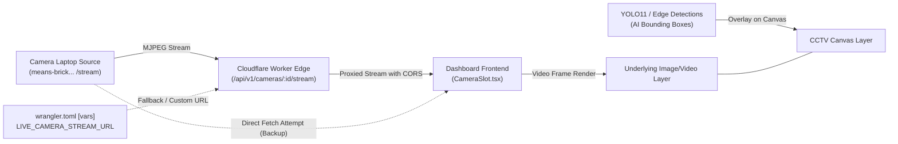
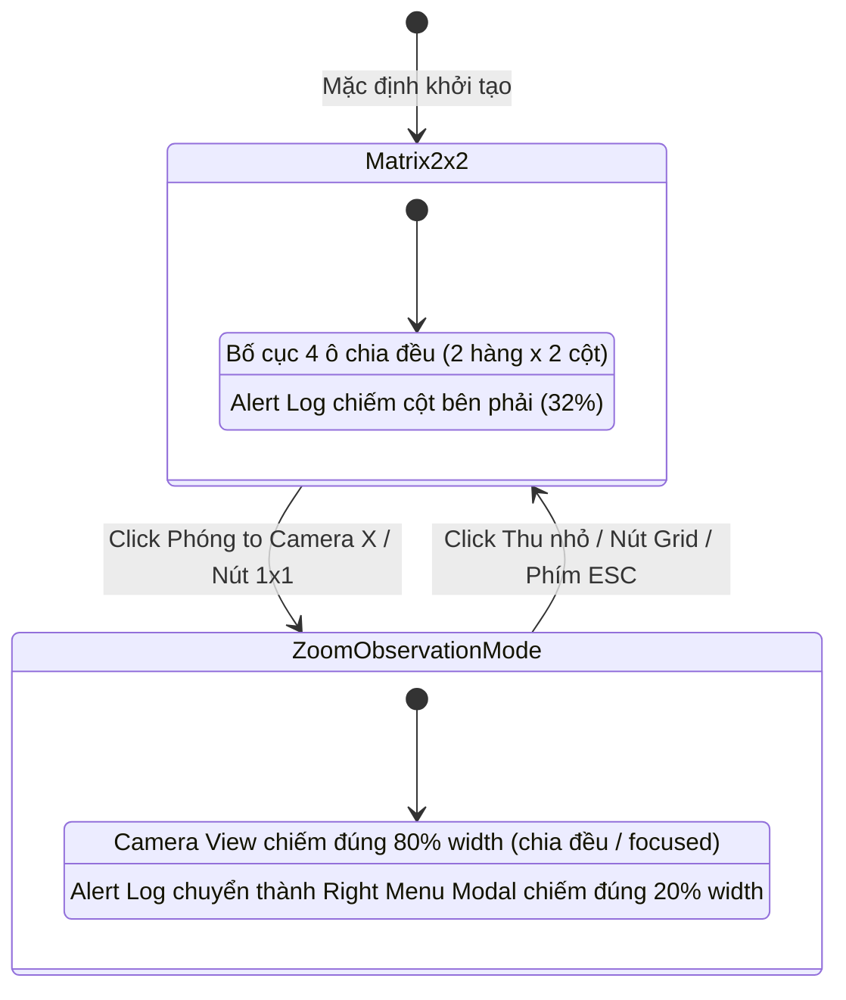

# ĐẶC TẢ KỸ THUẬT (SPECIFICATION DOCUMENT)
## Refactor: Tích Hợp Live Camera Stream Laptop, Khắc Phục Zoom Matrix (2x2), Alert Log Rút Gọn & Tái Cấu Trúc Menu Tác Chiến

**Dự án:** Hệ thống Giám sát An ninh & An toàn Đô thị Thông minh (Urban Safety AI-SOC)  
**Tác giả:** AI Coding Agent & Human Architect  
**Giai đoạn:** BƯỚC 1: ĐẶC TẢ KỸ THUẬT (STAGE 1 — SPECIFICATION)  
**Trạng thái:** [WAITING FOR SPEC APPROVAL]  
**Tuân thủ:** AGENTS.md (CD-01 đến CD-06, Strict SDD & Dual HITL)  
**Ngày soạn thảo:** 2026-11-07  

---

### 1. TỔNG QUAN YÊU CẦU NGHIỆP VỤ & BỐI CẢNH

Dựa trên yêu cầu từ Principal Architect:
1. **Luồng Video Trực tiếp (Live Camera Stream):**
   - Fetch luồng video từ địa chỉ: `https://means-brick-determined-send.trycloudflare.com/api/v1/cameras/LAPTOP_01/stream` và hiển thị trực tiếp lên Dashboard SOC Video.
   - Cơ chế dự phòng (Backup): Hỗ trợ cấu hình/chỉnh sửa biến URL luồng trực tiếp trên Cloudflare Worker (`wrangler.toml` và Worker `env`), có gateway proxy chuyển tiếp để chống nghẽn CORS/Network drop.
2. **Khắc phục lỗi Phóng to / Thu nhỏ Live Camera Matrix (2x2):**
   - Sửa lỗi các nút điều khiển 1x1 / Maximize / PTZ không tương tác hoặc làm vỡ bố cục.
   - Cho phép người trực SOC click chọn phóng to từng camera cụ thể để quan sát chi tiết và thu nhỏ về ma trận 2x2 mượt mà.
3. **Thay thế Modal Threat Score thành Alert Log Rút Gọn (Compact Alert Log):**
   - Thay thế khối gauge hiển thị điểm rủi ro cồng kềnh bằng bảng **Alert Log rút gọn**, tối ưu cho việc cảnh báo người trực sớm nhất, rõ ràng nhất về các nguy cơ an ninh (`CRITICAL`, `HIGH`, `MEDIUM`).
   - **Cơ chế co giãn tự động khi phóng to quan sát:**
     - Khi ở chế độ 2x2 bình thường: Alert Log chiếm góc phải dashboard theo tỉ lệ chuẩn.
     - Khi người trực phóng to một camera để quan sát: Khối Alert Log tự động mở rộng thành **Right Menu Modal chiếm đúng 20% chiều rộng màn hình (`width: 20%`)**, phần còn lại **80% chiều rộng (`width: 80%`) chia đều cho các camera**.
4. **Xóa bỏ hoàn toàn Tab và chức năng "AI Analyzer":**
   - Gỡ bỏ tab `AI Analyzer` khỏi Sidebar, loại bỏ file `AiAnalyzerView.tsx` và các logic liên quan.
5. **Xóa bỏ hoàn toàn Tab và chức năng "Live Video Wall":**
   - Gỡ bỏ tab `Live Video Wall` khỏi Sidebar, loại bỏ file `LiveVideoWallView.tsx` và các logic liên quan.

---

### 2. KIẾN TRÚC & LUỒNG DỮ LIỆU (DATA FLOW & ARCHITECTURE)

#### 2.1. Sơ đồ Luồng Video Stream & Proxy Backup Edge


#### 2.2. Sơ đồ Chuyển Trạng Thái Quan Sát (Zoom State Machine)


---

### 3. ĐẶC TẢ SCHEMA DỮ LIỆU & INTERFACES

#### 3.1. Cấu hình Worker Environment (`CloudflareWorker/src/types.ts`)
```typescript
export interface Env {
  // Existing bindings
  AI?: any;
  DB?: D1Database;
  INCIDENT_CACHE?: KVNamespace;
  ASSETS?: Fetcher;

  // New Stream URL Configuration with Backup
  LIVE_CAMERA_STREAM_URL?: string; // Default: "https://means-brick-determined-send.trycloudflare.com/api/v1/cameras/LAPTOP_01/stream"
  ALLOWED_ORIGINS: string;
  ALLOWED_IPS: string;
  ENVIRONMENT: string;
  // ...
}
```

#### 3.2. Camera Device Model Mở Rộng (`Dashboard/Front End/src/types/soc.ts`)
```typescript
export interface ICameraDevice {
  id: string;
  name: string;
  ip: string;
  fps: number;
  bitrateKbps: number;
  status: 'ONLINE' | 'DEGRADED' | 'OFFLINE';
  streamUrl: string;             // URL stream (Worker proxy hoặc direct URL)
  directStreamUrl?: string;       // Direct tunnel URL (dự phòng)
  ptzEnabled: boolean;
  ptzState: {
    zoom: number;                 // 1.0 đến 5.0
    pan: number;                  // 0 đến 360 độ
    tilt: number;
    focus: string;
  };
  boundingBoxes: IAIBoundingBox[];
  lastSnapshotBase64?: string;
  zoneId?: string;
  address?: string;
  latitude?: number;
  longitude?: number;
}
```

#### 3.3. Cấu trúc Bản ghi Alert Log Rút Gọn (`ICompactAlertLog`)
```typescript
export interface ICompactAlertLog {
  id: string;
  eventId: string;
  timestamp: string;             // ISO string hoặc hh:mm:ss
  cameraId: string;              // e.g. "LAPTOP_01"
  cameraName: string;            // e.g. "Laptop Camera 01"
  severity: 'CRITICAL' | 'HIGH' | 'MEDIUM' | 'LOW';
  behavior: string;              // Hành vi nhận diện: "Loitering", "Weapon Concealed", "Normal"
  confidence: number;            // 0.0 - 1.0
  status: 'PENDING_VERIFICATION' | 'OPERATOR_CONFIRMED' | 'DISMISSED';
  reasoningSnippet: string;      // Tóm tắt lý do cảnh báo ngắn gọn
  rawIncident?: any;
}
```

---

### 4. ĐẶC TẢ CHI TIẾT CÁC MODULE CẦN THỰC THI

#### 4.1. Worker Stream Proxy & Backup Endpoint (`CloudflareWorker/src/index.ts` & `camera_manager.ts`)
- **Route:** `GET /api/v1/cameras/:id/stream` và `GET /api/cameras/:id/stream`
- **Logic thực thi:**
  1. Xác định target camera. Nếu `:id === "LAPTOP_01"`, lấy `targetUrl = env.LIVE_CAMERA_STREAM_URL || "https://means-brick-determined-send.trycloudflare.com/api/v1/cameras/LAPTOP_01/stream"`.
  2. Khởi tạo request fetch stream tới `targetUrl` với timeout hợp lý.
  3. Trả về stream trực tiếp (`response.body`) với headers:
     - `Content-Type: multipart/x-mixed-replace; boundary=frame` (hoặc header từ upstream).
     - `Access-Control-Allow-Origin: *`
     - `Cache-Control: no-cache, no-store, must-revalidate`
  4. Nếu upstream tunnel bị lỗi/ngắt kết nối: Trả về trạng thái HTTP 503 kèm JSON thông báo rõ nguyên tắc và link backup.
  5. Trong `camera_manager.ts`: Khởi tạo sẵn camera `LAPTOP_01` trong danh sách mặc định nếu chưa có telemetry, gán `streamUrl = "/api/v1/cameras/LAPTOP_01/stream"`.

#### 4.2. Khắc Phục Lỗi Phóng To / Thu Nhỏ Live Camera Matrix (2x2)
- **Tạo State Quản lý Bố cục:**
  - `zoomedCameraId: string | null` (mặc định `null` — hiển thị 2x2).
- **Hành vi Tương tác:**
  - Click vào biểu tượng phóng to góc mỗi ô camera hoặc click vào nút `1x1` trên toolbar sẽ kích hoạt chế độ quan sát chi tiết (`zoomedCameraId = camera.id`).
  - Khi đã phóng to:
    - Hiển thị nút "THU NHỎ (2x2)" / "GRID" ở thanh công cụ góc trên để quay lại chế độ ma trận 2x2.
    - Hỗ trợ phím tắt `Escape` để thoát nhanh về 2x2.
  - Các nút `+` / `-` trên `PtzToolbar`:
    - Áp dụng zoom kỹ thuật số trực tiếp (`transform: scale(...)`) từ 1.0x đến 3.0x trên camera đang được quan sát, kèm gửi lệnh PTZ tới backend.

#### 4.3. Bảng Alert Log Rút Gọn & Co Giãn 20% Right Menu Modal
- **Thiết kế Module `AlertLogModule.tsx`:**
  - Thay thế `ThreatScoreModule.tsx` trên Dashboard.
  - **Phần Header:**
    - Điểm rủi ro tổng quát thu gọn (Threat Score badge nhỏ gọn: `LOW` xanh lá, `HIGH` hổ phách, `CRITICAL` đỏ).
    - Bộ đếm sự cố chưa xác thực (`Awaiting Verification: N`).
  - **Phần Danh sách Cảnh báo Rút gọn (Alert Log Stream):**
    - Hiển thị danh sách các cảnh báo mới nhất từ `incidents` / `kv_recent_incidents`.
    - Dạng thẻ sắc nét phong cách SOC: Timestamp, Mã Camera, Badge mức độ (`CRITICAL`, `HIGH`, `MED`), mô tả hành vi ngắn gọn.
    - Nhấp vào cảnh báo sẽ kích hoạt mở `EvidencePlaybackModal` để Vận hành viên xác thực HITL ngay lập tức.
- **Quy tắc Bố cục Phân chia Màn hình (Layout Division Rule):**
  - **Khi ở chế độ 2x2:**
    - Camera Matrix chiếm ~68-70% (8 cột grid), Alert Log chiếm ~30-32% (4 cột grid).
  - **Khi phóng to camera để quan sát (`zoomedCameraId !== null`):**
    - Màn hình chuyển sang bố cục Flex/Grid chuẩn xác:
      - **Khu vực Camera:** Chiếm đúng **80% chiều rộng (`w-[80%]`)**, các camera chia đều không gian hiển thị (hoặc ô quan sát chính chiếm ưu thế nổi bật kèm dải camera phụ đồng bộ).
      - **Khu vực Alert Log:** Tự động mở rộng thành **Right Menu Modal chiếm đúng 20% chiều rộng (`w-[20%]`)**, ghim sát mép phải, cho phép theo dõi sát sao luồng cảnh báo liên tục mà không che khuất màn hình quan sát.

#### 4.4. Xóa Bỏ Hoàn Toàn Tab "AI Analyzer" & "Live Video Wall"
- **Các file cần xóa:**
  - `Dashboard/Front End/src/components/views/AiAnalyzerView.tsx`
  - `Dashboard/Front End/src/components/views/LiveVideoWallView.tsx`
- **Các file cần cập nhật:**
  - `Dashboard/Front End/src/components/Sidebar.tsx`: Gỡ bỏ 2 mục `'Live Video Wall'` và `'AI Analyzer'` khỏi mảng `operations`.
  - `Dashboard/Front End/src/App.tsx`: Xóa các import và switch case tương ứng, đảm bảo ứng dụng chỉ định tuyến qua 6 tab tác chiến sạch sẽ:
    1. `SOC Dashboard`
    2. `Threat Intelligence`
    3. `Incident Feed`
    4. `Device Manager`
    5. `Settings`

---

### 5. RÀNG BUỘC HIỆU NĂNG, AN TOÀN & XỬ LÝ LỖI (FALLBACK & RELIABILITY)

1. **Ràng buộc Độ trễ Stream (Latency SLA):**
   - Proxy stream qua Cloudflare Edge không được đệm (unbuffered chunk streaming) để độ trễ giữ dưới 300ms.
2. **Cơ chế Fallback khi Tunnel Offline:**
   - Nếu upstream Cloudflare Tunnel (`trycloudflare.com`) bị reset hoặc đóng kết nối, `CameraSlot` tự động chuyển sang chế độ canvas dự phòng thông minh (Hiển thị thông báo "KẾT NỐI LẠI LUỒNG VIDEO... Thử lại sau 3s"), không làm crash UI dashboard.
   - Cho phép người dùng cập nhật biến `LIVE_CAMERA_STREAM_URL` trong `wrangler.toml` bất cứ lúc nào.
3. **Bảo toàn Chốt Chặn HITL (CD-04):**
   - Click vào bất kỳ cảnh báo nào trong Alert Log rút gọn đều mở `EvidencePlaybackModal` để người trực duyệt `CONFIRM_AND_DISPATCH`, `DOWNGRADE_MONITOR`, hoặc `DISMISS_FALSE_POSITIVE`. Tuyệt đối không tự động dispatch.

---

### 6. TIÊU CHÍ NGHIỆM THU (ACCEPTANCE CRITERIA)

| Mã | Tiêu Chí Kiểm Tra | Kết Quả Mong Đợi |
|---|---|---|
| **AC-01** | Fetch video stream `LAPTOP_01` | Video hiển thị trực tiếp trên CameraSlot LAPTOP_01; cấu hình URL backup hoạt động trong Worker. |
| **AC-02** | Phóng to / Thu nhỏ Camera Matrix | Click phóng to mở rộng camera được chọn; click thu nhỏ hoặc ESC quay về lưới 2x2 mượt mà, không vỡ layout. |
| **AC-03** | Alert Log Rút Gọn | Thay thế ThreatScoreModule cồng kềnh bằng danh sách cảnh báo ngắn gọn, rõ ràng, dễ đọc cho người trực. |
| **AC-04** | Tỷ lệ 80% Camera / 20% Right Menu | Khi phóng to quan sát, Right Menu Modal Alert chiếm đúng 20% width, 80% còn lại chia đều cho các camera. |
| **AC-05** | Gỡ bỏ Tab AI Analyzer | Tab và route AI Analyzer bị xóa hoàn toàn, không còn file thừa và code compile sạch 100%. |
| **AC-06** | Gỡ bỏ Tab Live Video Wall | Tab và route Live Video Wall bị xóa hoàn toàn, không còn file thừa và code compile sạch 100%. |
| **AC-07** | Build Integrity Check | Lệnh `pnpm run build` chạy thành công không có bất kỳ cảnh báo lỗi TypeScript nào. |

---

**[STATUS: PENDING ARCHITECT APPROVAL]**
